# 地形资源与编辑器命令

[类图索引](../../../class-diagrams/index.md) · [运行时方案](../../runtime/terrain-destruction.md)

地形编辑器插件负责 `.terrain` 生成描述导入、场景组件编解码、可撤销笔刷和状态恢复、MCP 转发。生成与网格算法仍由运行时地形插件提供；核心及编辑器基础不引用具体地形插件。宿主按清单装配。

```mermaid
classDiagram
    class AssetImporter
    class TerrainImporter {
        +id() string_view
        +kind() AssetKind
        +matches(const Path& source) bool
        +inspect_batch(const ImportContext& context, string& fingerprint, string& error) bool
        +scan_dependencies(ImportAsset& asset, const ImportContext& context, string& error) bool
        +convert(const ImportAsset& asset, const ImportContext& context, string& error) bool
    }
    class SceneComponentCodec
    class TerrainCodec {
        +type() ComponentPayload
        +name() string_view
        +read(const table& input, ComponentDataT& component, string& error) bool
        +validate(const ComponentDataT& component, string& error) bool
        +scan_dependencies(const ComponentDataT& component, const ImportContext& context, vector~Guid~& dependencies, string& error) bool
        +write(const ComponentDataT& component, table& output) void
    }
    class EditorEdit
    class TerrainStateEdit {
        +affects_scene() bool
        +apply(string& error) bool
        +revert(string& error) bool
    }
    class TerrainSettingsEdit {
        +apply(string& error) bool
        +revert(string& error) bool
    }
    class TerrainVolume
    class TerrainComponent
    class TerrainGeneratorDataT
    class TerrainAssetDataT
    class TerrainStateDataT
    class TerrainDataT
    class ImportAsset
    class ImportContext
    class AssetPipelineSystem
    class EditorCommands
    class WorldSystem
    class SceneCommands
    class McpSystem
    class EditorMcpTools
    AssetImporter <|-- TerrainImporter
    SceneComponentCodec <|-- TerrainCodec
    EditorEdit <|-- TerrainStateEdit
    EditorEdit <|-- TerrainSettingsEdit
    AssetPipelineSystem *-- TerrainImporter : 宿主登记后独占
    TerrainImporter ..> ImportAsset : 读取源和GUID
    TerrainImporter ..> ImportContext : 输出发布位置
    TerrainImporter ..> TerrainGeneratorDataT : 生成参数
    TerrainImporter ..> TerrainVolume : 同步纯计算
    TerrainImporter ..> TerrainAssetDataT : 输出独立体积资源
    TerrainCodec ..> TerrainComponent : 复用设置校验
    TerrainCodec ..> TerrainDataT : 唯一组件模型
    TerrainCodec ..> ImportContext : 验证地形和材质GUID
    EditorCommands *-- TerrainStateEdit : 独占撤销记录
    EditorCommands *-- TerrainSettingsEdit : 设置及资源切换撤销
    TerrainSettingsEdit --> WorldSystem : 借用至历史释放
    TerrainSettingsEdit *-- TerrainDataT : 前后设置
    TerrainSettingsEdit *-- TerrainStateDataT : 前后状态的序列化快照
    TerrainSettingsEdit ..> TerrainComponent : 恢复设置及体积
    TerrainStateEdit --> WorldSystem : 借用至历史释放
    TerrainStateEdit ..> SceneCommands : 借用稳定节点身份
    TerrainStateEdit *-- TerrainStateDataT : 前后状态的序列化快照
    TerrainStateEdit ..> TerrainComponent : 原子恢复
    McpSystem --> EditorMcpTools : 工具回调借用
    EditorMcpTools ..> EditorCommands : 现有命令通道转发
    EditorCommands ..> TerrainComponent : 显式动态塌方与非撤销Reset
```

## 资源契约

- `.terrain` 是 TOML 生成描述：`cells_x/cells_y/cells_z`、`voxel_size`、`chunk_cells`、`origin`、`height`、`amplitude`、`frequency`、`seed` 和可选 `[[cavities]] center/radius`。未知字段或无效值明确失败，不静默修复。
- 邻接 meta 使用标准 GUID、`importer = "terrain"` 和 `meta_version = 1`；工具版本及 `terrain.fbs` 指纹参与增量构建。导入得到独立 `TerrainAssetData`，写入标准 `cache/gen/GUID`。材质不成为体积资源依赖。
- 场景普通 Node 挂 `type = "terrain"`，保存地形 GUID、材质 GUID、碰撞开关、地表/洞壁颜色和 UV 缩放。`TerrainCodec` 显式扫描两项资源依赖，基础场景导入器不添加插件特判。

## 命令契约

- `register_terrain_codec()` 登记组件 codec；导入器交给现有资源管线。
- `register_terrain_commands(WorldSystem&, SceneCommands&, EditorCommands&, const Path& project_root)` 借用世界和场景命令至命令与撤销历史释放。项目根按值捕获。
- `create_terrain_asset` 负责校验地形描述和生成结果；项目内路径检查、源文件与唯一 meta 的创建共用编辑器 `asset_io` 普通函数。调用方持有项目资源锁，先拒绝已有源文件或 meta，再写同目录临时文件，依次重命名发布 meta 和源文件；失败清理临时文件，源文件发布失败时回滚本次 meta。之后沿用现有资源导入命令。
- `set_terrain/get_terrain` 通过标准资源路径配置和查询组件。场景落盘仍保存 GUID。`TerrainSettingsEdit` 在切换资源时保留前后体积快照，撤销回原资源时保留原有挖掘修改；仅换材质或颜色不重置地形。
- `terrain_brush` 对节点局部坐标的球形区域挖掘或填充；坐标包含生成资源的 `origin`，不自动解释成世界坐标。
- `terrain_reset/terrain_load_state` 与笔刷共用 `TerrainStateEdit`。处理函数只准备候选 ETRS 快照，由编辑器框架执行 `apply()` 并调用 `TerrainComponent::restore`；当前重新初始化体积，所以 MCP 笔刷、撤销/重做、加载与重置均全块重建，再完整提交 GPU/Jolt 网格。该路径不复用脚本直接 `apply_sphere` 的局部块缓存。失败保留旧有效状态，撤销/重做验证场景身份、稳定节点身份、组件设置和当前快照，不覆盖外部修改。
- `terrain_save_state/terrain_load_state` 只读写 `cache/terrain-states/` 内指定相对文件。状态绑定基础 GUID 与内容指纹，不能恢复到另一基础地形，也不覆盖 `assets/` 或 `cache/gen/`。
- 笔刷和状态恢复改变即时地形，不改变场景持久组件设置，`affects_scene()` 返回 false；运行修改需显式保存状态，不由场景保存隐式烘焙回初始资源。
- `register_terrain_mcp_tools(McpSystem&, EditorMcpTools&)` 只转发命令；未选 MCP 插件时不创建协议工具目标。
- 步骤 4 增加 `terrain_collapse_detached(minSamples, maxFragments, fragmentCells=4, density=1600)`，直接调用运行时同步塌方并返回 `fragmentCount/revision/undoable=false`。它是运行操作，不能进入编辑批次，不伪造只含静态体积的撤销记录。`get_terrain` 同时返回活动碎块数。
- `terrain_reset_runtime` 是独立的非撤销运行操作，恢复源体积并清理动态碎块。现有 `terrain_reset` 保持可撤销契约；存在动态碎块时，原有笔刷、状态保存/加载、可撤销重置明确拒绝，提示先执行运行时重置。项目脚本仍可使用 `ApplySphere` 继续修改静态地形，保留正在运动的碎块。

首版同步计算与提交，不增加任务队列、后台线程或编辑器专用运行时模式。持久资源与状态继续以 FlatBuffers schema 为唯一模型来源。
