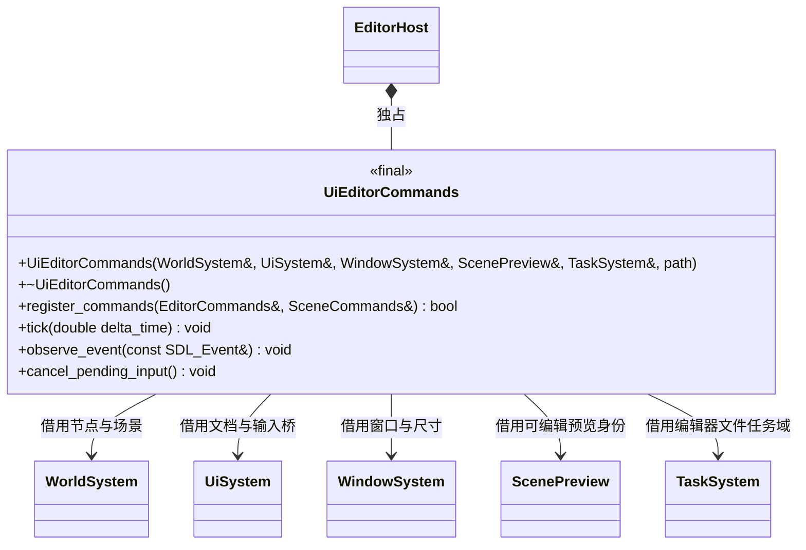
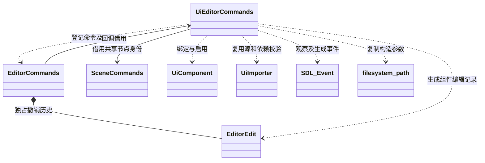
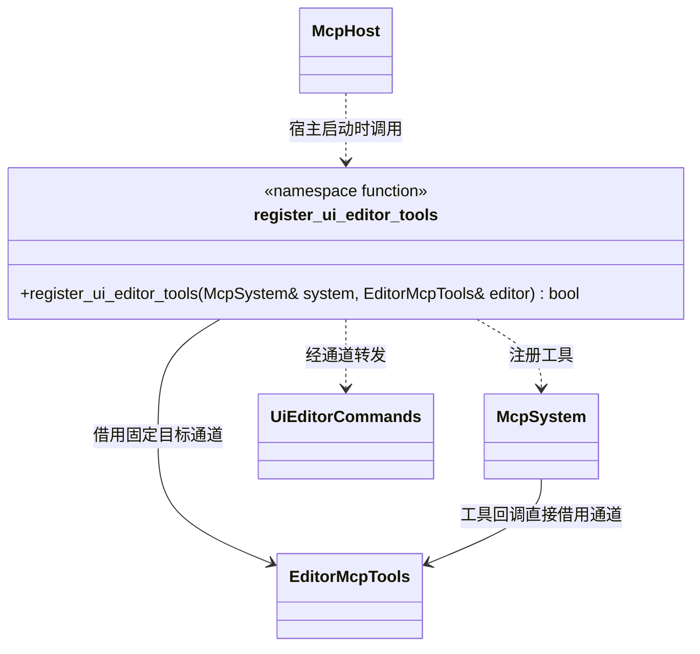
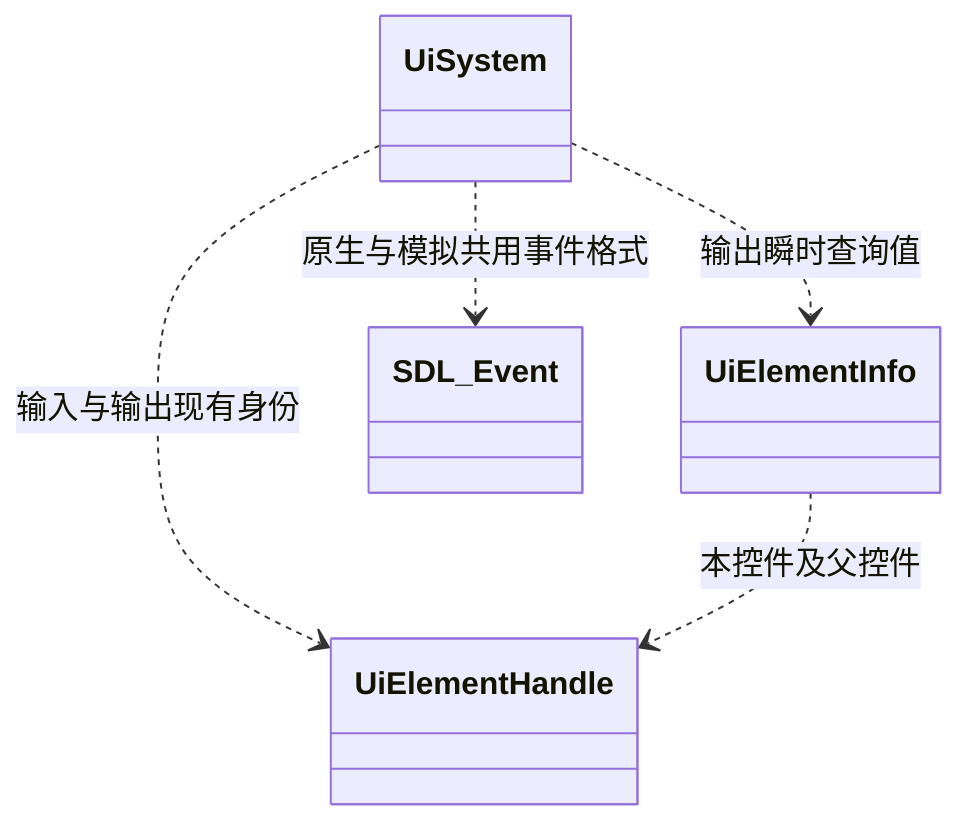
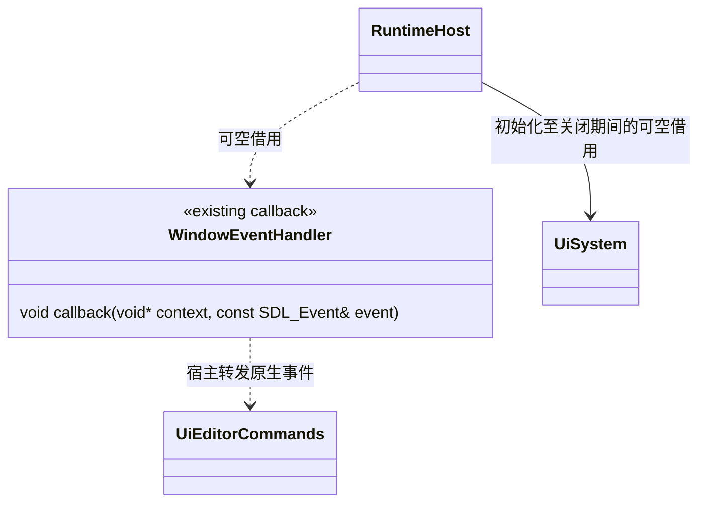
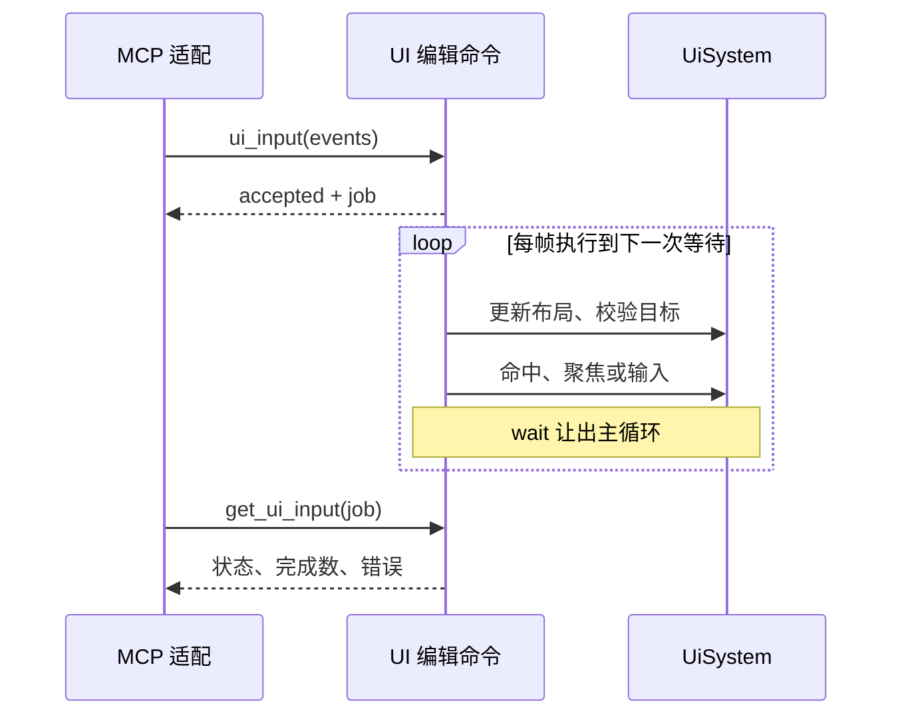
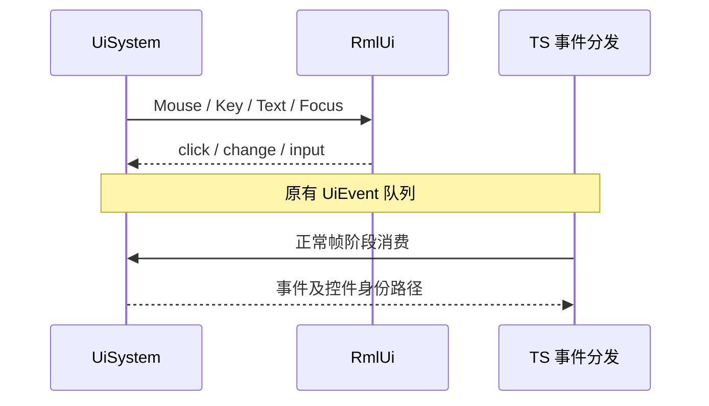

# UI 编辑器插件

[类图索引](../../../class-diagrams/index.md) · [运行时 UI](../../../runtime/class-diagrams/ui-system.md) · [UI 脚本接口](../../runtime/class-diagrams/ui-script-api.md) · [编辑器命令](../../../editor/class-diagrams/editor-commands.md) · [资源管线](../../../editor/asset-pipeline.md)

`editor/ui` 插件已实现，让 MCP 查询和调整 UI、保存 RML 源文档，并通过真实输入路径模拟普通 UI 操作。运行时继续使用普通 `Node + UiComponent + RmlUi`；项目数据和 Controller 保留在 TS。此文件维护已确认的插件与运行时公开契约。

通用 MCP 执行 TS 项目代码由独立脚本调试契约负责。它可用于读取或显式修改项目 Model；UI 插件负责真实可见状态与输入，不再新增执行 TS、运行任意表达式或直接调用 Controller 的工具。两者共享现有命令通道，业务变化和真实交互的回执分别说明。

## 编辑器装配与职责

`UiEditorCommands` 执行编辑器命令，模块函数 `register_ui_editor_tools` 只声明并转发 MCP 工具。两者均属于 `engine::plugins::ui`，不增加常驻 System 或通用 Manager。复用现有 `ComponentEdit` 和 `SceneCommands::node_identity` 实现组件绑定的撤销，不建立第二套撤销系统。

构造参数 `path` 为 `std::filesystem::path project_root`，复制宿主已校验的项目根。命令服务、源文件校验和组件操作的依赖如下；图中同名类引用上图，不重复定义公开方法。

MCP 侧只负责固定项目通道的工具适配；原生输入观察回调的装配见下方 RuntimeHost 增量图。

- 所有查询、DOM 调整与合成输入在编辑器主线程执行。宿主沿现有编辑器逐帧流程调用 `tick` 推进一个有界输入序列；等待让出主线程，不增加线程、通用调度器或第二套任务系统。文件处理复用编辑器任务域，完成提交回到现有命令安全点。
- 构造函数建立安全状态，`register_commands` / `register_ui_editor_tools` 返回值标注 `[[nodiscard]]`。`UiEditorCommands` 禁止复制和移动，析构、`observe_event` 和 `cancel_pending_input` 为 `noexcept`；不把可能失败的文件访问或文档加载放进构造函数。
- 宿主独占插件对象并负责条件装配；先注销原生输入观察回调并取消输入作业，再释放命令服务及撤销历史和 `UiEditorCommands`，其借用对象最后释放。MCP 宿主先结束工具回调，再销毁借用的 EditorMcpTools 通道。
- 清单放在 `cmake/plugins/editor/ui.cmake`，源码/公开头放在对应 `plugins/editor/ui/`。`editor/ui` 明确依赖 `editor/asset_import`，复用其中的 UiImporter 校验，MCP 适配目标仅在已选 `editor/mcp` 时创建。核心、编辑器基础库和运行包均不链接这个具体插件。
- 不复制 RmlUi DOM、布局、hit-test 或事件实现。运行时不暴露 RmlUi 指针，不 include 编辑器头文件；无编辑器插件时 UI 绘制和 TS MVC 继续使用原路径。

## 运行时最小查询与输入增量

查询、命中、焦点和输入均复用核心 `UiSystem` 的已实现接口，完整签名与 `UiElementInfo` 字段统一在[运行时 UI 类图](../../../runtime/class-diagrams/ui-system.md)维护；本页只列编辑器的调用关系。核心接口不包含 MCP、JSON、源文件或编辑器策略。

- `UiElementInfo` 是查询快照，不持久化、不新增第二份场景模型；仅含标准库类型。`bounds` 为窗口逻辑坐标中的 `[x,y,width,height]`，是变换后的包围矩形，不能单凭矩形判定可点击。裁剪和遮挡由 `hit_test` 决定。
- 查询前沿用 `synchronize()` 更新文档和布局；失败清空输出。`document_root` 返回实际文档根，`child_element` 覆盖无 HTML id 的控件和文本节点；不要求为每个控件创建场景 Node。
- `inspect_element.visible` 包括文档、祖先和自身可见性，`enabled` 沿用祖先禁用判定；`focused` 来自实际 RmlUi 焦点，`element_style` 返回所请求属性的计算结果。当前样式不作为持久源数据。
- `hit_test` 复用现有文档排序、模态占用、RmlUi `GetElementAtPoint` 与实际 UI 路由规则，返回顶层真实命中元素；无命中为成功且空句柄，查询本身失败返回 false。被模态窗口阻挡时不能穿透下层文档。普通背景占用仍遵守现有交互控件与 `data-input-capture` 契约。
- `pointer_active()` 为 `const noexcept`，表示 UI 仍持有鼠标或触摸按压/capture，与仅表示可见模态占用的 `pointer_claimed()` 不同。序列开始前还查询 SDL 实体键盘、鼠标按钮与全部活动触点，已有真实按压时拒绝开始，避免抢走用户操作。插件不借用 InputSystem，也不管理游戏输入通道。
- 句柄沿用 `{document_id, element_id}`，文档重载/解绑/组件移除后全部旧句柄失效；同名新控件不能恢复旧句柄。父节点替换文字导致子控件销毁时，其旧观察指针按原契约失效。

- `focus_element` 校验文档/祖先可见与启用，并调用 RmlUi 原生 Focus 路径，按结果设置键盘归属；不直接派发业务事件。也可通过真实点击或 Tab 导航取得焦点。
- 新 `process_event` 重载的 modifiers 是 SDL 修饰键位值；旧重载保持原行为并调用共用实现。模拟输入使用序列中实际按住的 Shift/Ctrl/Alt/Meta，不能改写全局 `SDL_SetModState` 或鼠标模式。原生输入继续使用实际 SDL 状态。
- `cancel_input()` 保留原接口，补全取消时的模拟键/修饰键状态清理；先取消 hover/capture，再释放尚按住的键，取消期间抑制普通点击/激活事件。已产生的合法 click/change 事件不能删除以假装回滚。

原生事件先解除可能冲突的模拟按压，再正常进入既有 UI/Input 路由。`RuntimeHost::set_event_observer` 提供可空借用观察回调，完整签名见[运行宿主类图](../../../runtime/class-diagrams/runtime-host.md)；宿主装配后调用插件 `observe_event`，WindowSystem 保持单一事件接收者。

现有编辑器 tick 在 SDL 事件泵之前，单靠下一帧 tick 发现实体输入无法保证及时取消：跨帧模拟按压可能先接收到真人的释放，误产生 click。因此保留此单一观察回调；不为此增加轮询线程或输入会话框架。

`set_event_observer` 为 `noexcept`；回调仅在主线程原生输入路由前调用，不能改变或吞掉事件。宿主保证借用存活，关闭前解除注册。该接口没有编辑器类型，正常运行宿主不登记时保持原路径。模拟输入直接走 UiSystem 原生桥，不绕回观察回调。插件 `tick` 位于现有编辑器安全点、`RuntimeHost::poll_events` 之前；随后宿主已有的文档同步及认领刷新把焦点/模态状态传给 InputSystem，不为插件重复建立路由。

## MCP 契约

所有 ID 以完整十进制字符串输出，避免 JSON 数字损失 uint64 精度。DOM 名称单独叫 `id`；句柄中的 `elementId` 是运行期身份。命令的 `activation: pending` 使用现有 `get_editor_receipt` 查询，不重复提交点击或保存。

| 工具 | 输入与结果 | 持久化/撤销 |
| --- | --- | --- |
| `get_ui_documents` | 查询全部已发布场景中的 UI 组件；返回真实 `sceneId/nodeId`、资源路径/GUID/代次、组件启用、文档可见、常驻状态、`documentId` 和逻辑/像素窗口尺寸 | 只读；包含常驻 UI，不局限活动玩法场景 |
| `set_ui_document` | `sceneId/nodeId`、已导入 `document` 路径，可选 `enabled`；添加或修改普通 UiComponent | 仅可编辑预览场景；复用 EditorEdit、批量事务、undo/redo、save_scene |
| `get_ui_tree` | `nodeId/documentId`，可选根句柄及分页/深度；返回父子身份、tag/id、文字、值、有效可见/启用、焦点、矩形，明确 `truncated/nextOffset` | 只读；文档代次不符失败，不自动查找同名新文档 |
| `get_ui_element` | 完整句柄，可选计算样式名列表；返回 UiElementInfo 和相应样式 | 只读；布局来自当前 RmlUi |
| `set_ui_element` | 完整句柄，单次一种操作：text/value/visible/enabled/class/style/image；参数对应已有 UiSystem 方法 | 仅改当前 View，不写源文件、不改 Model、不进撤销；不允许混入原子编辑批次 |
| `get_ui_source` | `path` 提交异步原始 RML/meta 读取；`job` 查询读取或保存结果，得到原始 RML、字体/图片绑定与内容哈希 | 只读；不从运行 DOM 反向序列化源码 |
| `save_ui_source` | 相同逻辑路径、`expectedSourceHash/expectedMetaHash`、完整 RML；可选明确的字体/图片绑定 | 独立源文件保存；保留 GUID，复用既有导入与发布，不混入场景撤销 |
| `ui_input` | `documentId`、有界 `events` 数组；事件可含目标句柄和预期命中；返回 job 和 `accepted` | 真实输入序列，跨帧运行；不改源、不进撤销 |
| `get_ui_input` | job；返回执行状态、已完成事件数、失败位置、当前焦点/命中和错误 | 不消费业务 UiEvent 队列 |
| `cancel_ui_input` | job；取消余下事件并安全释放该序列持有的输入 | 不回滚已发生输入 |
| `click_ui` | 完整目标句柄；可选逻辑坐标和 button/clickCount | 仅把 move/down/up 组合提交给同一 ui_input 实现，无独立点击路径 |

`get_ui_documents` 对未能加载文档的组件返回绑定和明确错误，不把它当成不存在。树查询默认限制深度和节点数，并支持继续分页；有 id 的父级和无 id 的子级都保持真实层级。查询返回可能的密码控件时只返回值长度/掩码，不输出密码值。

`set_ui_document` 验证目标资源类型、场景身份和运行节点身份，撤销记录保存 AssetEntryT 资源版本值与生成的 UiData，不持有资源载荷；节点身份复用 SceneCommands 的共享身份单元，而不是旧 RmlUi 指针。玩法运行期间的临时显示改动使用 `set_ui_element`，不能把业务运行态误写入场景。

`set_ui_element` 继续遵守现有语义：`text` 为纯文字，会替换子内容；`value` 为直接设置 View 值，不等同真实输入或业务数据变更；`style` 修改本控件局部 RCSS 属性。Image 只接受 UI 资源已声明的纹理，不能绕过 GUID 依赖。读取实际 UI 时应能看到 TS Controller 随后覆盖的结果，不能暗中停用 Controller 以保留临时改动。

## 源编辑与运行交互

持久布局仍是 `.rml` 内联 RCSS 和邻接 `.meta` 字体/图片引用。首版通过读取/修改/保存完整源文档完成布局、文本、控件增删和层级编辑；不新建可视化 DOM 持久模型，不对运行时 Controller 已改写的 DOM 调用序列化来覆盖源文档。

读取与保存都委托已有 TaskSystem，并借用现有 `cache/.asset-build.lock`；锁占用时明确失败，调用方重新发起。`get_ui_source({job})` 在完成委托返回后读取结果，不在主线程等待文件。一次只有一个源文件任务，保留最近 16 个回执；输入保留最近 32 个回执。新源文件首次读取返回 `exists:false` 与空哈希，保存时生成新 GUID，并要求提供可解析的字体绑定。

保存仅接受项目 `assets/` 内规范化 `.rml` 路径，拒绝绝对路径、越界和符号链接逃逸。已有 meta GUID 保留，不能由命令改写。先比对读取时的源/meta 哈希，复用 UiImporter 校验 RML、字体、图片和已有资源类型，再复用资源管线文件工具、项目锁和逐文件 rename/失败回滚写入；任一步失败不得发布半份源文件或资源。只覆盖明确提交的绑定，不丢弃其他合法 meta 配置。

导入与场景刷新继续走现有资源管线：文件保存、导入发布、当前 View 激活是三个不同阶段。回执明确报告阶段，只有实际导入和文档代次更新后才报告 View 已刷新；存在未保存场景编辑时保留现有 `reloadPending` 规则，不擅自丢弃。重新加载销毁旧文档及事件，调用方重新查询句柄。预览不执行 Gameplay Controller；要验证 TS 点击行为必须在实际玩法运行中进行。

## 有界输入序列

采用一次请求内配对的事件序列，而不是让 MCP 客户端长期占有远程鼠标。`ui_input` 支持以下基础事件，select、checkbox、slider、滚动条和项目自定义控件都由同一套 RmlUi 输入机制处理，不为每种控件增加业务操作接口。

| 事件 | 语义 |
| --- | --- |
| `pointer_move` | 窗口逻辑坐标；真实更新 hover，按压中移动即拖动 |
| `pointer_down` / `pointer_up` | 左/中/右按钮成对；维持真实捕获，支持长按、双击与拖动 |
| `wheel` | 当前逻辑位置和双轴滚动增量；由实际命中、捕获和 RmlUi 滚动规则处理 |
| `focus` | 完整句柄；复用 RmlUi Focus，失败不强制聚焦隐藏或禁用控件 |
| `key_down` / `key_up` | 明确键标识、repeat；支持 Tab/Shift+Tab、Enter、Space、方向键、编辑键及修饰键组合 |
| `text` | UTF-8 Unicode 已提交文本，经 RmlUi `ProcessTextInput`；不直接 SetValue |
| `wait` | 有界毫秒等待，继续执行正常主循环、UI 更新和 TS 事件分发，不阻塞线程 |

首版每序列最多 256 个事件，总时长最多 10 秒；时间使用单调时钟，不受世界暂停和模拟时间缩放影响。接受前整体校验结构、文本长度、键名、坐标有限值、down/up 配对和等待总量；拒绝同时有第二个序列。按压只能跨该作业内的帧，不能跨独立 MCP 请求保留。单次 hover、focus 或文本输入允许保留它们正常产生的悬停/焦点/文档结果，但作业结束不保留按住的按钮或键。

拖动就是 down → 多段 move/wait → up；长按就是 down → wait → up；组合快捷键就是修饰键 down → 普通键 down/up → 修饰键 up。真实字符输入使用 text，key_down 不伪造文字。文档使用的 RmlUi 编辑、选择、焦点和表单逻辑决定 change/input 结果；Unicode 文本提交不等于模拟操作系统 IME 预编辑窗口。

动态文字、计算样式、布局坐标或业务 Model 改变不增加额外“全 UI 版本”，不会每帧取消任务。只校验本次作业的文档身份，以及当前待执行事件明确引用的控件身份；每一步按最新布局重新命中。页面正常切换后，可结束当前序列、查询新树，再提交新序列。已完成事件的旧目标被正常移除，不使后续无关步骤自动失败。

## 输入路径与取消

提交与逐帧推进：

上图的“输入”进入下面的既有路径；TS 事件消费仍在正常脚本阶段，不由编辑器抢读。

1. **目标和坐标。** 作业绑定实际文档 ID 和编辑器会话身份。逻辑坐标由 WindowSystem 查询；Retina 截图坐标只转换一次。默认中心不保证可点，命中须为目标或其合法子级；遮挡/模态/滚动裁剪时失败，不寻找另一个坐标偷偷点击。可指定坐标进行普通 hover/wheel/drag，不能将 framebuffer 像素直接当成 RmlUi 坐标。
2. **真实输入。** 使用正确窗口 ID 构造 move/button/wheel/key/text 事件，进入现有 `UiSystem::process_event` 和 RmlUi 原生桥。不能调用 Element::Click、DispatchEvent 或 TS handler 冒充输入，不向全局 SDL 队列投递丢失目标身份的延迟事件。失败或未命中的 UI 输入不穿透为游戏开火；滚轮先更新实际位置。
3. **捕获与焦点。** down 时验证预期命中；拖动后 up 遵守 RmlUi 原始捕获与当前命中，不强制要求 up 仍处于原矩形，否则会破坏滑块/文本选择的正常语义。键盘和 text 使用真实有效焦点；命令的可选预期焦点句柄用于防止发给错误输入框。focus 走 RmlUi 原生 API，Tab 导航和 Enter/Space 激活走真实按键。
4. **输入所有权。** 开始时实体鼠标、键盘或触点已按下则返回 busy，不抢占。正常执行时只记录该序列实际按下的键/按钮。原生输入到来时，RuntimeHost 先通知插件安全取消剩余模拟输入，然后照常分派真实事件；不吞真实输入。窗口使用 relative 模式则报告不可执行指针操作，不擅自切换项目鼠标模式或游戏暂停。
5. **取消条件。** 显式取消、超时、窗口失焦/后台/销毁、尺寸或缩放变化、文档重载/解绑、待用控件失效、相关脚本 Run 结束或重载都停止余下事件。宿主生命周期入口先调用 `cancel_pending_input`；文档 ID 变化仍作兜底检查。普通文本/布局刷新和常驻文档跨玩法场景保留不等于 Run 已结束。
6. **无残留按压。** 取消先退出 hover/capture，再在抑制激活的取消路径释放该序列仍按住的按钮/键，清空模拟修饰键；不得通过普通 up 补出一次意外 click。已完成的输入、已经产生的业务事件和 Model 变化保持真实结果，不宣称回滚。正常结束保留应有焦点和 hover，只确保按压集合为空。
7. **暂停和回执。** 世界暂停不停止编辑器作业和 UI；现有宿主安全点刷新 InputSystem 认领状态，插件不更改项目输入通道。命令通道 accepted 只说明作业已收下，`get_ui_input` 才报告 running/complete/cancelled/failed。结果包含 completedEvents/failedIndex；complete 表示输入序列已执行，不能等同胜负、存档或页面业务成功。
8. **业务事件。** 插件不 `poll_event` 抢走 TS 队列；实际业务结果通过稍后查询 UI/场景或真实截图确认。现有 UiEvent 只对 TS 暴露 click/change/input，本轮普通控件输入复用这些已有事件。若项目需要自定义 pointer/key/focus 订阅，再单独评审对应 TS 事件契约，不用测试入口绕过当前脚本边界。

## 验证入口

构建、回归操作、实际 UI 输入结果及未覆盖范围统一见[测试与范例](../../../testing.md)。输入序列完成只代表已执行输入，业务是否成功仍通过实际 View、场景与项目结果确认。

## 已实现的查询与编辑字段

- `get_ui_tree` 使用 `nodeId/documentId`，可选 `root` 完整句柄、`offset`（0–8192）、`limit`（1–1024，默认 256）和 `depth`（0–64，默认 8）。每项包含 `childrenTruncated`，文字和值各最多返回 8192 字节并明确标记截断；分页按当前 View 遍历，不宣称跨帧快照。
- `get_ui_element` 与 `set_ui_element` 使用 `target:{documentId,elementId}`。修改明确指定 `operation`：text/value/visible/enabled/image 使用 `value`；class 使用 `name/active`；style 使用 `name/value`。拒绝与当前操作无关的字段。
- `save_ui_source` 使用 `path/source/expectedSourceHash/expectedMetaHash`，可选 `fonts:[{family,asset,shader}]` 和 `textures:[resourcePathOrGuid]`。源文件完成只报告 `stage:source_saved, import:pending, view:pending`；现有编辑器监听负责后续导入和激活。
- 宿主在 Run 身份变更、停止和关闭之前调用取消，插件自身也检查窗口逻辑/像素尺寸与文档身份。临时 View 文字变更不会触发全局代次。

`register_ui_editor_tools` 是模块登记函数，没有适配器对象或独立状态；工具回调直接借用 EditorMcpTools，宿主保证通道存活到 McpSystem 关闭。
