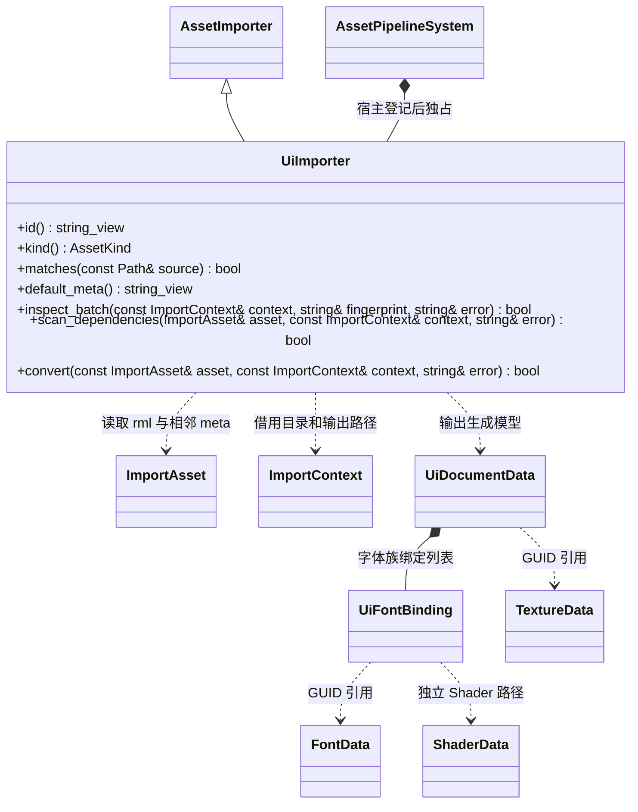

# UI 文档导入

UI 是普通场景节点上的组件。该插件只把 RmlUi 文档及其显式资源引用转换成单项 UI 资源，不创建场景节点，不实现字体渲染。

- `.rml.meta` 的 `[ui]` 指定纹理列表；每个 `[[ui.fonts]]` 分别指定文档内字体族、字体资源和 Shader。字体族忽略 ASCII 大小写且在同一文档唯一；同一字体可通过不同族使用不同 Shader，依赖按 GUID 去重。
- 源 `.rml` 保留 RmlUi 标记和内嵌 RCSS。首阶段不接受外部样式、脚本、模板或 CSS 外部图片；`img` 仅引用 meta 已声明纹理。
- 生成的 `cache/gen/GUID` 只包含文档、字体绑定、纹理 GUID。资源依赖图负责共享加载与释放，导入器不建立独立文件加载机制。
