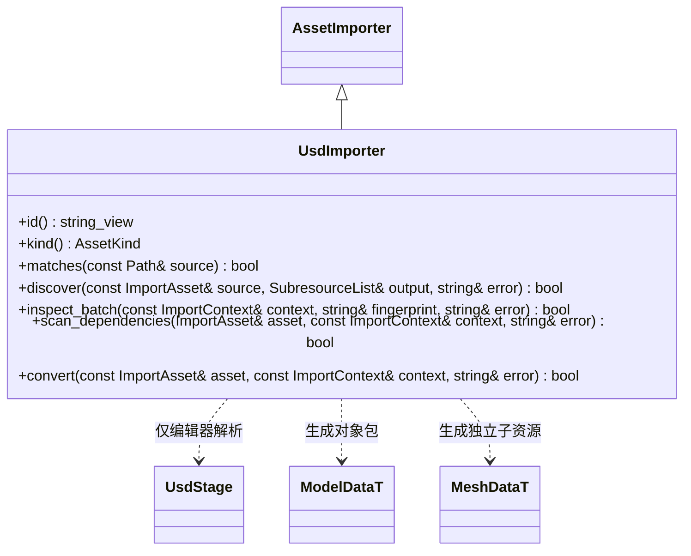

# USD 导入插件

USD 的依赖和目标只在 `editor/usd_import` 被选择时出现，不进入核心、编辑器基础库或运行包。当前转换范围为默认时刻的静态多边形网格，统一米和 Y-up，层级节点保留，世界变换烘焙入顶点；材质使用内置 PBR。源材质、贴图、蒙皮、动画和实例化原型尚未转换，检测到不支持的网格条件返回错误，不标记为已实现。

所有格式通过 `AssetImporter::id()` 调度，可同时产出 `AssetKind::model`；不能用运行资源类型代替源格式身份。

- 每次发现使用独立匿名 SdfLayer 快照，避免其他编辑器持有的 Layer 缓存返回旧数据；源哈希在发现和发布前核对。
- 在组合 Stage 前检查源 Layer 的 composition 与 file-format 依赖；外部 sublayer/reference/payload，即使目标缺失或未激活，也明确拒绝。不会用“加载到的层数量”判断是否自包含。
- 当前支持 Xform、Scope 和 Mesh，网格要求 `subdivisionScheme = "none"`，三角形或凸且共面的多边形。层级世界变换烘焙后节点变换为单位矩阵。源法线、UV、颜色和材质不转换，生成平面法线及内置 PBR 材质。
- 含 Sphere 等未支持的几何、Material/Shader、骨架、实例、时变属性、洞、细分面、凹面或自交面时返回明确错误，保留上次成功目录，不发布缺失内容的对象包。
- USD 与 FBX 通过不同导入器 id 共存，各自源变化仅重建对应模型及子网格；子资源 GUID 保存在源 meta。
