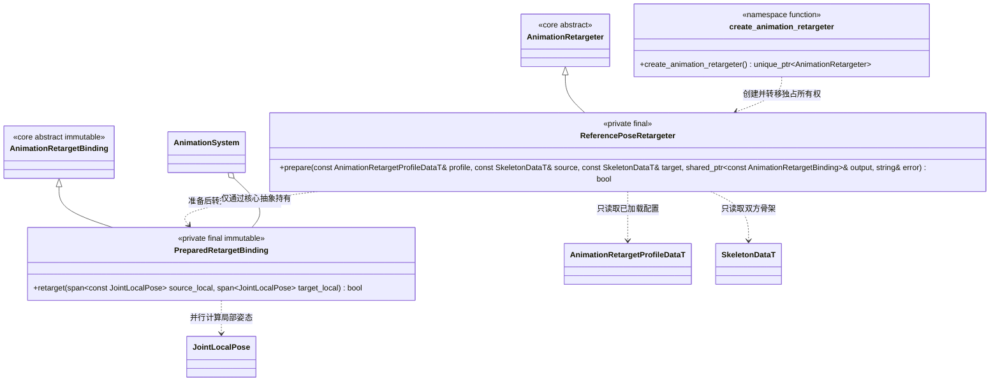

# 动画重定向插件

[核心资源与执行契约](../../../runtime/class-diagrams/animation-retargeting.md) · [动画系统](../../../runtime/class-diagrams/animation-system.md) · [插件选择](../../plugins.md)

本页定义 `runtime/animation_retarget` 可选插件的最小实现边界。源码与头文件分别归 `src/engine/plugins/runtime/animation_retarget/`、`include/engine/plugins/runtime/animation_retarget/`；CMake 清单归 `cmake/plugins/runtime/animation_retarget.cmake`。

两个实现类和工厂位于 `engine::plugins::animation_retarget`。公开头只声明宿主登记用的工厂；两个具体类均为插件实现私有类型，不进入公开头或 TS 声明。公共抽象的方法与完整失败约定只在[核心图](../../../runtime/class-diagrams/animation-retargeting.md)定义，此处的重写保持相同签名、`const`／`noexcept` 约定及 `[[nodiscard]]`。

插件不继承 System，不新增 Manager、资源图、任务池、全局注册表或状态机。它只依赖核心的 schema／姿态契约和所需通用数学实现；不依赖具体脚本、资源依赖图、角色控制器、编辑器或其他运行时插件。若后续适配需要额外第三方算法，先明确固定版本、许可和实际用途再加入清单；不为了重定向替换现有 Ozz 播放、混合与蒙皮系统。

## 算法适配范围

- prepare 校验双方骨架父链、完整映射、校准参考姿态和 hips 策略，预计算双方模型空间参考变换及必要的关节／骨链补偿。返回结果只读；不在每角色、每帧重新解析路径或构建图。
- retarget 读取源局部姿态并按准备结果计算所需模型空间方向，转换成目标局部姿态。目标参考骨长和未映射辅助骨保留；源与目标父链不同不能直接拿两份局部旋转相减。**具体可支持的骨链重组、参考方向修正与误差限制尚待上游算法适配及人形样例确认，不将本类名称当作通用重定向已经完成。**
- 不直接复制源全身平移或缩放。hips 按 profile 的两种明确策略处理；比例由作者显式配置，缺必要骨／参考数据或出现不支持的剪切、镜像、非均匀缩放时报错。
- 输出是目标局部 TRS，不是 skinning palette、最终世界矩阵或物理移动命令。不进行脚锁、地面查询、武器握持、RootMotion 提取或项目状态判断；普通绝对姿态与 Additive 差值不能混用。
- prepared binding 不含 mutable 缓存、Ozz Context、TS 回调或裸资源借用。不同角色共享同一 binding 时，时间、输入、工作缓冲和输出均独立；执行失败遵守核心契约，不发布部分关节结果。

## 上游参考的准确边界

Ozz 提供采样、姿态混合、LocalToModel 与 IK 基础 job，**不自带这里所需的通用源／目标骨架重定向器**。现有引擎的同名称／完整父路径匹配也只是兼容骨架轨道绑定。

已固定阅读的 RavEngine `f5853bcb50a5b80f79fcfae515f06cc2c7a4db48`（Apache-2.0）可供多层、Mask 与 Ozz 接法参考，不能作为本插件的重定向算法依据：其 [AnimationAsset::Sample](https://github.com/RavEngine/RavEngine/blob/f5853bcb50a5b80f79fcfae515f06cc2c7a4db48/src/AnimationAsset.cpp#L146) 直接采样轨道，[UpdateSkeletonData](https://github.com/RavEngine/RavEngine/blob/f5853bcb50a5b80f79fcfae515f06cc2c7a4db48/src/AnimatorComponent.cpp#L254) 只准备缓冲，[参考骨架矩阵](https://github.com/RavEngine/RavEngine/blob/f5853bcb50a5b80f79fcfae515f06cc2c7a4db48/src/SkeletonAsset.cpp#L129) 用于蒙皮；所检查范围没有源／目标映射、体型比例或双参考姿态转换。

当前实现已适配 Wicked Engine 固定提交 `c433ae7b9d433df106fd53970b625a710744232b` 的模型空间参考姿态转换，来源和 MIT 许可见 `third_party/notices/wicked-animation-retarget.md`。Godot 等其他实现不属于当前依赖；后续评估仍须确认模型空间、骨链、hips 和参考姿态语义。未核查的能力不写成已具备，也不将不同上游中互不等价的局部算法拼接后宣称完整人形重定向。

首期验收应由同一组源动作运行驱动两个目标角色，共同覆盖骨名、身高／肢体比例及 A/T 参考姿态差异；检查目标骨长、关节朝向、脚底明显漂移和 hips 策略。保持源动作共享及实例运行态隔离，额外核查缺骨／不匹配／插件未装配／工厂创建失败／资源换代／重复关闭。这里只定义验收边界，不提前宣称算法、功能或平台已经通过。
