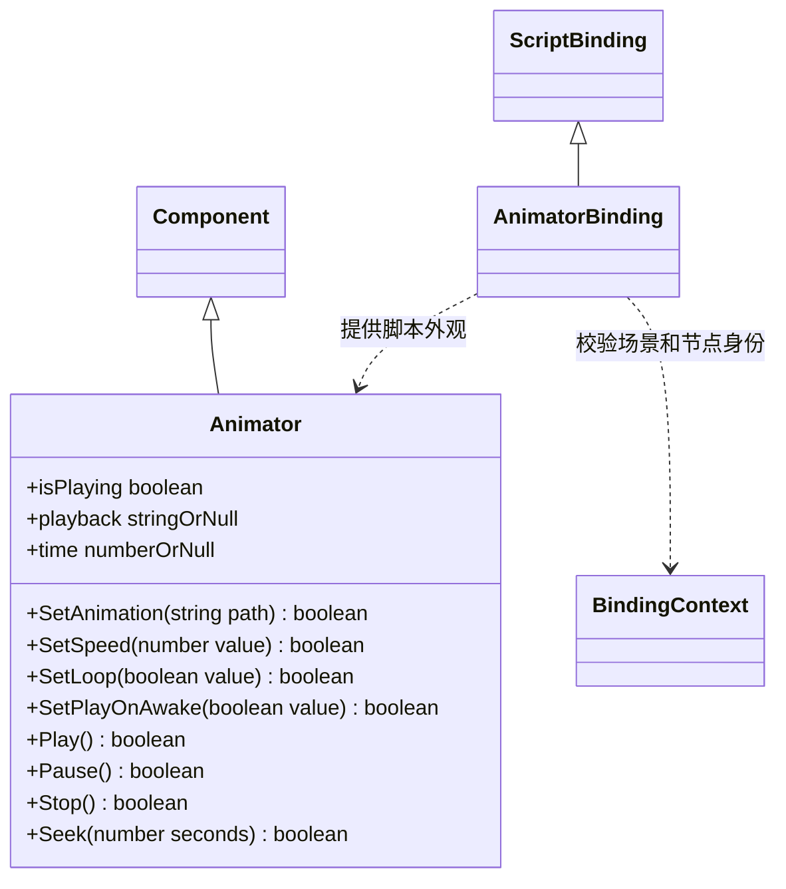

# 动画脚本接口

[绑定实现](script-bindings.md) · [运行时 Animator](../../../runtime/class-diagrams/animator.md)

- 通过 `node.AddComponent(Animator)` 创建，`node.GetComponent(Animator)` 查询；原生对象仍由 Node 独占。脚本对象仅保存场景、节点和组件种类，不持有原生指针。
- `SetAnimation` 使用独立动作的资源路径；空字符串清空动作，失败保持原设置。动画匹配同节点的 MeshRenderer 骨架，不要求源骨架与目标骨架 GUID 相同。
- `SetSpeed` 接受 `0..16`；`Pause` 保留最后姿态，`Stop` 恢复绑定 Mesh。`Seek` 以秒定位；停止状态定位进入暂停，播放状态定位继续播放。
- `isPlaying`、`playback`、`time` 为只读属性。失效组件分别返回 false、null、null；状态字符串为 `stopped`、`playing` 或 `paused`。
- 编辑器命令与 MCP 共用 `set_animator` / `get_animator`、`play_animation`、`pause_animation`、`stop_animation`、`seek_animation` 和 `get_animation_state`。设置支持撤销；播放控制为瞬态操作，不进入撤销历史。所有命令携带场景和节点身份。
