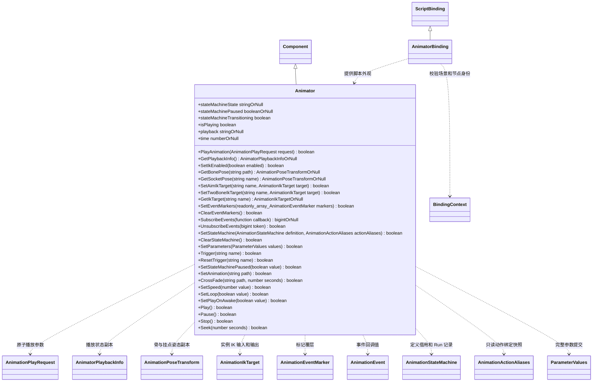

# 动画脚本接口

[绑定实现](script-bindings.md) · [运行时 Animator](../../../runtime/class-diagrams/animator.md)

本页统一维护 Animator 的完整 TS 外观，与 `include/engine.d.ts` 一致；[状态机](animation-state-machine.md)维护共享定义和执行语义，[运行时事件图](../../../runtime/class-diagrams/animation-events.md)维护事件身份与分发边界。图中的 `OrNull` 表示对应 TS 联合空值类型。

- 通过 `node.AddComponent(Animator)` 创建，`node.GetComponent(Animator)` 查询；原生状态唯一保存在 ECS，Node/Component 为值句柄。脚本对象保存场景、节点、组件种类和统一组件实例身份，不持有原生指针。
- `SetAnimation` 使用独立动作的资源路径；空字符串清空动作，失败保持原设置。它只检查路径和 Animation 资源，不同步预检 Mesh/骨架绑定；返回 true 不保证该组合可播放。动画系统准备时按完整关节路径匹配同节点 MeshRenderer 的骨架，不要求源和目标 GUID 相同，不包含通用重定向。
- `CrossFade(path, seconds)` 预检资源与骨架绑定后过渡到零秒开始的新动作；秒数有限且非负，零秒直接切换，空路径失败。请求与当前动作 GUID、代际相同且当前未停止时直接成功返回，不重启、不解除暂停，也不改变已有过渡。连续打断保留当前混合姿态。`Pause` 冻结过渡，`Stop`、`Seek` 和直接换动作取消过渡。来源保留请求时的速度和循环设置，`SetSpeed` / `SetLoop` 调整目标动作；脚本负责业务状态，动作资源须显式进入项目打包清单。
- `SetSpeed` 接受 `0..16`；`Pause` 保留最后姿态，`Stop` 恢复绑定 Mesh。`Seek` 以秒定位；停止状态定位进入暂停，播放状态定位继续播放。
- `isPlaying`、`playback`、`time` 为只读属性。失效组件分别返回 false、null、null；状态字符串为 `stopped`、`playing` 或 `paused`。
- 编辑器命令与 MCP 共用 `set_animator` / `get_animator`、`play_animation`、`pause_animation`、`stop_animation`、`seek_animation` 和 `get_animation_state`。设置支持撤销；播放控制为瞬态操作，不进入撤销历史。所有命令携带场景和节点身份。
