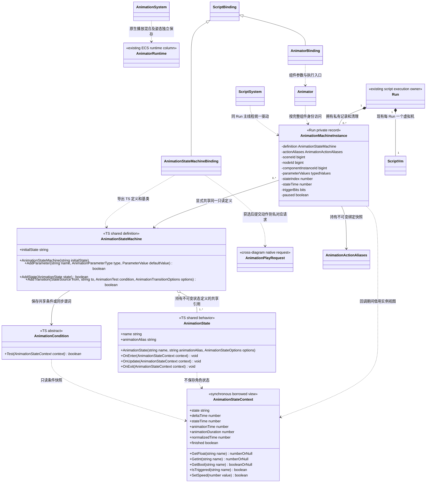

# TS 动画状态机

[类图索引](../../../class-diagrams/index.md) · [现有动画脚本接口](animation-script-api.md) · [Animator](../../../runtime/class-diagrams/animator.md) · [分层方案](../../../runtime/scripted-animation-controller.md)

本图定义脚本插件的 TS 外观与 Animator 脚本扩展，`include/engine.d.ts` 与实际绑定同步。Animator 当前完整脚本外观统一由[动画脚本接口](animation-script-api.md)维护；原生原子播放请求、重定向、IK 与骨骼挂点由各自运行时类图维护。

## 三层与所有权

1. **动画资源**保存独立动作、骨架及适配配置。动作别名绑定使用正式资源路径，不存项目转换规则。
2. **自定义状态机 TS**通过继承或组合声明共享状态、条件和转换；宿主自动评估并提出播放请求。
3. **业务 TS**装配一次后只提交参数与触发器，不自行 tick、选择动作或调用 CrossFade。



`AnimationMachineInstance` 是脚本 Run 私有记录的说明名称，不增加公开 TS 构造函数、原生 System 或通用 Manager。TS 自定义逻辑的临时状态属于当前 VM；C++ 的播放时钟、过渡与姿态继续存 ECS/既有动画域。原生 Runtime 不保存 TS 对象或 VM 句柄。图中跨图类型不在本页重新定义方法。

## 精确类型

以下为已实现的状态机 TS 签名，可选参数和默认值与 `include/engine.d.ts` 同步；Animator 的完整方法统一见[动画脚本接口](animation-script-api.md)。

```typescript
declare module "engine" {
    export type AnimationParameterType = "float" | "int" | "bool" | "trigger";
    export type ParameterValue = number | boolean;
    export type ParameterValues = Readonly<Record<string, ParameterValue>>;
    export type StateSource = string | null;
    export type AnimationPredicate = (context: AnimationStateContext) => boolean;
    export type AnimationTest = AnimationCondition | AnimationPredicate;

    export interface AnimationStateOptions {
        speed?: number; // 默认 1，沿用原生 [0, 16] 范围。
        loop?: boolean; // 默认 true。
    }

    export interface AnimationTransitionOptions {
        seconds?: number; // 默认 0.15，有限且非负。
        priority?: number; // 默认 0，安全整数；较大者优先。
        exitTime?: number; // 可省略；有限且非负，详见下文。
        interrupt?: boolean; // 默认 false；过渡未完成时是否允许此转换。
        reenter?: boolean; // 默认 false；目标就是当前状态时是否重新进入。
    }

    export type AnimationActionBinding = string | Readonly<{
        path: string;
        retargetProfile?: string;
    }>;
    export type AnimationActionAliases = Readonly<Record<string, AnimationActionBinding>>;

    export class AnimationStateMachine {
        constructor(initialState: string);
        readonly initialState: string;
        AddParameter(name: string, type: AnimationParameterType,
                     defaultValue?: ParameterValue): boolean;
        AddState(state: AnimationState): boolean;
        AddTransition(from: StateSource, to: string, condition: AnimationTest,
                      options?: AnimationTransitionOptions): boolean;
    }

    export class AnimationState {
        constructor(name: string, animationAlias: string, options?: AnimationStateOptions);
        readonly name: string;
        readonly animationAlias: string;
        OnEnter(context: AnimationStateContext): void;
        OnUpdate(context: AnimationStateContext): void;
        OnExit(context: AnimationStateContext): void;
    }

    export abstract class AnimationCondition {
        abstract Test(context: AnimationStateContext): boolean;
    }

    export class AnimationStateContext {
        private constructor();
        readonly state: string;
        readonly deltaTime: number;
        readonly stateTime: number;
        readonly animationTime: number;
        readonly animationDuration: number;
        readonly normalizedTime: number;
        readonly finished: boolean;
        GetFloat(name: string): number | null;
        GetInt(name: string): number | null;
        GetBool(name: string): boolean | null;
        IsTriggered(name: string): boolean;
        SetSpeed(value: number): boolean;
    }

}
```

精确外观归属：构造函数和 `Add*` 属于图中相应定义类；其余方法与属性由图中类声明。所有展示的只读属性在 TS 声明中使用 `readonly`。`AnimationCondition` 是可继承抽象基类；项目也可以直接传同步谓词，无须为每个阈值创建一种类型。`AnimationStateContext` 仅由驱动器提供，不可由项目构造。

`retargetProfile` 指向资源层的正式适配配置。字符串是仅含 path 的简写；省略配置只接受执行器既有的兼容骨架组合，不猜测角色骨名、参考姿态或比例。状态/条件使用动画别名，不认识具体骨骼差异。相关资源类型和导入契约由运行时资源与编辑器类图确认，本页不另建 Graph 资源。

## 共享定义与轻量实例

- 构造定义、添加参数/状态/转换均不需要角色或活动场景，可在普通 TS 模块初始化阶段完成；此阶段不加载资源、不访问原生场景。
- `initialState`、状态名、参数名与动作别名必须是非空字符串，名称按完整字符串精确匹配。状态名和参数名在各自定义内唯一，不按文件路径处理。
- `AddParameter` 的 float/int 默认 0，bool/trigger 默认 false；float 必须有限，int 必须为安全整数，bool 必须为布尔。trigger 只能以 false 初始化。重复名称、错误类型/默认值或已封存定义返回 false，不产生部分修改。
- `AddState` 接受 `AnimationState` 或其子类实例。状态、条件及转换配置只含共享定义和行为，不能保存角色、播放时间或本次 context。定义中的状态名和选项、转换顺序在封存后不可改变。
- 首次成功绑定时完整校验初始状态、转移目标、参数声明、状态选项与别名覆盖，并封存定义；失败的绑定不把定义封存成半成品。允许在定义阶段先声明转换再添加目标状态，悬空引用在绑定前拒绝。
- 复用是**显式传同一个 definition 对象**。同一个类创建的不同对象不自动合并；不同角色配置不按类名或对象内容猜测为同一份。绑定快照为只读，显式复用同一 actionAliases 对象可以共享其不可变快照。
- 每个 Animator 只保留参数值、状态索引、状态计时、Trigger、暂停及组件身份等轻量实例数据。不按敌人数量复制全部状态/条件/转换，也不创建每角色虚拟机。
- 共享子类不能靠 `this` 的角色字段或捕获角色的闭包保存实例变量；自定义条件使用 context 参数及状态时间。冻结对象只是辅助检查，不能承诺自动识别所有闭包或 JS 私有字段副作用。

## 组件参数与装配

- `SetStateMachine(definition, actionAliases)` 只在当前 Run 可调用作用域、有效 Animator 身份上成功。初始化时准备初始动作并从零秒进入初始状态；资源或骨架预检失败返回 false，保留旧机器、参数和原生播放。替换为另一份定义成功后重建实例参数、计时和 Trigger。
- 再次传入同一 definition 与同一 actionAliases 对象是幂等成功，不重新进入当前状态、不复位参数。需要重开时由调用方显式清除再装配，不通过每帧重复绑定实现。
- `SetParameters(values)` 只写当前绑定机器中已声明的 float/int/bool 参数。所有键与数值先校验，任一错误整批失败；不进行类型转换，不用它写 trigger。业务在 Update 中提交，本次自动驱动读取这些值。
- `Trigger(name)` / `ResetTrigger(name)` 只接受已声明 trigger，成功返回 true。重复 Trigger 在消费前合并为一个待处理信号；需要保留每次发生次数的事件另用明确事件数据，不冒充布尔 Trigger。
- 参数和 Trigger 写入由完整组件身份定位，而非 JS wrapper 对象身份。多次 `GetComponent(Animator)` 指向同一记录；删除再添加同名组件不会复活旧记录。
- `ClearStateMachine()` 在有效 Animator 上幂等成功，退出并删除脚本记录、待处理信号；不自动停止、定位或替换最后的原生动作。解绑后恢复现有手动播放器控制。旧/外来 Run 或失效组件返回 false。
- `stateMachineState` 返回当前逻辑状态名；未绑定或组件失效为 null。`stateMachinePaused` 同样在未绑定/失效时为 null；`stateMachineTransitioning` 在未绑定/失效时为 false。
- `SetStateMachinePaused(value)` 在有效且已绑定实例上幂等成功，冻结机器与其原生播放/过渡；恢复不重启自然已结束的动作。世界暂停另沿用 WorldSystem，不由此接口改写。

机器绑定后明确拥有播放控制权：业务不能再用直接 SetAnimation/CrossFade/Seek/Play 等方法与机器争写。状态进入通过内部组件执行入口提交 `AnimationPlayRequest`，携带别名解析出的 path/profile、过渡时间、状态速度/循环及显式 restart；原生预检成功后才发布脚本转换。旧手动 CrossFade 的同资源 no-op 行为保持不变，不能拿它代替机器新状态从零进入的语义。

装配样式为一次 `animator.SetStateMachine(sharedDefinition, sharedAliases)`；随后业务只调用 `SetParameters(...)` 与 `Trigger(...)`，不获取内部实例、不轮询状态后选择动作。

## 条件、回调与时间

- `from = null` 表示任意当前状态；字符串表示精确源状态。初始版本只支持平面状态集合，不增加没有实现的子机器/并行层接口。
- 条件必须同步返回严格 boolean。可选转换先按 priority 降序、再按登记顺序判断；本次最多接纳一次转换，不连续运行瞬时循环。默认跳过指向当前状态的候选；显式 `reenter = true` 才重新进入，并重新启动动作与计时，支持重复受击/攻击信号而不让常真条件默认每帧重启。
- `interrupt = false` 的候选在已有原生过渡期间不参与判断；true 允许按当前已显示姿态打断。跨状态重新进入使用原子播放请求，资源提交失败不消费 Trigger、不变更脚本当前状态。
- `exitTime` 是自本次状态进入起累计、包含循环次数的归一化动作时间下限；未达下限不判断该候选条件，达到后保持满足。不是只存在一帧的“恰好等于”条件，也不因循环取模回零丢失。省略时不加时间门槛。
- 每次评估读取同一份实例参数/Trigger 快照。条件不得修改场景、播放或参数；驱动记录各候选条件通过 IsTriggered 读到 true 的信号，只在该候选获选且原生接纳后消费这些信号。未获选条件读到的 Trigger、未被条件读取的 Trigger 和其他实例的 Trigger 均不消费。回调期间产生的后续输入留到下次驱动。
- `OnEnter` / `OnUpdate` / `OnExit` 默认无操作，可由状态子类覆盖；只能同步执行。正常进入提交后一次 OnEnter，离开时一次 OnExit；每次自动驱动对最终活动状态至多调用一次 OnUpdate。初始绑定不产生虚构来源的 OnExit。
- context 的 state 与时间描述该次回调对应的状态。`deltaTime` 为本次有效模拟步长，进入/退出回调为 0；`stateTime` 是未暂停的状态存活秒数，不乘片段播放速度。`animationTime` / `animationDuration` 取原生动作信息，`normalizedTime` 保留循环累计，`finished` 明确表示自然到达非循环动作结尾，不把任意 paused 当成完成。
- GetFloat/GetInt/GetBool 在未知名称或类型不匹配时返回 null，IsTriggered 对无效/非 trigger 名称返回 false；不把错误读取悄悄当作数值 0。条件作者自行处理 null；需要诊断时报告具体参数和状态。
- `context.SetSpeed(value)` 只在活动状态的 OnEnter/OnUpdate 中可用，沿用原生 [0,16] 数值范围；条件和 OnExit 中返回 false。它只调节该实例当前动作速率，不切状态、不重置时间，也不修改共享定义。初始速率来自状态选项。
- context 仅在当前同步回调有效，不得存入状态字段、闭包、定时任务或 Promise。其外观可随轻量实例复用，不在不同角色之间复用同一个公开 context 对象；每次回调检查当前有效作用域，作用域外使用拒绝，不能因此访问下一角色。无需每帧重建整套状态或上下文。TS 回调异常沿用当前 Run 的失败与完整清理策略，不承诺隔离任意角色异常或回滚用户副作用。

现有非循环动作结束会进入 paused，机器仍需读取 finished/时间并评估退出。显式机器暂停、世界暂停、组件停用才冻结相应判断/计时；恢复不补算被暂停的时长。原生完成查询与累计时间遵守 Animator 所属公开契约，TS 不另推算一份逐动作时钟。

## 现有 Run 与原生生命周期

- 继续使用同一个 Run/VM 和 ScriptBindingRegistry，通用 TS 基类与调度实现归 `plugins/runtime/script/`；不要求所有自定义控制器继承 Gameplay。只有现有玩法入口遵守 Gameplay 入口约定。
- `ScriptSystem` 在业务 Update 后通过既有 `call_binding` 自动驱动本 Run 的绑定实例，然后由现有宿主顺序执行 AnimationSystem/Ozz。新增/删除实例在稳定安全点维护，遍历回调不使实例集合失效。
- 每次驱动与提交重新检查 Run 可调用身份、Scene、完整 Node、Animator 组件实例。跨关卡不会将旧局部 ID 指向新角色；保持有效的常驻节点继续保留本 Run 的实例。
- 条件/生命周期/事件回调只在 Run 主线程安全点执行，不能从 Ozz worker 调用 TS。动画采样、混合、重定向、IK 和 palette 继续走 C++；编译资源按真实资源身份共享，SamplingContext 和姿态各自独立。
- 删除节点、移除组件或 Scene 真正销毁时清除记录。停止 Run 复用现有 `bindingCleanupHooks` / `__clearBindings`，然后销毁 VM；新 Run 不持有旧定义、实例或回调。热重载沿用 GameplaySession 的候选预检、停止、资源切换与重新装配，不新增执行器。
- 所有动作/配置仍须进入当前资源版本与出包清单。静态 import 控制器类复用现有模块闭包，不新增字符串模块加载门面。项目文件、制作说明与用法按既有项目目录约定组织。

## 实施文件归属

| 位置 | 责任 |
| --- | --- |
| `src/engine/plugins/runtime/script/bindings/animation_state_machine_binding.hpp/.cpp` | TS 定义/状态/条件/context、Run 私有实例及统一同步驱动；加入既有绑定登记。 |
| `src/engine/plugins/runtime/script/bindings/animator_binding.cpp` | 新组件装配、参数和状态查询门面；复用完整组件身份，不新建全局播放入口。 |
| `src/engine/plugins/runtime/script/bindings/script_binding_registry.cpp`、`script_system.cpp` | 既有登记、自动驱动和清理安全点；不复制 VM/Run 生命周期。 |
| `include/engine.d.ts` | 实现完成后同步正式 TS 外观，不提前声明未绑定能力。 |
| `include/engine/runtime/scene/animator.hpp`、`src/engine/runtime/scene/animator.cpp`、`src/engine/runtime/animation/animation_system.cpp` | 经运行时所属类图确认的原子播放、完成/时间查询及姿态执行；不包含项目条件或 TS 对象。 |
| 现有脚本插件 CMake 与 `tests/plugins/runtime/script/`、`tests/runtime/animation/` | 登记实际源码，验证共享定义/N 实例隔离、身份、条件、失败、暂停/结束与中断，不新增独立测试框架。 |

本页记录已确认的公开契约；实际构建与验收以测试文档为准。
