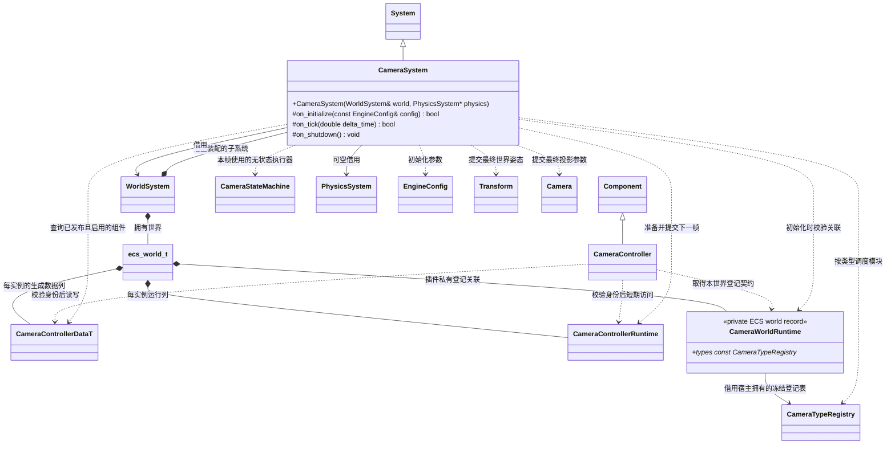
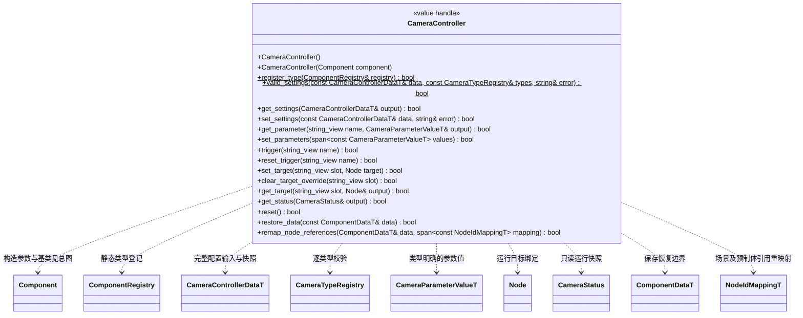
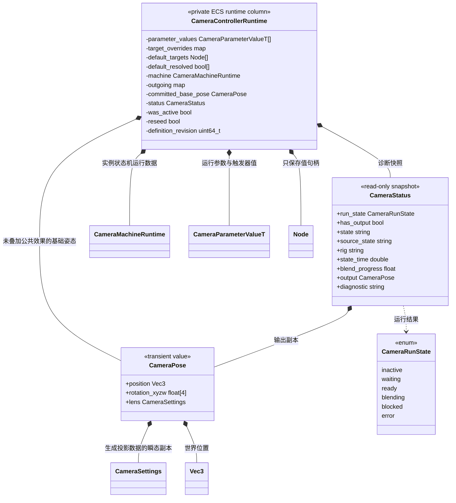

# 参数驱动相机插件

[类图索引](../../../class-diagrams/index.md) · [状态机与配置](camera-state-machine.md) · [C++ 模块组合](camera-modules.md) · [TS 接口](camera-script-api.md) · [编辑器接入](../../editor/class-diagrams/camera-controller.md)

**状态：已实现；验证范围见[测试文档](../../../testing.md)。** 本页及关联图定义当前契约。Schema、原生插件、编辑器、MCP、TS 与公开范例使用同一版本。

相机能力归独立运行时插件 `engine::plugins::camera`。普通相机节点组合 `Transform`、核心 `Camera` 和 `CameraController`；控制组件保存完整配置，C++ 根据参数评估状态机、组合镜头模块并提交最终视角。没有脚本插件时，同一份场景配置也能直接运行。

新加组件默认为完全空的未配置状态，不驱动相机；只有完整配置成功后才运行。全空配置与完整有效配置可以保存，部分填写却缺少初始状态等必要项的配置必须拒绝。

## 职责与所有权

- `CameraController` 是值句柄，不拥有模块对象、状态机对象或虚函数表。真实配置唯一存于生成的 ECS Data 列；运行时索引、参数值和缓存存于领域 Runtime 列。
- `CameraSystem` 只负责准备、求解、混合及输出。状态机执行器和各模块不直接写真实相机；同一个受控相机的姿态与投影只由该系统提交。
- 宿主先创建 `CameraTypeRegistry`、显式登记所需类型并冻结，再调用插件入口 `register_camera_components(WorldSystem&, const CameraTypeRegistry&) -> bool`，关联世界并复用 `ComponentRegistry::add<CameraController>()`。同一世界不能重复绑定不同登记表；失败保留原关联。登记表必须活到该世界关闭之后，不建立进程全局表或通用服务定位器。
- `PhysicsSystem` 可空，纯固定镜头等不需要物理。启用要求物理查询的模块时必须具备已初始化的物理系统；缺少能力明确报告，不静默关闭避障。
- 宿主选用具体插件实现。角色、脚本和编辑器只消费组件、数据及登记契约，不查找或向下转型默认 `CameraSystem`。可替换不包含运行时卸载代码、ABI 兼容或状态迁移。

## 组件公开契约

所有可能失败的原生操作标注 `[[nodiscard]]`。失败查询清空输出；失败修改保留原有效状态。只读成员为 `const`。配置错误包含字段路径与原因；不以日志代替返回状态。

| 操作 | 契约 |
| --- | --- |
| `get_settings` | 返回独立生成数据快照，包含状态机、方案、模块配置、参数默认值和目标默认引用 |
| `set_settings` | 主线程安全点完整替换；先校验引用、类型、取值、模块能力并准备运行计划，成功后一次提交。成功重置到初始状态及参数默认值，清除触发器和目标覆盖；失败保留原配置、运行状态及输出 |
| `set_parameters` | 修改实例运行值；整批检查名字、类型、重复项及范围，全部通过才提交。不修改参数默认值，不重建方案，不接受 trigger 类型 |
| `trigger` / `reset_trigger` | 置位或清除声明过的触发器；重复置位合并为一个待消费事件 |
| `set_target` | 覆盖一个已声明目标槽。非空目标须是同一世界已发布且身份有效的 Node；允许跨已发布场景。`Node{}` 表示明确解绑 |
| `clear_target_override` | 撤销运行覆盖，重新使用该槽的持久默认引用；不同于明确解绑 |
| `get_status` | 返回当前已提交状态、过渡和输出的独立快照；不返回可变 Runtime 或 ECS 指针 |
| `reset` | 恢复参数默认值、初始状态及默认目标，清除触发器和模块历史；下一次更新重新求解。真实相机保留当前输出，直到新输出成功提交 |

普通参数每次提交立即成为本实例的运行值；相机更新入口取得一次只读快照。完整配置替换用于制作、加载或有意重设控制器，逐帧输入使用 `set_parameters`。定义替换不会隐式混合两张状态图；需要平滑切换的方案应预先放在同一状态机中。

## 实例运行状态与输出

`rotation_xyzw` 使用 `std::array<float, 4>` 保存归一化四元数，默认是单位旋转，不能用 Euler 角直接线性混合。`CameraSettings` 沿用核心生成类型；投影模式等离散项不做数值插值。`has_output` 在控制器首次成功提交前为 false，此时 output 只是安全默认值。

`committed_base_pose` 保存混合后、公共效果之前的基础姿态；最终成功输出只存于 `status.output`。目标覆盖按槽名索引，默认目标另存 Node 值句柄与解析标记；目标失效不会重新绑定同名实体。`outgoing` 是配置提交时按状态准备的转换索引。

`CameraRunState` 描述本控制器执行结果，属于运行诊断。`blocked` 表示约束未得到有效解，`error` 表示配置能力、查询或输出提交错误；`get_status` 成功只表示快照读取成功，不代表镜头当前可正常求解。目标缺失且尚未得到可用输出时为 `waiting`。各具体模块的阻尼、噪声等历史另存[类型化模块 Runtime 列](camera-modules.md)，不复制到配置中。

## 更新与生命周期

1. 玩法 C++ 或 TS 提交参数、触发器及目标。角色输入适配在物理前更新绝对观察角，并以同一角度计算移动方向。
2. 物理、动画及挂点更新完成，刷新世界变换；`CameraSystem` 再读取目标快照，评估条件和当前需要的方案。
3. 求解方案、处理过渡、施加公共效果及最终空间约束。数值、投影和相机组件身份通过校验后，在同一结构稳定阶段提交 Transform、Camera 和实例运行状态。
4. 角色视图适配更新本镜头的身体／头部／第一人称部件隐藏列表，然后执行音频观察点及渲染收集。

首批要求受控 Camera 位于场景根节点；目标不能是该相机或其后代，跨控制器目标依赖环也必须拒绝。独立目标槽可以分别表达跟随对象和瞄准对象，不能强制二者相同。普通原生查询只借用当前稳定阶段的数据，不把列地址或目标 Transform 指针保存到下一帧。

启用且已发布的控制组件按各自实例更新，不因存在多个组件就争抢一个全局相机。实际展示哪个 Camera 沿用 `Scene::set_active_camera`；一个控制器内的状态切换只改变同一个真实相机的输出。未被展示的控制器是否继续更新由其启用状态决定。

世界暂停时冻结状态时间、过渡和模块历史；不消费触发器，单帧参数仍丢弃。组件禁用时停止写相机并清除单帧值和触发器，保留普通参数；重新启用从初始状态重新求解并以当前视角播种模块，避免沿用过时速度。删除组件、普通场景卸载或系统关闭清理对应 Runtime 与输出占用，旧句柄不能控制同名的新实例。

## 场景、预制体与方案切换

| 场景需求 | 表达方式 |
| --- | --- |
| 探索、瞄准、对话、观察台、过场之间切换 | 同一控制器的状态分别引用不同 Rig；输入业务参数，按条件过渡 |
| 同一镜头方案供多个状态使用 | 多个状态引用同一个只读 Rig 定义，求解历史仍按状态实例隔离 |
| 同一方案用于多个角色或关卡 | 通过预制体复用组件配置；实例参数与目标绑定独立，首批不另建相机图资源类型 |
| 普通场景切换 | 新场景使用自身初始状态、参数默认值和活动 Camera，不继承前一场景的隐含设置 |
| 玩家与镜头常驻、目标属于新场景 | 保留原控制器实例，由调用方显式覆盖目标槽并提交场景参数；旧目标失效后不会绑定到新场景同 local ID 的对象 |
| 跨场景连续过渡 | 保留同一个常驻输出 Camera，待新目标已发布后执行图中显式过渡；旧场景卸载前可将离开端固定为当前输出，不持有已卸载目标 |

目标替换只作用于指定实例，重置受影响的追踪历史并从当前输出播种。是否切镜头或混合由状态图显式决定，不能仅凭目标名称变化自动切换方案。新目标尚未准备好时保持已提交输出，并允许图中的 `TargetValid` 条件选择固定的安全方案；安全方案也由项目配置。

原节点的 `PostProcessComponent` 继续保存画面参数；本轮 Rig 不接管后处理，也不增加全局画面配置。运行时修改不会自动写源场景或预制体；只有编辑器保存流程写源文件。控制组件保存的配置不包含当前状态、参数运行值、阻尼历史或混合输出。显式保存整个场景时，核心 Transform 和 Camera 仍按既有流程保存当前组件值；模板初始镜头由 Rig 中明确配置的位置和投影决定。

## 与现有角色功能的迁移边界

评审通过后，通用跟随、距离、俯仰约束、投影、避障和相机 Transform 写入从 `character_controller` 移到本插件。角色插件声明对相机契约的单向依赖；相机插件不引用角色、输入或脚本插件。

`CharacterCamera` 保留角色适配：命名主体槽、同帧观察角提交、角色状态到镜头参数的映射，以及第一人称表现分类。完整配置、角度接口与两个装配阶段统一见[角色与镜头衔接契约](character-integration-design.md)。观察角直接读写控制器已声明的 float 参数，输入适配按声明范围处理俯仰，缺少绑定或类型不匹配明确失败。

`CharacterCameraSystem` 仅根据已提交状态及绑定对象更新 `CharacterVisual` 对应的每镜头隐藏列表，不写 Transform 或投影。进入映射为第一人称的状态时即采用第一人称隐藏策略，离开时立即采用目的状态策略；切换失败保持原策略。角色身体继续投射阴影。无 CharacterCamera 的普通镜头仍隐藏仅供第一人称使用的部件，沿用现有角色可见性语义。

角色公开契约见所属图；旧求解器与旧字段已删除，同一相机只由 CameraSystem 提交。现有动画状态机仍是 TS 功能，本方案只借鉴参数与转换语义，不迁移它，也不新增跨领域通用状态机框架。
