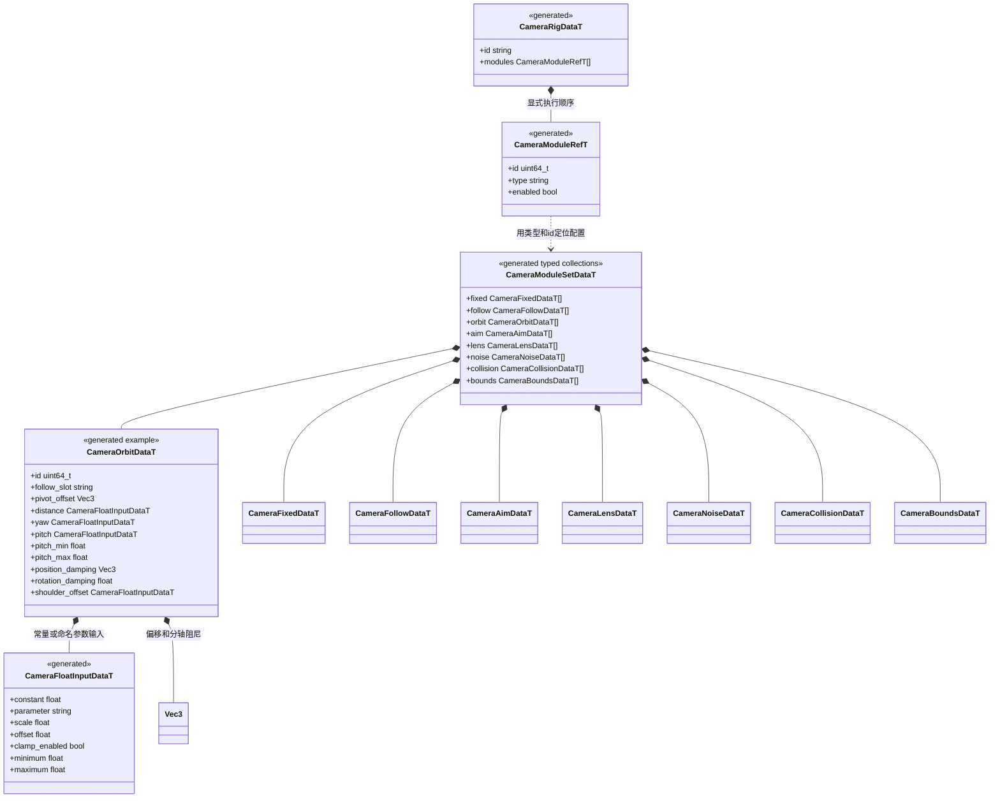
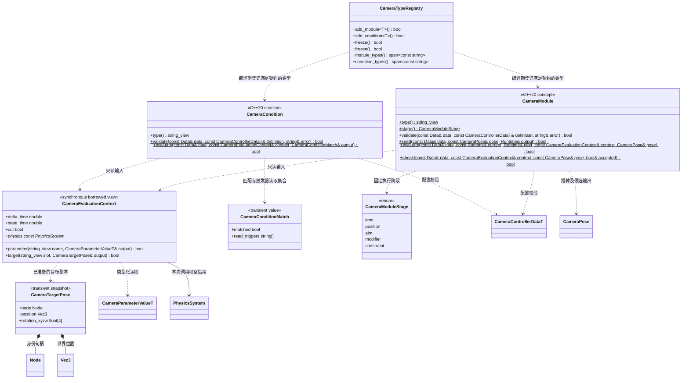
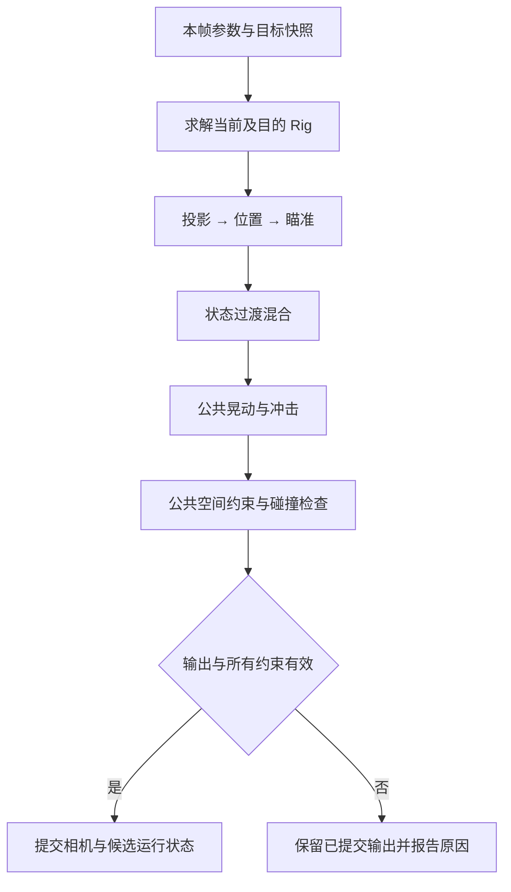

# 相机 C++ 模块组合与扩展

[相机插件总图](camera-controller.md) · [状态机与配置](camera-state-machine.md)

**状态：设计草案，待评审，尚未实现。** Rig 是一份可复用的生成配置，模块是独立 C++ 算法类型；两者均不展开为新的场景 Node 或 Component。场景上的入口保持一个 `CameraController`，没有脚本依赖或逐实例虚函数对象。

## 方案和类型化配置

每个模块配置具有稳定 id，在同一个控制器内唯一。相同配置可被多个 Rig 引用；配置不包含执行历史。`CameraModuleRefT` 只有顺序、身份与启用关系，不是保存任意值的容器。实际配置分别存生成的具体类型集合；不引入手写 JSON 配置、动态属性路径、宏反射或运行时 RTTI。

`CameraFloatInputDataT.parameter` 为空时读取 constant，否则读取已声明 float 参数并计算 `value * scale + offset`，再按显式开关限幅。不存在或类型不匹配的参数在配置时拒绝，不回退常量。结果仍须满足所属字段的物理范围。单位由字段确定：长度为米、时间为秒、角度为度；屏幕构图坐标采用归一化视口。

结构和普通参数由 `set_settings` 完整替换；需要逐帧调节的数值通过这种声明式绑定映射到运行参数。一个速度参数可以同时影响 FOV、距离及噪声强度，不必每帧遍历并改写整张配置。

## 最小 C++ 扩展契约

`CameraModule` 和 `CameraCondition` 是编译期约束的名字，不是拥有虚表的基类。具体类型分别声明 `using Data = schema::...DataT`；模块另声明自己的 `Runtime` 类型。登记适配器为具体类型建立数据访问、校验及调用表，不以不断增长的 switch 选择算法。表内部的类型消除只用于函数调度，不成为持久数据模型。

`add_module<T>()` 同时登记该类型的配置定位、阶段、能力要求及类型化 Runtime 列操作；`add_condition<T>()` 登记只读条件。具体类型独占自己的字段校验，组合框架只检查顺序和引用关系。重复类型键、未满足契约或冻结后增加类型返回 false。`freeze` 完成自检后固定登记集合；后续重复调用可成功，类型列表借用有效期不超过登记表。

运行模块按 `(控制器实例身份, 状态身份, 模块 id)` 保存历史，公共输出模块使用独立的公共作用域身份。ECS 为每种 Runtime 保持具体类型的实例集合，世界拥有这些列；不由 Component 句柄拥有。`current` 为只读已提交记录，`next` 是本次候选；失败丢弃候选。模块不能保存 context、Data 列或其他 Runtime 的借用，不能直接写 Camera、Transform、场景结构或业务参数。

实例创建、重新进入、目标替换及定义替换均通过 seed 从明确姿态建立运行状态；不读取未初始化历史。普通模块历史在状态退出并完成离开端混合后释放；公共噪声等历史在控制器整个启用周期内独立保留。

`check` 是 constraint 阶段类型必须提供的补充方法，其余阶段不要求实现。它只复核最终姿态，不修改运行历史；返回 false 表示查询错误，返回 true 且 accepted 为 false 表示约束不满足。登记时按阶段检查该契约，调度器无需理解具体碰撞或边界算法。

条件不拥有可变实例历史。需要记忆的判断用状态停留时间、参数或显式状态表达。`evaluate` 返回 false 是执行错误；返回 true 且 `matched == false` 才是条件未满足。只有触发器条件报告 read_triggers，组合与消费语义由状态机统一处理。

## 首批模块与参数范围

下表描述拟议职责和主要参数分组；所有类型各自独立文件并满足上图契约。各效果只有显式添加并启用后才执行。此处不是已实现功能清单。

| C++ 类型 | 阶段及职责 | 主要参数 |
| --- | --- | --- |
| `FixedCameraModule` | position：固定或目标相对视角 | 明确位置、旋转、可空锚点槽、局部偏移；无目标固定方案可作安全状态 |
| `FollowCameraModule` | position：第一人称或普通跟随 | 跟随槽、位置偏移、偏移空间、分轴位置阻尼、瞬移判定距离 |
| `OrbitCameraModule` | position：第三人称环绕 | 轴心偏移、距离、绝对 yaw/pitch 输入、俯仰上下限、肩部偏移、位置及旋转阻尼 |
| `AimCameraModule` | aim：跟踪瞄准与屏幕构图 | 独立瞄准槽、目标偏移、构图位置、死区／软区、旋转阻尼、世界上方向 |
| `LensCameraModule` | lens：投影参数 | 透视 FOV、正交尺寸、近远裁剪面；模式为离散配置，可用运行 float 参数驱动数值 |
| `NoiseCameraModule` | modifier：晃动与冲击 | 位置／旋转幅度、频率、种子、强度参数、单帧冲击输入及衰减；不消费状态转换触发器 |
| `CollisionCameraModule` | constraint：最终空间查询 | 球半径、余量、距离下限、碰撞过滤、忽略主体槽、收缩／恢复阻尼；相机碰撞和目标视线检测分别开关 |
| `BoundsCameraModule` | constraint：限制活动范围 | 世界或锚点局部盒、边界余量；首批仅盒体，不宣称任意网格约束 |

模块生成结构只声明本类型实际使用的参数；不接受未实现的参数或无效开关。Follow 与 Orbit 通常二选一；若同一阶段有多个模块，按显式顺序组合，每个类型负责声明和校验自身输入要求。首批每个 Rig 至少明确配置一个位置来源及一个 Lens；LookAt 可省略，保留位置模块给出的方向。

Lens 只写其声明的投影字段；Camera 的视锥裁剪开关仍使用核心组件上的设置。CameraPose 携带完整 CameraSettings 时，求解器从实际相机保留这些非投影字段，避免每帧被默认值覆盖。

状态图中 Parameter、Trigger、TargetValid、StateTime 四类条件分别对应 `ParameterCameraCondition`、`TriggerCameraCondition`、`TargetCameraCondition`、`StateTimeCameraCondition`，共用相同登记方式。轨道、多目标自动构图、复杂视线绕行和专用后坐力模型可以增加具体 C++ 类型，但不作为这批草案的内置实现承诺。

## 固定阶段与最终安全检查

Rig 列表按 lens、position、aim 阶段执行，顺序不能倒置，使屏幕构图使用本帧投影参数。控制器的 `output_modules` 只接受 modifier、constraint，保证混合之后仍处理噪声位移和穿墙风险。相同阶段遵守配置顺序；调度器不擅自重排。

最终约束按配置顺序求解后还要共同复核：不能用后面的边界修正破坏前面的碰撞约束。无共同可行解时报告 blocked。最后的碰撞检查包括相对上一已提交位置的运动扫掠与当前目标约束，不能仅检查两端 Rig 是否安全；阻尼和噪声不能在该检查之后再移动相机。

相机穿入碰撞体与相机到目标之间被遮挡是两项不同查询。首批 Collision 的视线策略限于向目标收缩并按延迟／阻尼恢复，不承诺自动绕复杂建筑找到最佳视角；更复杂的搜索作为独立模块扩展。忽略主体使用已有 `PhysicsQueryFilter` 的节点及后代过滤，默认不查询 sensor；不在相机插件内另写物理场景。

碰撞模块的运动扫掠不依赖跟随目标。目标失效时，目标相关的视线与距离约束标为不可评估，运动碰撞检查继续执行；状态图可以据此进入不依赖目标的固定方案。需要目标的 Follow、Orbit 或 Aim 仍须报告目标缺失，不能把原点当作目标。

起点重叠、移动障碍挤压以及多个约束冲突可能没有可行结果。模块必须明确失败或给出经过复核的结果；保留上一输出只是确定的失败行为，不能据此宣称上一位置在变化后的世界里仍安全。未启用碰撞约束时不提供防穿墙保证。

混合所需的两个 Rig 最多各求解一次；公共效果与约束每帧只执行一次。查找与字段绑定在配置成功时准备，候选存储复用已有容量，不在逐帧路径扫描整张状态图的所有方案或复制全部持久配置。

## 增加一种类型

新增模块时，补充其 FlatBuffers 生成配置、具体 C++ 类型及 Runtime、逐类型字段校验，再由宿主 `add_module<T>()` 登记；条件同理。扩展保持单一版本，一次同步 Schema、生成数据、编解码、绑定、MCP 参数说明和所属类图，不支持任意二进制插件在运行中注入未知 Schema。

设计参考采用公开文档中的职责划分：[Cinemachine 相机组合](https://docs.unity3d.com/Packages/com.unity.cinemachine@6.7/manual/CinemachineCamera.html)、[Decollider](https://docs.unity3d.com/Packages/com.unity.cinemachine@6.7/manual/CinemachineDecollider.html)、[Deoccluder](https://docs.unity3d.com/Packages/com.unity.cinemachine@6.7/manual/CinemachineDeoccluder.html)、[Unreal Gameplay Camera System](https://dev.epicgames.com/documentation/en-us/unreal-engine/gameplay-camera-system-overview)、[Phantom Camera](https://phantom-camera.dev/overview/what-is-this)、[Dolly drivers](https://docs.rs/dolly/0.6.0/dolly/drivers/index.html)。本草案采用本引擎的 C++、Schema 和 ECS 契约，不引入这些项目的源码或私有参考内容。
