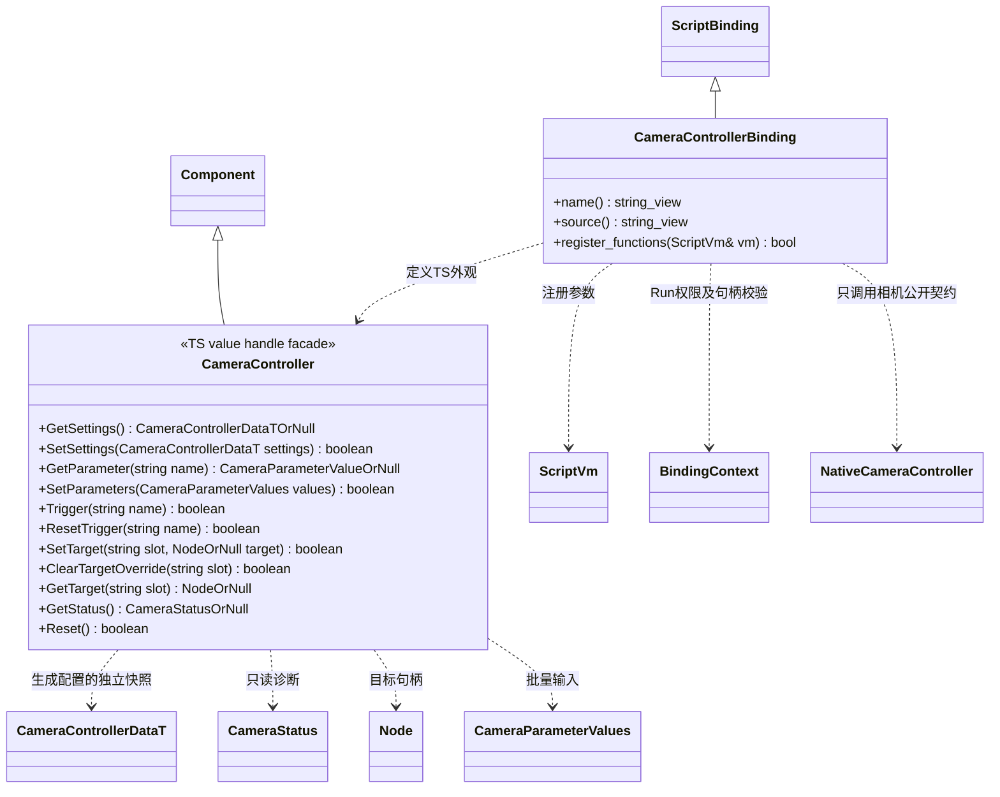

# 相机控制脚本接口

[原生相机类图](camera-controller.md) · [状态机与配置](camera-state-machine.md) · [逐类绑定](script-bindings.md)

**状态：已实现；验证范围见[测试文档](../../../testing.md)。** 本页定义当前 TS 外观；`include/engine.d.ts` 只声明已实现的绑定。相机的执行与运行状态仍由原生插件管理；TS 只读取配置、提交参数、绑定目标或显式替换定义。



`NativeCameraController` 指向 `engine::plugins::camera::CameraController`，不增加转发类。绑定归 `engine::plugins::script::bindings`；同时选择脚本与相机插件时才创建相应绑定目标，显式声明对相机契约的依赖。关闭脚本插件不影响相机运行，关闭相机插件不强制脚本启用它。

图中简写类型对应以下 TS 定义：`CameraParameterValueOrNull = number | boolean | null`，`CameraParameterValues = Readonly<Record<string, number | boolean>>`，`NodeOrNull = Node | null`，其余 `OrNull` 为对应类型与 null 的联合。`CameraControllerDataT` 是 Schema 生成的对象数据类型；字段及嵌套状态机直接由同一 Schema 导出，绑定提供符合该生成类型的快照，不手写另一份配置接口。`CameraStatus` 是原生只读快照对应的脚本数据。

- 使用普通 `node.AddComponent(CameraController)` / `GetComponent(CameraController)`，不新增脚本 Behaviour 或自定义组件继承体系。
- `SetParameters` 根据声明验证 number 对应 float 还是 int，拒绝未知参数、错误类型、非有限值或越界值；一项不合法整批不生效。trigger 必须通过 `Trigger` 写入。
- `SetTarget(slot, null)` 明确解绑；`ClearTargetOverride(slot)` 恢复该槽的场景默认值。`GetTarget` 对无绑定或失效目标返回 null；不恢复已卸载场景的旧句柄。
- `GetSettings` / `GetStatus` 返回独立快照，读取失败为 null。修改返回的配置对象后，必须显式 `SetSettings` 才会提交；修改 status 对原生状态无效。
- `SetSettings` 同步执行原生完整校验，失败返回 false 并保留原状态；此入口与编辑器使用同一契约。运行时配置修改不自动保存源资源。
- TS 热重载只结束旧 Run 的脚本引用，不重建仍存活的原生相机组件；若玩法重建场景，则按组件身份正常销毁和创建。C++ 相机 Runtime 不保存 JS 对象、闭包或 VM 句柄。

以下仅表示接口使用方式，当前不可直接运行：

```typescript
const camera = cameraNode.GetComponent(CameraController);

// 配置中的状态机选择方案；业务不逐帧指定状态名。
if (!camera.SetParameters({ speed, aiming, in_dialogue: inDialogue })) {
    return false;
}

// 特定动作以已声明的触发器表达。
if (inspectPressed && !camera.Trigger("inspect")) {
    return false;
}
```

首次模板制作可由 MCP 写完整定义并保存到场景／预制体；之后 C++ 或 TS 只提交业务参数。需要由 TS 生成整张状态图时，同样构造生成配置并调用 `SetSettings`，不建立仅能由 TS 执行的第二种相机状态机。常规接口不提供绕过条件的 `SetState`，调试通过参数和只读状态查询完成。
