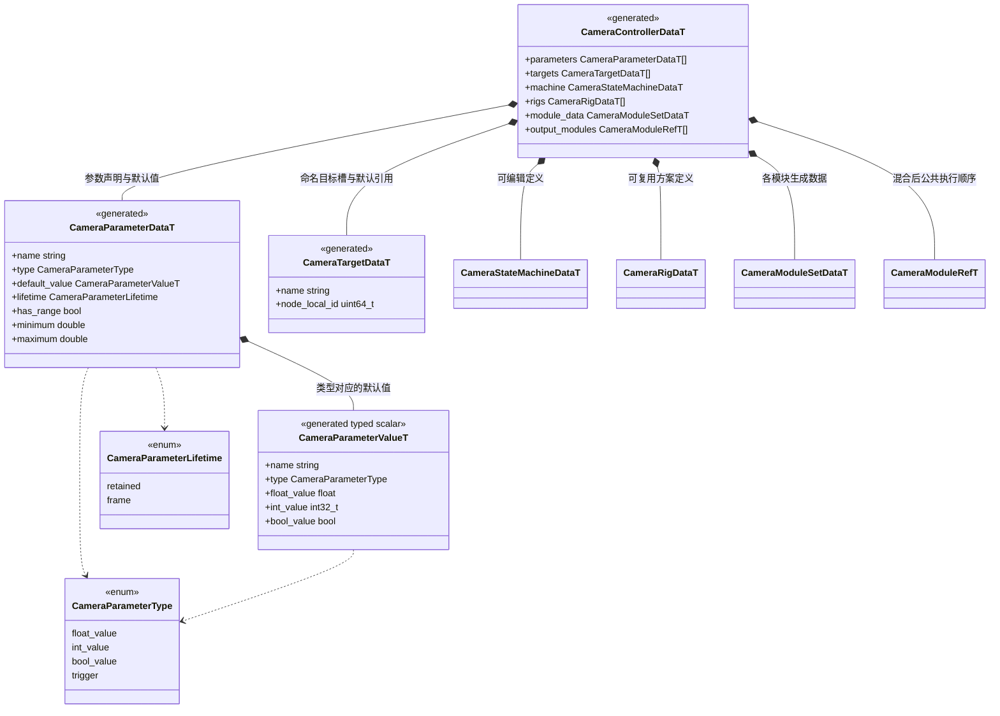
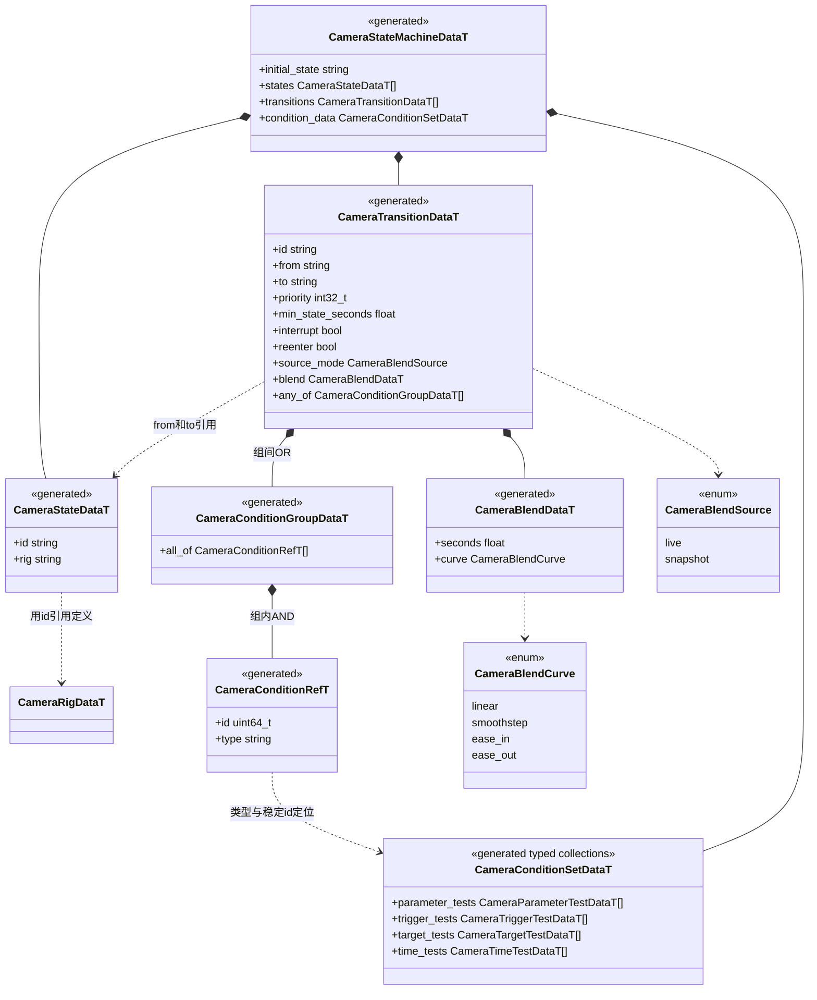
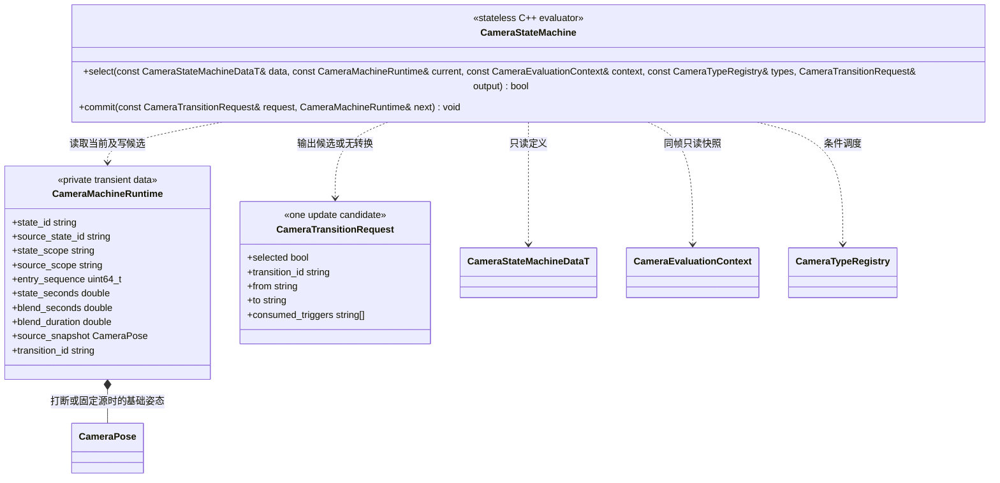

# 相机状态机与配置数据

[相机插件总图](camera-controller.md) · [C++ 模块组合](camera-modules.md) · [TS 接口](camera-script-api.md)

**状态：已实现；验证范围见[测试文档](../../../testing.md)。** 状态机定义向场景、预制体、C++、TS 和 MCP 开放；执行过程、当前状态和混合缓存由 C++ 管理。只使用命名参数、声明式条件及显式登记的 C++ 条件类型，不保存脚本回调或虚拟机对象。

## 唯一持久模型

以下 `*DataT` / `*ValueT` 均由 `include/schemas/runtime/camera.fbs` 生成，组件载荷接入当前运行时场景 Schema。字段内容直接存 ECS 生成数据列，不另建手写的持久 C++ 或 TS 模型。

参数值用枚举与明确标量字段表达，只有对应类型字段可以非默认；它是生成的轻量数据结构，不是动态反射对象。所有名字在其所属集合内唯一；状态、Rig、模块和条件用稳定标识引用，重排数组不能改变身份。运行计划可缓存查找索引，但不维护第二份配置来源。

| 类型或生命周期 | 规则 |
| --- | --- |
| float | 有限数值；C++ 为 float，TS number 在绑定边界检查范围和可表示性 |
| int | `int32_t` 范围内的整数；不将浮点自动截断 |
| bool | 仅布尔值，不接受 0/1 替代 |
| trigger | 默认 false；只由 `trigger` / `reset_trigger` 操作，成功转换消费，否则保留；不能配置为 frame |
| retained | 运行值保持到下一次写入或显式重置 |
| frame | 单次相机更新使用的增量或脉冲，默认必须为数值零或 false；无论求解成功与否，更新结束后归默认，暂停时也丢弃 |

连续输入的单位由具体模块参数定义。首批 Orbit 的 yaw/pitch 是绝对角度；鼠标增量与摇杆角速度由调用方或原生角色适配换算。相机不直接读取 InputSystem，也不把同一增量在多个物理子步或两端求解中累计多次。

## 状态、条件与转换

`from` 为空表示 Any State，`to` 必须存在。`any_of` 至少包含一组，单组空 `all_of` 明确表示无附加条件；实际项目可组合参数、触发器、目标有效性及状态停留时间。参数条件允许同类型比较，bool 只支持相等或不等，float 相等必须显式给容差。否定触发器不属于首批条件；目标有效性条件可以显式要求无效。自定义判断通过[条件类型登记](camera-modules.md)增加，组合器不嵌入项目判断。

每种条件的配置是独立生成结构，具有 `id` 及其专属字段：参数条件保存 `parameter / comparison / value / tolerance`，触发器条件保存 `parameter`，目标条件保存 `slot / expected_valid`，时间条件保存 `comparison / seconds`。它们在 `CameraConditionSetDataT` 中按具体类型存储；条件引用只用于执行顺序，不把动态 union 放进持续运行的 ECS 数据。

## 执行器与实例记录

`select` 返回 bool 表示评估过程是否成功；成功且 `selected == false` 表示本帧没有转换。条件评估错误不是条件为假。`commit` 只写候选运行记录，真实发布由 CameraSystem 在所有输出预检成功后完成；失败不推进原状态或消费触发器。

每次进入状态递增 `entry_sequence` 并产生新的 `state_scope`；混合期间保留 `source_scope`，保证重入相同状态也不复用上次的模块历史。成功提交后清理已退出的作用域。

转换规则统一如下。

1. 同帧普通参数、触发器和目标有效性只取一个快照。条件同步、只读，不创建节点、不修改参数、不保存上下文指针。
2. 合并当前状态与 Any State 的出边，按 priority 从高到低、定义顺序从前到后评估。每帧至多启动一条转换；相机不使用动画的 normalized exit time，停留限制使用秒。
3. `reenter == false` 时忽略目标等于当前逻辑状态的转换。正在混合时只评估 `interrupt == true` 的出边。
4. 第一条条件满足的候选先准备目的方案、模块运行状态及最终输出。准备失败保持原状态和触发器，报告失败，不在同帧暗中改选低优先级方案。
5. 成功开始转换时，逻辑状态成为目的状态，`state_seconds` 归零，之后从目的状态的出边判断；源端运行记录仅为完成混合保留。切换参数来回抖动应通过不同阈值与 `min_state_seconds` 明确约束。
6. AND 组全部满足才成立；OR 按声明顺序选择第一组成立的条件。只消费获选成立组中为真的触发器，未选分支、失败组或提交失败都不消费；重复触发合并消费一次。
7. 完整配置的初始状态必需存在，所有状态及 Rig 引用必须有效；完全空的未配置组件保持 waiting，不参与求解。项目需要安全状态时，显式配置目标失效等转换条件。

## 过渡求解

普通过渡的 `source_mode == live` 时，两端继续使用本帧目标求解；`snapshot` 则固定离开瞬间的基础姿态，适合离开即将卸载的场景。两端所有 Runtime 按状态身份隔离，即使引用相同 Rig 也不会共享阻尼历史。

打断正在进行的过渡时，强制从当前已混合的基础姿态继续到新目的端，不建立无限增长的混合链。基础姿态不含公共噪声；公共效果每帧仅施加一次。最终约束在新一帧混合与效果之后执行，不能把“捕获最终输出”再叠加一次噪声。开始帧以已提交的最终视角校准输出，避免切换瞬间重复偏移。

位置按配置曲线插值，旋转使用最短弧四元数混合；同一投影模式下插值 FOV 或正交尺寸及裁剪面，并保持合法范围。透视与正交之间首批只允许 `seconds == 0` 的 cut，非零混合在配置校验时拒绝。`seconds == 0` 表示切镜头，但仍要经过本帧最终约束及输出校验。

候选运行记录与模块历史采用准备／提交方式：失败帧不污染当前阻尼、随机序列或过渡时间。普通帧更新同样遵守此规则。状态/过渡诊断在成功提交后更新，失败原因单独写诊断字段。

## 一个场景的配置例子

以下是项目数据示例，不是引擎内置状态或业务硬编码。

| 状态 | 引用方案 | 典型进入条件 |
| --- | --- | --- |
| `explore` | `third_person` | 非对话、非瞄准且非第一人称 |
| `aim` | `shoulder_aim` | `aiming == true` 且非对话 |
| `first_person` | `eye_view` | `first_person == true` 且非对话 |
| `dialogue` | `dialogue_shot` | `in_dialogue == true`，优先级高于普通操作 |
| `safe` | `fixed_safe_view` | 必需目标无效；恢复后按业务参数离开 |

移动速度可以连续驱动 FOV 或跟随距离；后坐力和晃动通过参数驱动模块，不为每个强度建立一个状态。首批为单层状态机；嵌套状态、并行状态层、图资源热迁移及过场时间轴不在这份设计中。
