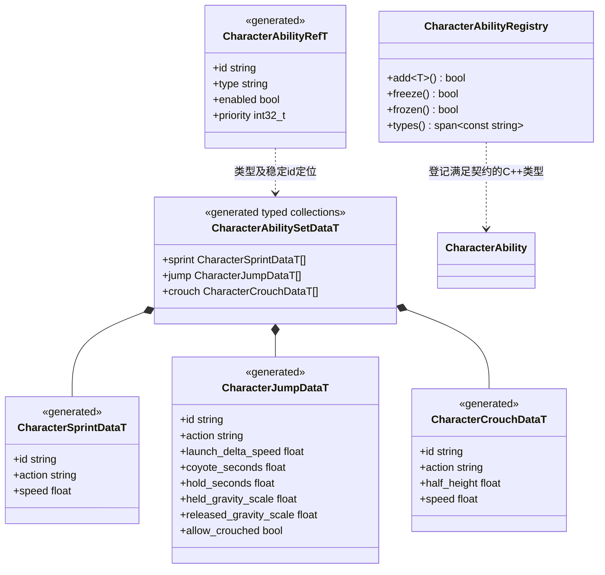
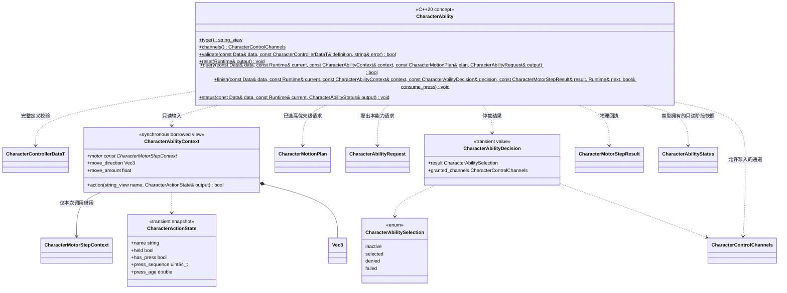
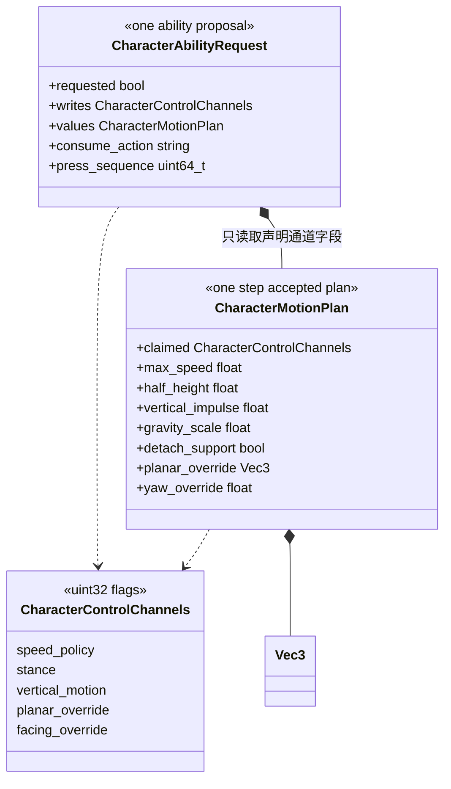

# 角色能力组合（设计草案）

[角色控制总图](character-control-design.md) · [固定步物理接口](../../../runtime/class-diagrams/character-motor-control.md)

**状态：设计草案，待评审，尚未实现。** 能力是 C++ 算法类型、生成配置和实例 Runtime 的组合，保存在一个 CharacterController 的内部。场景只配置类型、参数、启用关系、输入动作和优先级，不为每项能力创建 Node、Component 或脚本实例。

## 配置与登记

配置均由运行时 Schema 生成并直接保存在角色 Data 列中。id 在控制器内唯一；保留同 id/type 表示修改现有配置，删除后重新加入则创建新的 Runtime，不恢复旧历史。同类型配置可以有多个实例，但按控制通道互斥。实际数据按具体类型存储，引用只保存类型和 id，不使用动态 union、任意 JSON 或通用属性反射作为长期模型。

动作名称引用控制器声明的 CharacterActionDataT；输入缓冲秒数只在动作声明保存，JumpData 不再维护另一份相同字段。未知类型、未知动作、重复 id、非法范围和缺少必要字段使整份配置失败。

每种算法独立文件，通过 add<T>() 同时登记生成数据定位、字段校验、运行列及调用操作。重复类型或冻结后登记返回 false；表由宿主拥有并在场景运行前冻结，不支持运行中加载未知 Schema 的二进制类型。

## 统一 C++ 契约

CharacterAbility 是编译期约束，不是有虚函数表的实例基类。每种类型声明自己的 `Data = schema::...DataT` 和 Runtime。Runtime 是按控制器实例与能力 id 索引的具体类型 ECS 列，由世界拥有，不能存回生成配置。

query 只读当前记录及高优先级已接受的计划，不消费动作、不产生外部副作用。返回 false 是执行错误，返回 true 且没有请求表示当前不需要该能力。finish 在物理步完成后构造下一份领域记录，并用 consume_press 回执本次请求是否可以消费；无资源加载、场景修改或物理查询。所有仍存在的启用能力都收到决定和回执，包括本步未选中的能力，以便推进或结束自己的阶段。reset 产生确定的安全状态。

持续能力每步重新参与通道仲裁；失去通道后不能沿用旧 active 状态继续提交。具体 finish 根据 denied 决定结束或等待，状态快照明确表示结果。status 由具体类型生成自己的阶段说明，框架不解析私有 Runtime 或维护类型分支。

## 控制通道与请求

每步从基础移动配置、当前有效姿态和零一次性动作建立计划，随后按 priority 降序、配置顺序升序处理能力。请求写入范围不得超出类型登记的 channels；当前请求与已占用通道重叠时整项拒绝，不拆成半个技能。没有被能力声明的字段不能偷偷生效。planar_override 和 facing_override 只在相应通道获准时使用。

高优先级能力提交的期望姿态和速度限制对后续 query 可见；涉及净空与地面条件时还必须检查 context 中的真实物理状态。动作 press 也按名称与序列独占：同一个 press 不能被两个能力消费。只有获选、固定步成功且 finish 回执 consume_press=true 时，调度器才消费请求中匹配的序列；未选、前置条件未满足、准备失败均保留到缓冲窗口结束。Jump 以 impulse_applied 确认，不能把即将发出的请求当作已起跳。

能力计划完成后，基础运动算法按该步参数计算主动加减速，再应用明确的水平／朝向覆盖，形成一份 CharacterMotorCommand。实例状态在 finish_step 后发布。正常的碰撞阻挡不回滚已执行物理；例如站起失败保留矮胶囊，同时正常反馈本步移动结果。

基础运动始终存在，地面／空中采用不同参数。空中速度上限限制新的主动加速目标，不瞬间截掉已经拥有的速度、平台携带速度或外部冲量。动画使用实际物理速度，不能把主动请求速度当作真实行走结果。

## 首批能力行为

| 类型 | 通道 | 行为与关键参数 |
| --- | --- | --- |
| `SprintAbility` | speed_policy | 持有动作且在可站立地面移动时使用配置速度；失去条件后回到基础速度目标，变化仍经过加减速 |
| `CrouchAbility` | stance、speed_policy | 持有动作请求较矮胶囊；松开请求基础半高。实际仍未站起时继续维持蹲姿速度限制 |
| `JumpAbility` | vertical_motion | press 配合实际地面或离地宽限提出一次竖直速度增量；可按持有时间与释放状态选择重力倍率 |

建议模板将蹲姿优先级置于快跑之前，二者争用 speed_policy；Jump 查询高优先级计划以及真实姿态，allow_crouched=false 时，对已蹲下或正在请求蹲下均不启动跳跃。能力优先级与是否启用都属于场景配置。

Crouch 的半高必须落在 Motor 有效范围内且小于其基础半高；离线先验证字段范围，绑定到具体 Motor 时再核对两者关系，不通过时保持原有效配置或停止该实例主动控制并报告。

Jump 的 coyote_seconds 是最后有效地面离开后的有限宽限；主动起跳后不能再次用同一宽限启动第二跳。落地缓冲在下一次实际具备条件的固定步消费，始终保留“一次 press 最多起跳一次”的约束。hold_seconds 有上限，松开后按 released_gravity_scale 处理，不直接截断外部竖直速度；到达顶点或碰顶后结束持有阶段。launch_delta_speed 表示速度增量，离地补跳时仍保留原有竖直运动，不能据此保证所有补跳具有完全相同高度。

Sprint、Crouch 的 held 是持续意图；Jump 的 pressed 是有限缓冲事件。临时取消输入、组件禁用、世界暂停、目标失效或传送会清空待动作，防止恢复时执行旧按键。取消输入不承诺立即站起：物理尺寸恢复仍须通过净空检查。

`CharacterAbilityStatus` 为只读运行值：`id:string`、`active:bool`、`phase:string`、`remaining_seconds:double`、`selection:CharacterAbilitySelection`。phase 由具体类型定义有限名称并在其契约登记，remaining_seconds 非负且只在有定时阶段时使用；该值仅用于观察，不允许外部强制修改阶段。角色状态查询按类型登记生成这些快照，不暴露具体 Runtime。

## 扩展边界与参考

增加能力需要：生成配置、独立 C++ 类型及 Runtime、输入声明与通道契约、显式登记，以及对应的保存／脚本／MCP 字段支持。框架只仲裁与调度；不增加技能名字的大 switch。短时水平冲刺可通过 planar_override 形成普通 Motor 请求并继续接受碰撞，不能直接传送节点模拟冲刺。

动作资源、伤害判定、背包、冷却 UI、任务与网络预测不归这层基础移动组合。新增攀爬或 Root Motion 时，如现有 CharacterMotorCommand 无法准确表达其运动，先扩展所属类图，不绕过物理层。

本轮参考 [UE 5.8 Mover 的 Movement Modes 与 Layered Moves](https://dev.epicgames.com/documentation/unreal-engine/mover-features-and-concepts-in-unreal-engine)对基础运动与附加运动的职责区分；本方案的组件、Schema、固定步接口和仲裁契约为本引擎设计。[Mover 当前仍为实验功能](https://dev.epicgames.com/documentation/en-us/unreal-engine/mover-in-unreal-engine)，本项目不引入它或其网络框架。
