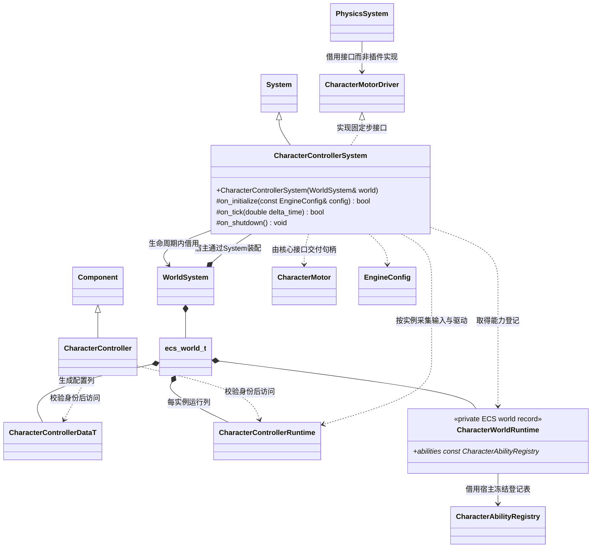
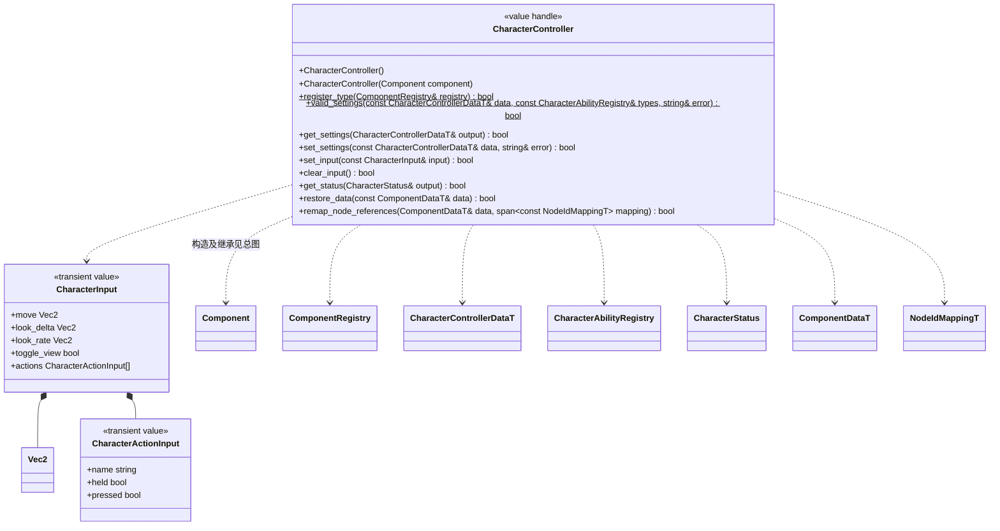
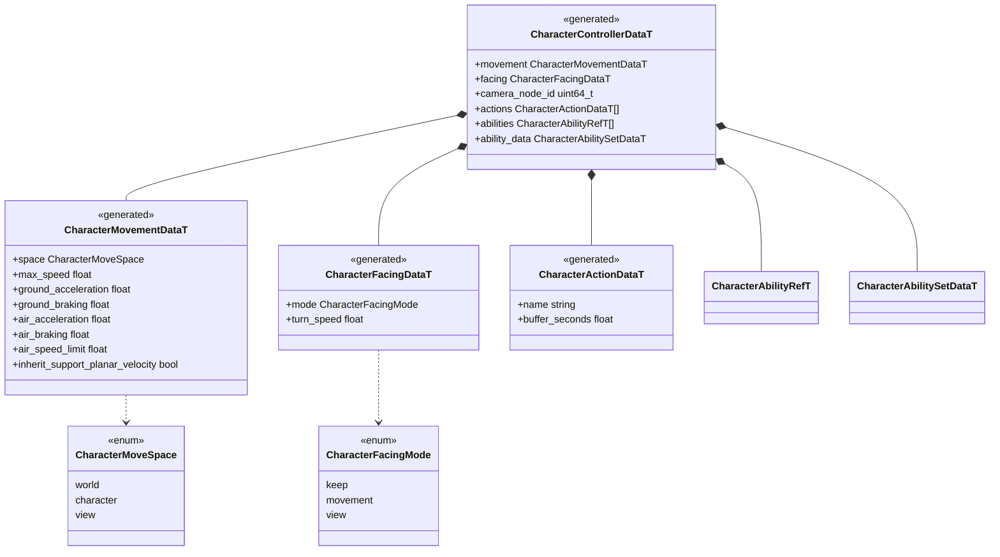
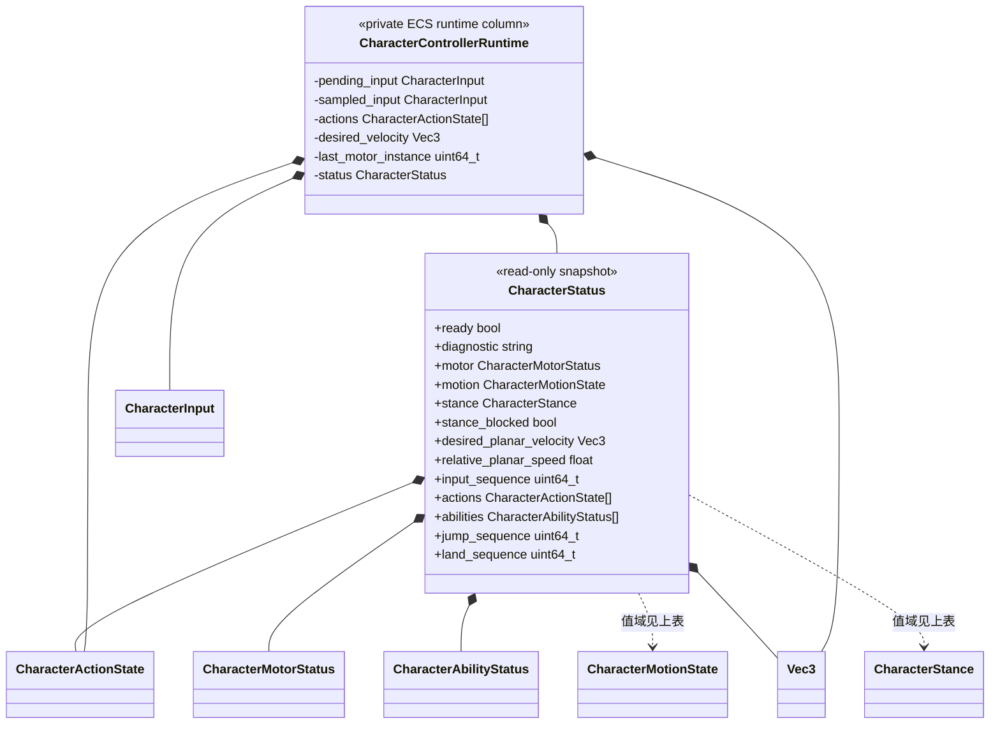

# 参数化角色控制（设计草案）

[类图索引](../../../class-diagrams/index.md) · [当前实现](character-controller.md) · [能力组合](character-abilities.md) · [固定步物理接口](../../../runtime/class-diagrams/character-motor-control.md) · [镜头、动画与脚本衔接](character-integration-design.md)

**状态：设计草案，待评审，尚未实现。** 目标是可复用的第一／第三人称基础角色。运动与能力由 C++ 实现，配置随普通组件保存到场景／预制体，C++ 与 TS 通过相同契约提交输入。继续扩展运行时 `character_controller` 插件，复杂资产制作归 DCC，角色控制不接管动画资源制作。

原生控制与能力类型位于 `engine::plugins::character_controller`；Schema 生成数据继续位于 `engine::schema`。

## 职责划分

| 层级 | 负责的事情 | 状态所在位置 |
| --- | --- | --- |
| 项目调用方 | 输入通道、玩家与角色的对应关系、AI 意图、业务操作 | 项目 Gameplay 或明确的原生调用方 |
| CharacterController | 主动移动手感、朝向、能力组合、输入缓冲与结果查询 | 生成 Data 与本实例 ECS Runtime |
| CharacterMotor / PhysicsSystem | 胶囊、碰撞、坡度、台阶、贴地、支撑与真实运动结果 | 核心物理域及 Motor Runtime |
| CharacterCamera / CameraController | 角色观察输入与参数映射／通用镜头求解 | 各自组件，镜头状态归相机插件 |
| Animator 与动画状态机 | 动作选择、播放混合和骨架姿态 | 已有动画与脚本运行域 |

角色骨架和美术模型挂在物理根节点的普通子节点；身体、头部、第一人称部件继续用 CharacterVisual 标记。首批不增加 Character、Player、Pawn、AbilityManager 等平行对象层，也不把每项能力做成一个场景组件。

## 系统与实例关系

宿主创建并冻结 CharacterAbilityRegistry，调用 `register_character_components(WorldSystem&, const CharacterAbilityRegistry&) -> bool` 关联世界并复用逐组件登记入口；表存活到世界关闭之后。Component 句柄不拥有行为对象。能力数据、运行状态和登记调度方式见[能力类图](character-abilities.md)，核心接口方法仅在[物理类图](../../../runtime/class-diagrams/character-motor-control.md)定义。

CharacterControllerSystem 的 on_tick 只取得本帧输入、更新观察参数并准备运动意图；实际加减速、能力计时和主动请求在 prepare_step 中计算。finish_step 根据物理回执提交能力历史及角色状态，reset 仅清理匹配实例的运行数据。模块不能写根节点 Transform。

## 组件与输入接口

所有失败操作返回状态并标注 [[nodiscard]]；失败读取清空输出，失败修改保留旧值。const 查询不返回 Runtime 指针。

- move.x 向右、move.y 向前；分量在 [-1,1] 内，长度大于 1 时归一化，保留较小模拟量。观察增量与观察速率分别传入，鼠标增量不乘 delta_time，速率按帧时间积分，换算参数归 CharacterCamera。
- set_input 原子检查完整输入、动作名称和重复项，成功替换本帧待输入。每实例由调用方汇总一份输入；同帧多次成功提交以最后一次为准，动作合并由调用方完成。未知动作拒绝，不猜测按键。
- 帧入口没有新输入时，移动、观察、held 与 toggle_view 归零。已由前帧收入缓冲的 pressed 不因此删除；clear_input、暂停或控制停止才明确清空它们。
- 动作声明决定缓冲秒数，每动作最多保存一个待处理 press；再次按下更新该记录，不积累无限队列。buffer_seconds=0 仍允许下一实际固定步尝试一次；正数窗口使用已步进的仿真时间，到期丢弃。held 在该渲染帧的所有物理子步内保持同一个快照。
- clear_input 取消本组件主动水平速度计划及待消费动作，保留 Motor 的外力；已生效的起跳继续受物理控制，持有能力按空输入处理释放。它的 bool 表示身份与操作是否有效。组件禁用或删除时按完整实例身份释放控制。

同一世界的多个控制器各自消费自己的输入。取消现有系统级 set_player/set_input 和隐式“唯一玩家”选择；玩家切换由调用方先清旧组件输入，再向新组件提交。单玩家模板仍只绑定一个节点，不因场景存在多个控制器就广播输入。AI 也可以向显式配置为 world 空间的同类控制器提交意图；这不等于已经提供 AI 或多人网络。

## 持久配置与运行结果

这些结构拟由 `include/schemas/runtime/character_controller.fbs` 统一生成，直接存 ECS Data 列。名字与模块 id 在所属集合内唯一；配置中的相机引用是所属场景 local ID，复制预制体时重映射。view 空间或 view 朝向明确要求有效的 CharacterCamera 绑定；缺少引用时报告并暂停主动控制，不转向新场景同 local ID 对象，也不自动改用另一种坐标系。

首批加速度和制动为 m/s²，转向为度/秒；ground/air 两种物理条件选择相应参数。空中改变方向只能通过配置的加速度改变主动速度，不能覆盖外部冲量和平台携带速度。停止输入使用制动，clear_input 表示明确取消主动意图，不再执行一段隐式滑行。

set_settings 在主线程安全点完整校验后提交；相同 id/type 的能力保留实例历史并在下一固定步读取新参数，新增或类型改变的能力从安全初态开始，删除的能力停止提出主动请求。必要的运行尺寸恢复依照物理类图处理，不能因为删除蹲姿配置就强制穿过头顶。失败保留原配置与运行状态。restore_data 是加载／重建边界，清除瞬态历史；两者语义不同。

仅调整现有数值参数时保留有效输入；改变动作集合、能力身份或动作绑定时清空待输入与 press 缓冲，等待调用方按新配置重新提交，避免旧动作意外触发新能力。

默认控制器具有基础行走参数，能力列表为空；跳跃、快跑和蹲姿均需显式配置并启用。仅添加控制组件不会隐式打开这些能力。

`CharacterControllerRuntime` 保存待输入、每帧快照、动作序列与过期时间、主动速度计划、朝向及状态；具体能力历史另存类型化 ECS Runtime 列。`CharacterStatus` 是独立只读快照，包含：

| 字段 | 含义 |
| --- | --- |
| `ready / diagnostic` | 角色是否具备有效控制链及失败原因 |
| `motor` | CharacterMotorStatus，包含最近物理 step 与实际速度、支撑和尺寸 |
| `motion` | unknown / grounded / rising / falling，从物理结果派生；未获得物理结果时为 unknown |
| `stance / stance_blocked` | unknown / standing / crouched，以及本步尺寸请求是否受阻；只报告已确认的实际姿态 |
| `desired_planar_velocity` | 已提交的主动速度请求，不冒充碰撞后的实际速度 |
| `relative_planar_speed` | 相对当前支撑的实际水平速度大小；无支撑时使用世界水平速度 |
| `abilities` | 能力身份、active、阶段与仲裁结果的快照，用于动画、镜头和诊断 |
| `input_sequence / actions` | 最近采集的帧输入序列与动作状态，明确区别于 motor.step 对应的物理结果 |
| `jump_sequence / land_sequence` | 单调事件计数，分别记录已消费的起跳和实际落地，避免多子步时只看最终状态丢失边沿 |

状态字段是观察结果，业务通过输入驱动，不能直接把 motion 改成 grounded 或把 stance 改成站立。暂停时冻结仿真时间并清掉瞬态输入；常驻组件保留自身配置及有效身份，目标随场景卸载失效时停止对应主动请求。

## 首批范围与验收边界

首批设计覆盖行走加减速、空中控制、移动／观察方向朝向、显式快跑、跳跃缓冲与离地宽限、可控跳跃时长、蹲起净空检查，以及支撑平台速度与外部击退的分离。第一人称／第三人称是输入、朝向和镜头方案组合，复用同一个 Motor 与 Controller。

攀爬、游泳、飞行、翻越、战斗数值、装备、网络预测、Root Motion 和完整动画图不纳入首批。能力扩展受当前物理请求契约约束，新增运动种类先评审需要的物理能力。

实现阶段复用现有 physics 与 character_controller 用例，补充真实缺口：零／多物理子步的动作消费、不同渲染步长下相同固定输入序列、缓冲到期、受阻站起、平台离地速度、控制权交接及击退保留。最后在同一个第一／第三人称场景实际行走验收；本次仅设计，不记录未执行的构建或测试为通过。
