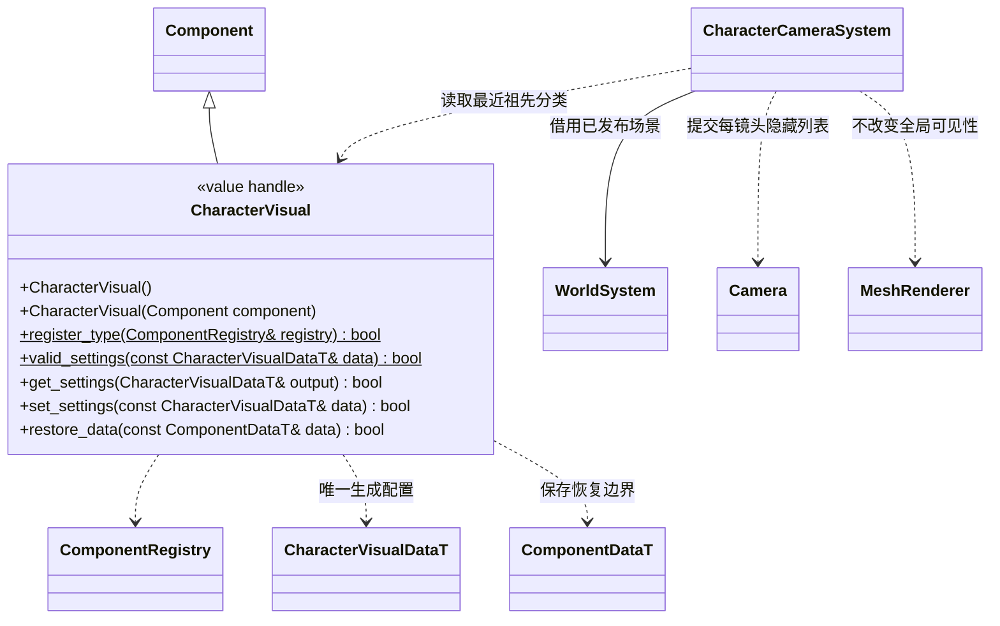

# 角色控制与角色表现

[类图索引](../../../class-diagrams/index.md) · [角色控制与输入](character-control-design.md) · [能力组合](character-abilities.md) · [物理驱动](../../../runtime/class-diagrams/character-motor-control.md) · [镜头、动画与脚本衔接](character-integration-design.md)

当前实现由参数化角色控制、核心固定步物理、通用相机与角色表现组成。Controller、Camera 适配器及系统的方法分别在上方所属图维护；本页只定义 CharacterVisual。运行时插件依赖 camera，不依赖脚本或编辑器。

CharacterVisual 使用 body、head、first_person 分类。子树采用最近祖先的标记，未标记的主体默认 body。进入 CharacterCamera.first_person_states 中的已提交状态后，只在该角色自己的镜头隐藏身体与头部；first_person 部件只向对应第一人称镜头显示。其他镜头仍看得到身体，身体继续投射阴影。

CharacterCameraSystem 在 CameraSystem 提交后更新每镜头隐藏列表；它不求解镜头、不写 Transform 或投影、不修改 MeshRenderer 全局可见性。禁用、删除组件或卸载场景时清除旧列表，完整组件身份防止旧句柄控制替换实例。

持久数据来自 runtime/character_controller.fbs 与 runtime/camera.fbs；运行输入、动作缓冲、能力计时和镜头混合历史只在 ECS Runtime。场景与预制体二进制只接受 schema_version=3，旧缓存重新导入。旧位置参数式 SetInput、系统级玩家选择、CharacterView 和旧 CharacterCamera 算法字段已删除，不提供转换分支或兼容别名。
