# 玩家控制、跟随相机与角色表现

独立相机插件的拟议结构见[参数驱动相机草案](camera-controller.md)。该方案尚待评审；本页继续描述当前已实现的角色与相机契约。

运行时插件 `engine::plugins::character_controller` 组织玩家输入与镜头策略，核心 `CharacterMotor` 提供玩家和 NPC 共用的运动能力。场景对象仍由普通 Node 和组件表达；NPC 不挂玩家输入组件。

```mermaid
classDiagram
    class CharacterController {
        <<value handle>>
        +CharacterController()
        +CharacterController(Component component)
        +register_type(ComponentRegistry& registry) bool$
        +valid_settings(const CharacterControllerDataT& settings) bool$

        +get_settings(CharacterControllerDataT& output) bool
        +set_settings(const CharacterControllerDataT& settings) bool
        +set_input(const CharacterInput& input) bool
        +clear_input() void
        +restore_data(const ComponentDataT& data) bool
        +remap_node_references(ComponentDataT& data, span~const NodeIdMappingT~ mapping) bool
    }
    class CharacterControllerSystem {
        +CharacterControllerSystem(WorldSystem& world)
        +set_player(Node node) bool
        +set_input(const CharacterInput& input) bool
        #on_tick(double delta_time) bool
    }
    class CharacterCamera {
        <<value handle>>
        +CharacterCamera()
        +CharacterCamera(Component component)
        +register_type(ComponentRegistry& registry) bool$
        +valid_settings(const CharacterCameraDataT& settings) bool$

        +get_settings(CharacterCameraDataT& output) bool
        +set_settings(const CharacterCameraDataT& settings) bool
        +synchronize_angles() bool
        +set_angles(double yaw, double pitch) bool
        +yaw() double
        +pitch() double
        +restore_data(const ComponentDataT& data) bool
        +remap_node_references(ComponentDataT& data, span~const NodeIdMappingT~ mapping) bool
    }
    class CharacterCameraSystem {
        +CharacterCameraSystem(WorldSystem& world, PhysicsSystem& physics)
        #on_tick(double delta_time) bool
    }
    class CharacterVisual {
        <<value handle>>
        +CharacterVisual()
        +CharacterVisual(Component component)
        +register_type(ComponentRegistry& registry) bool$
        +valid_settings(const CharacterVisualDataT& settings) bool$

        +get_settings(CharacterVisualDataT& output) bool
        +set_settings(const CharacterVisualDataT& settings) bool
        +restore_data(const ComponentDataT& data) bool
    }
    class Component
    class System
    class Node
    class WorldSystem
    class PhysicsSystem
    class CharacterMotor
    class Camera
    class MeshRenderer
    class CharacterControllerDataT
    class CharacterCameraDataT
    class CharacterVisualDataT
    class ComponentDataT
    class CharacterInput
    class NodeIdMappingT
    CharacterController ..> NodeIdMappingT : 重映射相机局部身份
    CharacterCamera ..> NodeIdMappingT : 重映射目标局部身份
    Component <|-- CharacterController
    Component <|-- CharacterCamera
    Component <|-- CharacterVisual
    System <|-- CharacterControllerSystem
    System <|-- CharacterCameraSystem
    Node ..> CharacterController : 按类型返回值句柄
    Node ..> CharacterCamera : 按类型返回值句柄
    Node ..> CharacterVisual : 按类型返回值句柄
    CharacterController ..> CharacterControllerDataT : 参数及返回类型
    CharacterCamera ..> CharacterCameraDataT : 参数及返回类型
    CharacterVisual ..> CharacterVisualDataT : 参数及返回类型
    CharacterController ..> ComponentDataT : 恢复参数
    CharacterControllerRuntime *-- CharacterInput : ECS中的瞬态待消费输入
    CharacterController ..> CharacterMotor : 按最近驱动实例身份取消主动意图
    CharacterCamera ..> ComponentDataT : 恢复参数
    CharacterVisual ..> ComponentDataT : 恢复参数
    CharacterControllerSystem ..> Node : 选择参数
    CharacterControllerSystem ..> CharacterInput : 输入参数
    CharacterControllerSystem --> WorldSystem : 借用
    CharacterControllerSystem ..> CharacterController : 仅选中的玩家
    CharacterControllerSystem ..> CharacterMotor : 物理前提交意图
    CharacterControllerSystem ..> CharacterCamera : 可选观察方向
    CharacterCameraSystem --> WorldSystem : 借用
    CharacterCameraSystem --> PhysicsSystem : 借用并做避障查询
    CharacterCameraSystem ..> CharacterCamera : 物理后更新
    CharacterCameraSystem ..> Camera : 当前视图隐藏列表
    CharacterCameraSystem ..> CharacterVisual : 子树内表现分类
    CharacterCameraSystem ..> MeshRenderer : 只读取稳定实例ID
    class ComponentRegistry
    class ecs_world_t
    class CharacterControllerRuntime {
        <<ECS runtime column>>
    }
    ecs_world_t *-- CharacterControllerRuntime : 实例运行数据
    CharacterController ..> CharacterControllerRuntime : 校验身份后短期借用
    class CharacterCameraRuntime {
        <<ECS runtime column>>
    }
    ecs_world_t *-- CharacterCameraRuntime : 实例运行数据
    CharacterCamera ..> CharacterCameraRuntime : 校验身份后短期借用
    CharacterController ..> ComponentRegistry : 静态登记类型操作
    CharacterVisual ..> ComponentRegistry : 静态登记类型操作
    CharacterCamera ..> ComponentRegistry : 静态登记类型操作

```

- `CharacterController` 只保存移动速度、跳跃速度、观察灵敏度和可空相机节点引用。`set_player(node)` 显式选中已发布世界的一个玩家，传默认 Node{} 解除选择，过期非空或跨世界句柄拒绝；未显式选择时只允许唯一启用玩家组件，多个候选返回失败，绝不广播一份输入。无相机时按角色朝向移动。输入每帧消费一次；控制器移除、禁用、替换、普通节点卸载或系统关闭，按场景/节点/组件实例身份撤销原主动意图，不能清掉 NPC 的请求或外部击退。
- `CharacterCamera` 挂在普通 Camera 节点，独立引用目标节点，可跟随没有玩家组件的 NPC 或其他物体。模式、眼高、距离、俯仰范围和避障参数由自己的 FlatBuffers 数据保存。观察角为瞬态；镜头在物理后取最终位置，第三人称使用现有 Jolt 球扫掠避障，第一人称位于目标眼高。
- `CharacterVisual` 标记身体、头部或第一人称手/武器，子树使用最近的标记，默认身体。第一人称只从自己的镜头隐藏身体/头部，第一人称手/武器仅向对应第一人称镜头显示。其他镜头仍看得到身体。本插件独占场景 Camera 的瞬态隐藏实例列表；过滤使用该列表，不修改 MeshRenderer 的全局可见性；角色身体继续投射阴影，禁用动画与可见性无关。
- 正式宿主按脚本/玩家意图、物理、动画、跟随相机、音频的顺序装配系统。核心不包含具体插件，插件的物理前/后安装入口由宿主提供；测试必须使用同一顺序。
- 原控制器中的相机参数迁移为相机节点上的 `character_camera`，其目标为角色节点；美术部件可挂 `character_visual`。二进制 schema 删除废弃字段；SceneData 与 PrefabData 只接受当前版本 2，默认版本 0 无效，旧缓存重新导入。不在运行时创建相机或修改场景结构。

## 输入链路

CharacterControllerSystem 不借用 WindowSystem，也不提供固定按键 fallback；调用方读取明确通道后，可向选中角色的 CharacterController 组件或直接向系统提交 CharacterInput，未提交时保持零输入。组件的 `set_input` 返回 bool，`clear_input` 为 `noexcept`；二者只管理瞬态意图，不进入 FlatBuffers 持久数据。`clear_input` 清除组件待输入，并按最近成功驱动的 Motor 实例身份清除其主动移动和未消费跳跃；不清除外部速度、待消费速度增量、未驱动角色或同节点替换后的 Motor。系统成功提交时记录该瞬态身份，不增加资源所有者。

系统作为组件 friend 消费输入，同帧显式系统提交优先于组件提交；所有组件的待输入每次系统更新后内部归零，未选中或禁用组件也不跨帧积压。日常消费不调用完整 `clear_input`，因而尚未发生物理子步的已排队跳跃会保留到固定步。停止驱动与系统关闭清除相关组件待输入及原 Motor 主动意图，不影响外部速度。

输入模块不选择玩家节点，多手柄可分别驱动多个输入通道；角色实例与通道关联、是否暂停和重连恢复由玩法决定。现有单玩家选择接口尚未扩展为完整多角色控制，不能把多设备输入写成多人玩法已实现。

常驻玩家与相机继续在原 Scene 中更新，选中玩家的组件实例和观察角不随活动 Scene 更换而重置。组件中的 local ID 引用只在所属 Scene 内解析；目标或外部相机正常卸载后停止对应跟随/主动输入，清理失效的视图隐藏，不转向新场景同 local ID 的节点。非法层级、数值和必要组件配置仍返回失败。视图隐藏列表覆盖全部已发布场景中的 MeshRenderer，保持每相机独立可见性。

本页组件均为可复制值句柄，生成设置唯一存于 `ComponentStorage<Data>` 的 ECS 列；`get_settings(output)` 返回独立值并明确报告失败，失败输出安全默认值；不保留吞掉失败的 settings() 包装。Runtime 为 ECS 中的领域运行列，资源引用、请求和缓存归该列或所属 System；句柄不拥有这些数据。Runtime 定义与可变访问仅供所属模块内部实现使用，公开组件不提供 `runtime()`；原生系统的 ECS 列借用仅在当前结构稳定阶段有效，不能跨结构修改留存。类型注册、失效身份与查询规则见 [ECS 场景](../../../runtime/class-diagrams/ecs-scene.md)。
