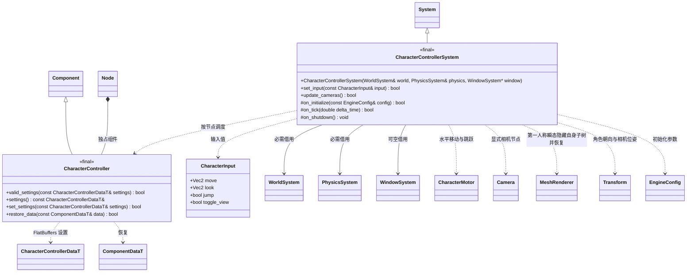

# 角色控制器插件

输入与相机模式属于可选运行时插件 `engine::plugins::character_controller`。核心 CharacterMotor 仅负责碰撞运动。

控制器是普通节点组件，可持久保存与恢复。相机引用是同场景 `NodeInfo.id`，相机节点须为根且带 Camera/Transform。一个相机同一时刻仅由一个启用控制器驱动。角色节点须另有 CharacterMotor；缺失依赖通过返回值报告。

第一人称相机放在脚底上方 `eye_height`，第三人称沿观察方向后退 `camera_distance`，球体扫掠限制其距离，避免穿墙。移动方向相对观察 yaw，斜向输入归一化；鼠标位移乘灵敏度，pitch 限定范围；Tab 切换模式。输入为瞬态，按键和鼠标读取可由可空 WindowSystem 提供，也可由调用方显式 `set_input`。

正常宿主将控制器系统装在物理系统之后：使用当前物理位置更新相机，输入提交给下一次物理步进；输入存在一帧延迟。没有窗口的调用方也可显式控制 `controller.tick → physics.tick → controller.update_cameras()` 的顺序。插件只负责输入与相机策略，不决定玩法、资源加载或渲染；MCP 与编辑器通过组件设置及宿主调用同一能力。

第一人称隐藏角色自身子树 MeshRenderer 的瞬态可见性，避免头部和身体挡住相机；动画仍继续采样。切回第三人称、禁用/移除控制器、节点移出子树或关闭系统时恢复每个 MeshRenderer 原先的可见值。记录只保存场景/节点及网格组件实例身份，不持有跨帧指针；不更改持久 enabled 或场景文件。
