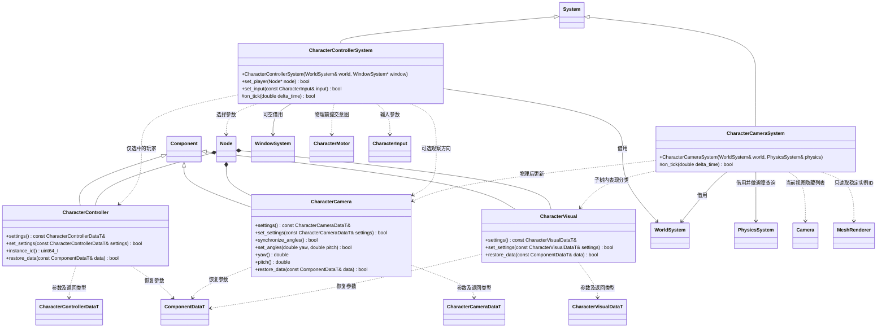

# 玩家控制、跟随相机与角色表现

运行时插件 `engine::plugins::character_controller` 组织玩家输入与镜头策略，核心 `CharacterMotor` 提供玩家和 NPC 共用的运动能力。场景对象仍由普通 Node 和组件表达；NPC 不挂玩家输入组件。

- `CharacterController` 只保存移动速度、跳跃速度、观察灵敏度和可空相机节点引用。`set_player(node)` 显式选中当前场景的一个玩家，传空解除选择；未显式选择时只允许唯一启用玩家组件，多个候选返回失败，绝不广播一份输入。无相机时按角色朝向移动。输入每帧消费一次；控制器移除、禁用、替换、换场景或系统关闭，按场景/节点/组件实例身份撤销原主动意图，不能清掉 NPC 的请求或外部击退。
- `CharacterCamera` 挂在普通 Camera 节点，独立引用目标节点，可跟随没有玩家组件的 NPC 或其他物体。模式、眼高、距离、俯仰范围和避障参数由自己的 FlatBuffers 数据保存。观察角为瞬态；镜头在物理后取最终位置，第三人称使用现有 Jolt 球扫掠避障，第一人称位于目标眼高。
- `CharacterVisual` 标记身体、头部或第一人称手/武器，子树使用最近的标记，默认身体。第一人称只从自己的镜头隐藏身体/头部，第一人称手/武器仅向对应第一人称镜头显示。其他镜头仍看得到身体。本插件独占场景 Camera 的瞬态隐藏实例列表；过滤使用该列表，不修改 MeshRenderer 的全局可见性；角色身体继续投射阴影，禁用动画与可见性无关。
- 正式宿主按脚本/玩家意图、物理、动画、跟随相机、音频的顺序装配系统。核心不包含具体插件，插件的物理前/后安装入口由宿主提供；测试必须使用同一顺序。
- 原控制器中的相机参数迁移为相机节点上的 `character_camera`，其目标为角色节点；美术部件可挂 `character_visual`。二进制 schema 保留已废弃字段的编号，源场景显式迁移并重新导入，不在运行时偷偷创建相机或修改场景结构。
