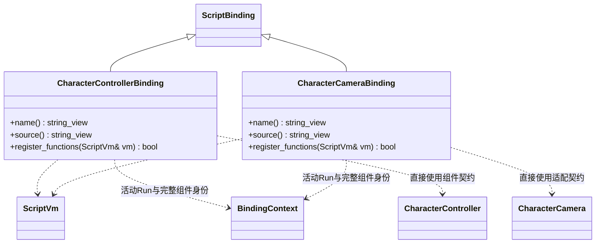

# 角色输入脚本绑定

[角色与相机的完整 TS 契约](character-integration-design.md#ts-外观与数据来源) · [统一输入](input-script-api.md) · [绑定注册](script-bindings.md)

绑定随 character_controller 插件选择登记；运行时不按类型扫描系统。CharacterController.SetInput 只接受一个输入对象：move、lookDelta、lookRate、toggleView 和按名称索引的 actions。动作包含 held 与 pressed，未知名称、无穷值或缺失字段整批拒绝。ClearInput 返回 boolean，清除主动计划与缓冲动作，保留物理外力。

GetSettings 返回可编辑的独立生成配置；修改后须显式 SetSettings。GetStatus 返回只读运行快照；组件删除、替换或场景结束后，原句柄的查询返回 null，修改返回 false。64 位身份在 TS 使用 bigint，在 MCP 使用十进制字符串。

范例 [CharacterControls](../../../../projects/showcase/assets/scripts/character_controls.ts) 读取明确输入通道并向指定组件提交。鼠标使用 lookDelta，摇杆使用 lookRate；换算与帧时间积分归 CharacterCamera。Sprint、Jump、Crouch 由场景显式声明并启用，调用方不推进固定步或自行求碰撞。
