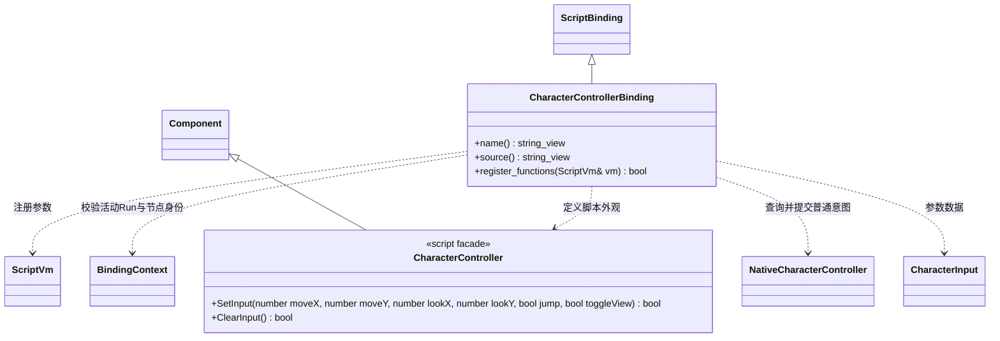

# 角色输入脚本接口

[角色原生类图](character-controller.md) · [统一输入](input-script-api.md) · [绑定注册](script-bindings.md)

图中 NativeCharacterController 引用 `engine::plugins::character_controller::CharacterController`，不重复定义其方法。绑定只在角色插件已选时登记，沿用普通 Component / Node 句柄，不使用全局系统查找。节点所属场景结束后旧引用失效。

`SetInput` 将有限数值与布尔值转换为 CharacterInput，成功表示接受下次原生控制器更新的意图，不立即移动角色；输入每次更新消费一次，没有新提交就回零。`ClearInput` 清理组件待提交意图；清理 Motor 已排队的跳跃由调用方显式调用 CharacterMotor.ClearInput。固定步、运动、相机和碰撞仍由原生负责。

示例 [CharacterControls](../../../../projects/showcase/assets/scripts/character_controls.ts) 在 TS 加载默认键位及 KV 覆盖、选择初始手柄、决定再次配对，提交通道后只查询少量动作并调用 SetInput。保存覆盖是显式操作，没有停止时自动保存。
