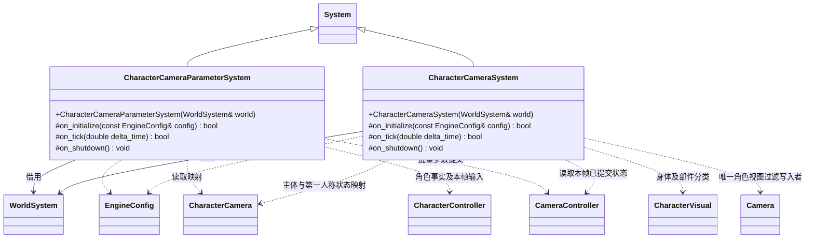
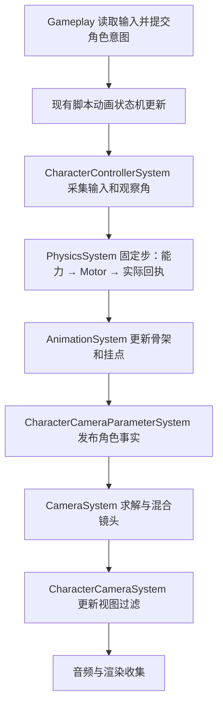
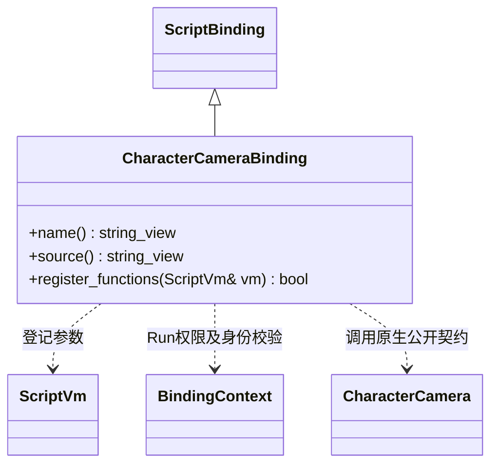

# 角色与镜头、动画、脚本衔接

[角色控制](character-control-design.md) · [角色能力](character-abilities.md) · [相机插件](camera-controller.md) · [当前动画状态机](animation-state-machine.md) · [编辑器接入](../../editor/class-diagrams/character-control-design.md)

**状态：已实现；验证范围见[测试文档](../../../testing.md)。** 本页明确角色与通用相机的结合方式。相机算法归 camera 插件，角色插件只提交观察参数和角色事实、维护角色视图过滤；动画仍使用现有 Animator 与状态机。

## 角色相机适配

```mermaid
classDiagram
    class CharacterCamera {
        <<value handle>>
        +CharacterCamera()
        +CharacterCamera(Component component)
        +register_type(ComponentRegistry& registry) bool$
        +valid_settings(const CharacterCameraDataT& data) bool$
        +get_settings(CharacterCameraDataT& output) bool
        +set_settings(const CharacterCameraDataT& data) bool
        +get_angles(double& yaw, double& pitch) bool
        +set_angles(double yaw, double pitch) bool
        +apply_look(const Vec2& delta, const Vec2& rate, double delta_time) bool
        +toggle_view() bool
        +restore_data(const ComponentDataT& data) bool
    }
    class CharacterCameraDataT {
        <<generated>>
        +subject_slot string
        +yaw_parameter string
        +pitch_parameter string
        +first_person_parameter string
        +first_person_states string[]
        +pointer_scale_degrees Vec2
        +rate_degrees_per_second Vec2
        +status_bindings CharacterCameraBindingDataT[]
    }
    class CharacterCameraBindingDataT {
        <<generated>>
        +source CharacterCameraSource
        +source_name string
        +parameter string
        +scale float
        +offset float
    }
    class Component
    class ComponentRegistry
    class ComponentDataT
    class CameraController
    class Vec2
    class CharacterCameraSource {
        <<enum>>
        relative_speed
        vertical_speed
        active_height
        grounded
        action_held
        ability_active
    }
    Component <|-- CharacterCamera
    CharacterCamera ..> ComponentRegistry
    CharacterCamera ..> ComponentDataT
    CharacterCamera ..> CharacterCameraDataT
    CharacterCamera ..> CameraController : 同节点参数及命名目标槽
    CharacterCamera ..> Vec2
    CharacterCameraDataT *-- Vec2 : 观察输入换算
    CharacterCameraDataT *-- CharacterCameraBindingDataT
    CharacterCameraBindingDataT ..> CharacterCameraSource
```



持久目标只保存在 CameraController 的命名目标槽，CharacterCamera 用 subject_slot 指定所观察主体，不再重复保存 target_node_id。距离、眼高、阻尼、俯仰求解、碰撞和投影全部在相机方案里。

观察角直接保存在相机已声明的 float 运行参数中。get_angles 返回独立数值并报告失败，替换原来无法区分失效的 yaw()/pitch()；不保留原 synchronize_angles 的隐式初始化路径。初始观察角来自参数默认值，需要对齐当前视角时由调用方显式读取和 set_angles。

apply_look 按 `delta * pointer_scale_degrees + rate * rate_degrees_per_second * delta_time` 计算角度增量，两个轴的正负由配置明确决定；根据相机参数声明归一化偏航和限制俯仰，整批提交，失败保留两个旧值。toggle_view 只改变声明过的 first_person_parameter 布尔值，实际切换由相机状态机决定；空参数名表示未提供此操作。

绑定使用同节点且启用的 CameraController，动作方向对应的 CharacterController.camera_node_id 必须指向此节点，subject_slot 必须解析为该角色。引用错误不自动重绑。普通非角色跟随镜头可以使用 CameraController 而不添加 CharacterCamera。

角色模板对同一输入轴使用一致的参数范围与 Rig 限制，避免镜头已到限制而输入仍在不可见范围内累计。当前偏航按 [-180,180) 归一化，参数声明须接受这一范围；俯仰以声明的有限上下限为准。

## 参数发布与视图过滤



两个阶段分别需要相机求解前的角色数据与求解后的相机状态，因此由宿主分别装配两个 System。参数系统不写真实相机姿态，过滤系统不再借用 PhysicsSystem 或计算距离。系统由世界的 System 树独占，WorldSystem 借用须覆盖其整个生命周期。

参数绑定可将实际速度映射到 FOV 输入、实际身高映射到眼高、grounded 映射到镜头条件，以及指定 action/ability 的状态映射到瞄准或动作方案。数字来源写 float，布尔来源写 bool；scale/offset 仅适用于数字，整批验证后提交。

每个目的参数只能有一个角色映射，且不能与 yaw、pitch、first_person_parameter 重复。映射参数由本适配负责，项目要直接驱动某个参数时应移除对应映射。主体卸载、适配禁用或绑定更换时，只将本适配拥有且仍属同一已发布、可模拟相机组件实例的参数恢复到其声明默认值，不能影响别的镜头实例。旧范围退出发布或模拟后直接丢弃本适配的写入记录，不尝试修改仍在有界退休的只读节点。

active_height 使用 Motor 实际半高与半径计算；请求站立受阻时仍输出矮胶囊的高度。action_held 使用本帧已采集的输入，不等待物理子步；速度、grounded 和实际尺寸读取最近完成的物理快照，并携带 step 标识用于诊断。

尚未获得有效物理快照时，物理来源映射保持相机参数默认值，不把空快照里的零值当作实际身高或速度。输入来源映射可以使用本帧有效输入；两类来源的就绪状态分别校验。

CharacterVisual 的子树分类、每镜头隐藏及角色阴影契约保持。进入 first_person_states 中的已提交目的状态即采用第一人称过滤，离开时采用目的状态过滤；失败切换不改变策略。过滤系统位于 CameraSystem 之后，避免读取上一帧镜头状态。停止或失效时按镜头实例身份清理自己维护的隐藏列表。

## 一帧的顺序



角色移动方向取本帧已提交的观察角，不读取带噪声或碰撞修正后的最终相机旋转。镜头位置在物理与动画后读取目标，因此第一／第三人称控制共享同一个角色移动链路。

## 动画边界

本轮角色模块发布实际速度、支撑、姿态、能力阶段及起跳／落地序列；项目把这些值送到现有动画状态机，Animator 继续完成动作播放、混合、重定向、IK、挂点与事件。原地动画不写角色根节点位移，Motor 是运动来源。

现有 TS 动画状态机在脚本阶段执行，所以读取的是最近已完成的物理快照；本契约没有把它描述成同帧物理之后的原生状态机。C++ 调用方同样可以读 CharacterStatus 并调用 Animator 的公开播放接口；一个 Animator 明确选用一种播放驱动，不能同时由手动播放与已绑定状态机轮流覆盖。

起跳与落地使用单调序列检测新事件，不把一帧的 grounded 布尔反复当作新事件。角色删除／替换后重置观察身份，不能将旧实例序列用于新角色。Root Motion、脚锁、攀爬对位、全身 IK 及同帧原生动画图需要另行设计，首批继续采用现有 InPlace 资源。

## TS 外观与数据来源

现有 CharacterControllerBinding 按原生契约升级，增加 GetSettings、SetSettings、GetStatus；SetInput 改为一个明确的输入对象，ClearInput 返回 boolean。CharacterCamera 增加独立 CharacterCameraBinding，方法对应 Get/SetSettings、Get/SetAngles、ApplyLook、ToggleView，使用同一原生组件契约；这两个绑定都遵循已有 ScriptBinding，不在 ScriptSystem 中集中编写角色逻辑。



绑定位于 `engine::plugins::script::bindings`，同时选择脚本与角色插件时才编译登记；组件本身没有 VM 指针或脚本回调。CharacterCamera.GetAngles 返回 `readonly [number, number] | null`，ApplyLook 接受两个数值二元组与秒数，SetAngles / ToggleView 返回 boolean。

脚本瞬态输入形状如下，属于输入外观，不是另建的持久模型：

```typescript
interface CharacterInput {
    move: readonly [number, number];
    lookDelta: readonly [number, number];
    lookRate: readonly [number, number];
    toggleView: boolean;
    actions: Readonly<Record<string, { held: boolean; pressed: boolean }>>;
}
```

GetSettings/SetSettings 使用 Schema 生成的对象数据，GetSettings 返回可编辑的独立配置副本，GetStatus 返回独立只读快照，失败为 null；修改操作返回 boolean 并遵循原生原子校验。TS 不推进固定步、不求碰撞、不自行推进能力计时。模板由 MCP 配置组件及能力列表；运行输入由 C++ 或 TS 提交，关闭脚本插件仍能运行原生角色控制。

现有 NavigationCrowdSystem 自己写节点位置，并明确拒绝同节点启用 CharacterMotor。首批保持这一边界；普通 AI 可以提交角色意图，但将群体导航的路径与避让结果接成 Motor 输入需要独立设计，不能把现有导航代理直接叠到该角色节点。

构建时 character_controller 显式声明对 camera 契约的单向依赖，camera 不依赖角色插件；核心物理仅声明 CharacterMotorDriver。脚本绑定和编辑器接入分别留在其作用域，关闭脚本后不链接 VM，关闭编辑器插件不影响角色运行。
