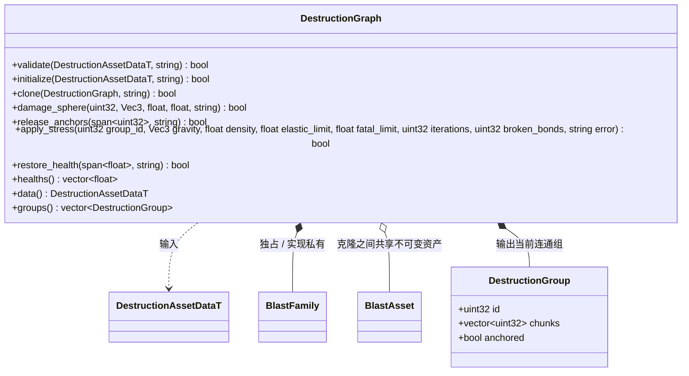

# 建筑破坏连通图

`DestructionGraph` 桥接 NVIDIA Blast 5.1 官方 lowlevel、ExtDamageShaders 与 ExtStress。核心、场景和 Jolt 不进入图算法。生成数据由 FlatBuffers 提供，运行态只保存 Blast 内存，不把其 ABI 内存写入资源。

组 ID 为最小碎块索引，不把 Blast 可重用 actor index 当稳定标识。损伤针对调用方指定的当前组，中心已经变换回该组原始资产局部坐标。同一次爆炸由调用方固定旧组列表，避免新组重复受伤。

血量顺序为资源内部 bonds，随后按碎块顺序的 world bonds；锚点初始血量来自资源的 `anchor_health`。恢复时先创建健康连接，再显式断开已为零的 bonds，确保 Blast 的连通图与血量一致。候选图通过官方 family 可重定位内存克隆，调用方统一决定发布或丢弃。

`release_anchors` 按源资源 chunk ID 精确撤销 world bonds，继续使用官方
`NvBlastActorApplyFracture` 与 `NvBlastActorSplit`；内部连接与其他锚点的血量保持不变。
请求先整体校验；重复 ID、没有锚点或已经断开的合法 chunk 不重复施加损伤。
图只处理连接，地基覆盖判断归调用方，不引用物理、地形或场景。

步骤 4 增加官方 ExtStress 计算桥接。图方法接受资产坐标系加速度及密度，
在当前 family 上构建临时求解器，登记所有存活 actor、设置节点质量；仅给选定
锚定组添加重力。使用官方 fracture 命令、ApplyFracture 和 Split 发布计算结果。
运行时系统负责坐标、缩放及多组事务；图不访问 Scene 或物理对象。

ExtStress 将连接 health 解释为剩余承载面积，而引擎损伤 health 是项目配置的强度单位。
桥接先建立临时 family，将每条 health 换成 `bond.area * health / initial_health`，
使用官方应力与损伤公式，再把受损比例换回原项目单位；world bonds 同样处理。
这样 Pa 阈值不随项目 `bond_health` 的计数尺度改变，增大实际连接面积确实降低压力。
不修改不可变资产，也不改变既有爆炸、撤锚或快照契约；回写使用已有事务恢复路径。
