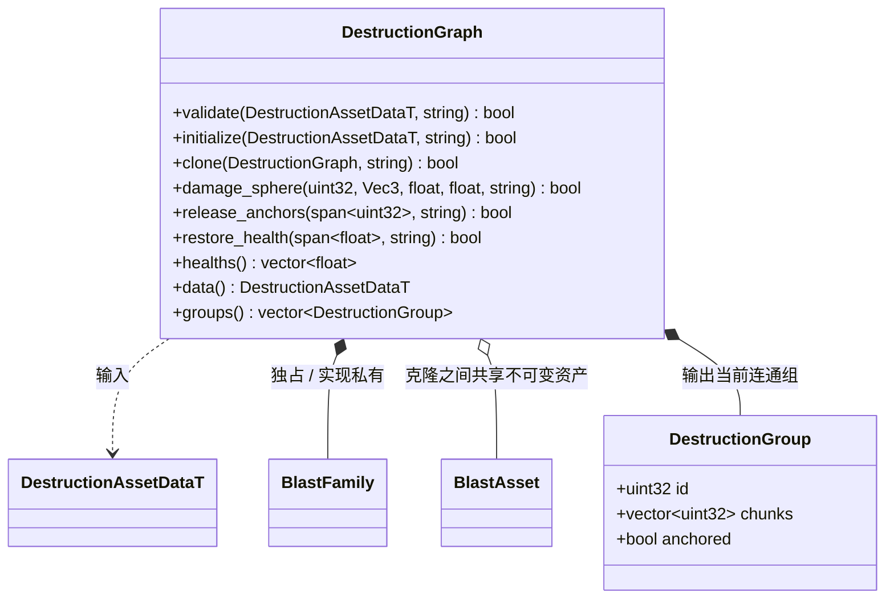

# 建筑破坏连通图

`DestructionGraph` 只桥接 NVIDIA Blast 5.1 官方 lowlevel 与 ExtDamageShaders。核心、场景和 Jolt 不进入图算法。生成数据由 FlatBuffers 提供，运行态只保存 Blast 内存，不把其 ABI 内存写入资源。

组 ID 为最小碎块索引，不把 Blast 可重用 actor index 当稳定标识。损伤针对调用方指定的当前组，中心已经变换回该组原始资产局部坐标。同一次爆炸由调用方固定旧组列表，避免新组重复受伤。

血量顺序为资源内部 bonds，随后按碎块顺序的 world bonds；锚点初始血量来自资源的 `anchor_health`。恢复时先创建健康连接，再显式断开已为零的 bonds，确保 Blast 的连通图与血量一致。候选图通过官方 family 可重定位内存克隆，调用方统一决定发布或丢弃。

`release_anchors` 按源资源 chunk ID 精确撤销 world bonds，继续使用官方
`NvBlastActorApplyFracture` 与 `NvBlastActorSplit`；内部连接与其他锚点的血量保持不变。
请求先整体校验；重复 ID、没有锚点或已经断开的合法 chunk 不重复施加损伤。
图只处理连接，地基覆盖判断归调用方，不引用物理、地形或场景。
