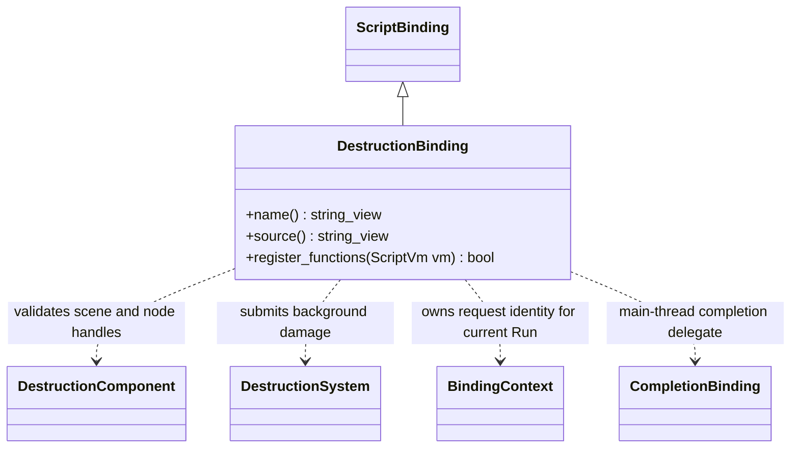

# 破坏脚本接口

`DestructionBinding` 实现现有 `ScriptBinding`，仅在清单选择 `runtime/destruction` 时注册。
QuickJS 与 V8 共用绑定，不增加另一份虚拟机相关实现。

| TS 接口 | 原生能力 |
| --- | --- |
| `node.GetComponent(DestructionComponent)` | 读取普通节点组件 |
| `DamageSphere(x, y, z, radius, damage, impulse = 0)` | 世界坐标球形损伤，官方 Blast falloff；独立物理冲量 |
| `DamageSphereAsync(x, y, z, radius, damage, impulse, completed)` | 返回是否接收请求，后台准备后主线程发布；`completed(success)` 调用一次，拒绝请求不回调 |
| `RefreshSupport(support: Collider, maxGap, minCoverage)` | 显式检查同场景指定碰撞体；多点覆盖不足则解除 world 支撑，不自动重新连接 |
| `OwnsFragment(nodeId: bigint)` | 当前生成碎块组归属查询；失效 ID 返回 false |
| `ApplyStress(x,y,z,elasticLimit,fatalLimit,iterations)` | 显式调用官方 Blast 应力；成功返回本次完全断裂连接数，失败 null；单位 Pa，由项目控制频率 |
| `Reset()` | 恢复源资源图和初始组 |
| `ready`、`revision`、`lastError` | 就绪、成功修改版本及错误 |
| `chunkCount`、`groupCount`、`dynamicGroups` | 资产碎块、当前连接组及脱离支撑的组数 |

纯物理运动不递增 revision；损伤、配置、恢复与重置成功发布才递增。
源生成参数与材料保存在资产/场景，业务脚本只提交操作，不在引擎判断试验场或具体建筑。

异步入口使用相同世界坐标、伤害与冲量单位，`impulse` 显式传入（无冲量传 `0`）。
委托通过当前 Run 的完成事件队列在主线程派发；成功意味着原生结果已发布，
失败或同场景 Reset/禁用等取消返回 `false`。场景更换、脚本停止直接丢弃旧委托，
回调不得返回 Promise。等待异步完成期间仍可推进物理；依赖其结果的支撑刷新、
应力或其他同步图修改应在完成委托后执行，避免主动使旧候选失效。

Showcase 的火箭试验场按命中顺序处理爆炸，每枚的建筑伤害与地形编辑并行准备。
完成后依次做同步塌方、支撑刷新与导航脏区登记，下一枚再开始。等待中的命中进入
有界队列，采样 `complete` 同时要求所有炮弹与编辑完成；Reset 清空命中队列并
使旧完成委托失效，不把“火箭已飞完”作为后台工作已结束。
