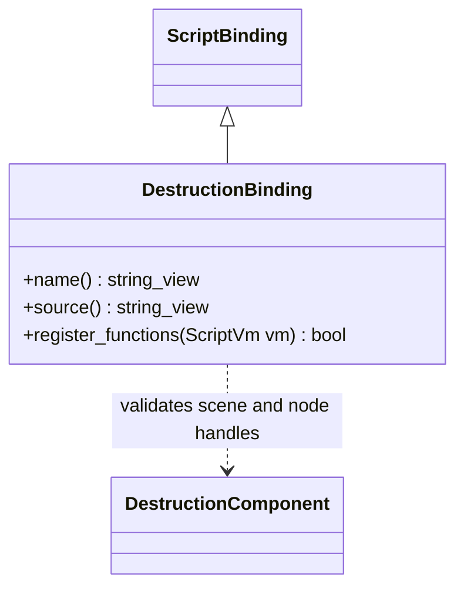

# 破坏脚本接口

`DestructionBinding` 实现现有 `ScriptBinding`，仅在清单选择 `runtime/destruction` 时注册。
QuickJS 与 V8 共用绑定，不增加另一份虚拟机相关实现。

| TS 接口 | 原生能力 |
| --- | --- |
| `node.GetComponent(DestructionComponent)` | 读取普通节点组件 |
| `DamageSphere(x, y, z, radius, damage, impulse = 0)` | 世界坐标球形损伤，官方 Blast falloff；独立物理冲量 |
| `RefreshSupport(support: Collider, maxGap, minCoverage)` | 显式检查同场景指定碰撞体；多点覆盖不足则解除 world 支撑，不自动重新连接 |
| `OwnsFragment(nodeId: bigint)` | 当前生成碎块组归属查询；失效 ID 返回 false |
| `Reset()` | 恢复源资源图和初始组 |
| `ready`、`revision`、`lastError` | 就绪、成功修改版本及错误 |
| `chunkCount`、`groupCount`、`dynamicGroups` | 资产碎块、当前连接组及脱离支撑的组数 |

纯物理运动不递增 revision；损伤、配置、恢复与重置成功发布才递增。
源生成参数与材料保存在资产/场景，业务脚本只提交操作，不在引擎判断试验场或具体建筑。
