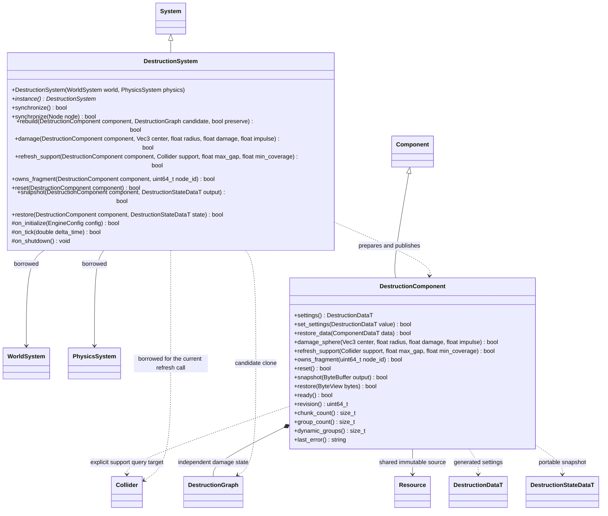

# 建筑破坏：Blast 计算与 Jolt 提交

步骤 2 使用官方 Blast Authoring 预破碎、ExtDamageShaders 径向损伤及 low-level 拆分。
不另写 Voronoi、连接连通性或应力求解器。运行插件只借用核心世界和物理；
Authoring 与 MCP 属于编辑器插件。核心增加的凸包复合碰撞、瞬态节点均不识别 Blast。

建筑是普通根节点挂 DestructionComponent，首版要求正等比缩放。每个 Blast 连通组对应
一个生成的瞬态根节点，拥有 MeshRenderer、凸包复合 Collider 和 RigidBody。
仍与 world bond 相连的组固定；脱离支撑的组使用 Jolt 动态刚体，继续允许受损拆分。
插件保留组的节点 ID，按场景及组件生命周期回收，不把生成节点写进场景。
破坏组件与源 Transform 均启用时，生成组才显示并参与物理；禁用时同步移除碰撞，
保留姿态与速度，状态恢复也遵守同一启用条件。

损伤使用世界坐标，按每组当前姿态转换为资产局部坐标。候选 graph、网格与碰撞先
准备，全部成功再替换旧组；断裂后继承原组姿态及速度。部分损伤保留而不强制拆块。
快照使用 FlatBuffers 的基础 GUID/hash、稳定 bond 血量以及各组块 ID、姿态和速度，
不保存 Blast ABI 内存。状态恢复先校验再提交；正常场景保存只保存初始资源与组件配置。

系统在物理前由父系统驱动；编辑器预览调用 synchronize，不直接 tick 子系统。
承重应力、导航与异步任务保留既有后续顺序。

编辑器单对象事务调用 `synchronize(Node&)`，只发布或回收该节点的输出；
每帧全局同步仍负责扫描和调度，不在编辑某一个对象时顺带发布其他待处理对象。

## 显式地基刷新

调用方先成功提交支撑碰撞的修改，再调用 `refresh_support`。破坏插件仅依赖
核心 `PhysicsSystem::cast_ray`，不依赖地形插件，也不自动扫描或订阅地形修改。
首版每次指定一个 Collider，沿世界负 Y 检查现有锚点的实际底面；底面三角形
采用多个内部采样点并按投影面积加权，`max_gap` 为允许的离地距离，
`min_coverage` 为最低覆盖比例，取值 `(0, 1]`。该覆盖近似不代表承重或应力求解。
针对当前切片/Voronoi 盒体的平面底面；没有可测平面底面的锚点返回失败，
不把 AABB 内不属于真实底面的区域当作支撑，不尝试推断任意模型的接触区域。

组件和自身变换必须启用并属于当前世界。拒绝跨场景、trigger、动态支撑及
该破坏组件自己生成的碎块作为地基；禁用或已清空的合法支撑碰撞按无覆盖处理。
射线只查询明确指定的支撑体，其他建筑、碎块和角色不会遮挡它。
全部锚点查询成功后，候选图只断失效 world bonds，并通过已有 `rebuild(..., true)`
一次发布；保留其他连接健康值、组姿态与速度。无变化不重建、不增加 revision。
填回支撑不会自动重新锚定，恢复仍使用 reset 或完整状态快照。

`owns_fragment` 只查询当前活动场景中该组件生成的组节点，不向核心增加归属知识，
不保留节点引用。失败、组件移除或场景更换后不会报告旧节点归属。
