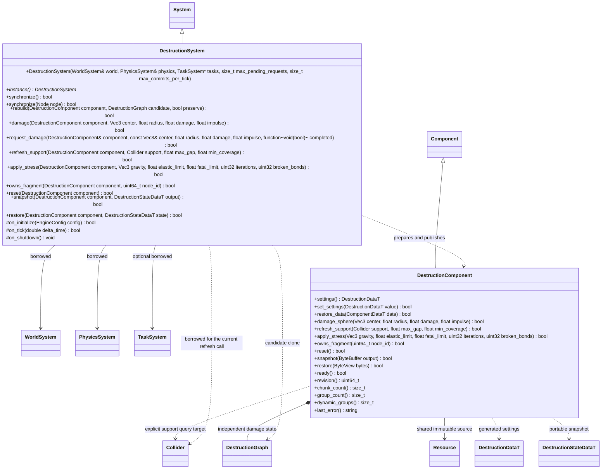

# 建筑破坏：Blast 计算与 Jolt 提交

步骤 2 使用官方 Blast Authoring 预破碎、ExtDamageShaders 径向损伤及 low-level 拆分。
不另写 Voronoi、连接连通性或应力求解器。运行插件只借用核心世界和物理；
Authoring 与 MCP 属于编辑器插件。核心增加的凸包复合碰撞、瞬态节点均不识别 Blast。

`request_damage` 是独立的非阻塞请求入口，保留同步 `damage` 契约。构造可借用已初始化任务域，默认最多 64 个未完成请求、每次同步最多发布 1 个候选；无任务域、空委托或预算满时拒绝请求。每个建筑串行排队，不同建筑可并行，候选数量受域并发上限限制。完成委托只在主线程全局 `synchronize`/tick 执行；关闭丢弃委托，worker 仅保留独占数据。

启动请求时复制 Blast family 并捕获各原始组的世界矩阵和缩放，worker 只计算资产局部损伤、变更组网格/凸包描述与该时刻的爆炸速度增量。发布时重新读取当前组姿态、速度并进行质心修正，再叠加速度增量；后台期间发生的刚体运动不会被旧 Transform 覆盖。源组缩放变化、组件 revision 改变、删除重建或普通节点卸载会取消旧结果。独立组件生命周期 token 避免同节点同 revision 的新组件被旧任务写入。同步 Reset/Restore 等仍立即生效，旧候选和排队请求随后以 false 完成。

队列预算包含尚未派发的完成项；提交预算限制单次发布数量，不承诺对一个节点/Jolt 原子发布做时间抢占。暂停时不启动或发布请求。异步应力与地基查询尚未迁移，查询继续在物理安全点使用原同步接口。

后台投递与主线程发布各自保存现有 owner 表的轮转位置；同一建筑内部仍严格按请求顺序执行。即使并发和每次发布预算只有 1，持续受击的低 ID 建筑也不会使其他建筑的已接收请求饥饿。

建筑是普通根节点挂 DestructionComponent，首版要求正等比缩放。每个 Blast 连通组对应
一个生成的瞬态根节点，拥有 MeshRenderer、凸包复合 Collider 和 RigidBody。
仍与 world bond 相连的组固定；脱离支撑的组使用 Jolt 动态刚体，继续允许受损拆分。
插件保留组的节点 ID，按场景及组件生命周期回收，不把生成节点写进场景。
破坏组件与源 Transform 均启用时，生成组才显示并参与物理；禁用时同步移除碰撞，
保留姿态与速度，状态恢复也遵守同一启用条件。

损伤使用世界坐标，按每组当前姿态转换为资产局部坐标。damage、stress 和支撑刷新
按排序后的稳定 chunk 集合及 anchored 状态匹配已发布组；未变化组复用原 Node、
MeshRenderer、Collider 与 RigidBody，不重新拼网格或构建凸包。只有拆分或锚定状态
变化的组准备新节点与碰撞，所有候选成功后才回收对应旧组；准备失败清理候选，
旧图、姿态、速度与有效碰撞保持可用，期间不推进物理步进或查询。
部分 health 损伤只发布图和 revision；无血量、分组和速度变化时不增加 revision。
冲量先完整校验目标速度，提交后保存在原 RigidBody 中，快照立即可见，下一次物理
同步必须将速度真正提交给 Jolt；不把组件数据更新当作物理已经消费。
断裂组继承原组姿态及质心速度（包含角速度产生的偏移），其他组身份保持稳定。
Reset、完整状态恢复与资源/组件配置变更仍走显式完整重建，不复用陈旧材质或碰撞配置。
快照使用 FlatBuffers 的基础 GUID/hash、稳定 bond 血量以及各组块 ID、姿态和速度，
不保存 Blast ABI 内存。状态恢复先校验再提交；正常场景保存只保存初始资源与组件配置。

系统在物理前由父系统驱动；编辑器预览调用 synchronize，不直接 tick 子系统。
承重应力使用下述显式步骤 4 接口；异步 damage 完成后，调用方按依赖顺序刷新支撑与导航。

编辑器单对象事务调用 `synchronize(Node&)`，只发布或回收该节点的输出；
每帧全局同步仍负责扫描和调度，不在编辑某一个对象时顺带发布其他待处理对象。

## 显式地基刷新

调用方先成功提交支撑碰撞的修改，再调用 `refresh_support`。破坏插件仅依赖
核心 `PhysicsSystem::cast_ray`，不依赖地形插件，也不自动扫描或订阅地形修改。
首版每次指定一个 Collider，沿世界负 Y 检查现有锚点的实际底面；底面三角形
采用多个内部采样点并按投影面积加权，`max_gap` 为允许的离地距离，
`min_coverage` 为最低覆盖比例，取值 `(0, 1]`。该覆盖近似不代表承重或应力求解。
针对当前切片/Voronoi 盒体的平面底面；没有可测平面底面的锚点返回失败，
不把 AABB 内不属于真实底面的区域当作支撑，不尝试推断任意模型的接触区域。

组件和自身变换必须启用并属于当前世界。允许同一已发布世界中不同 Scene 的明确支撑体；拒绝 trigger、动态支撑及
该破坏组件自己生成的碎块作为地基；禁用或已清空的合法支撑碰撞按无覆盖处理。
射线只查询明确指定的支撑体，其他建筑、碎块和角色不会遮挡它。
全部锚点查询成功后，候选图只断失效 world bonds，并通过已有 `rebuild(..., true)`
一次发布；保留其他连接健康值、组姿态与速度。无变化不重建、不增加 revision。
填回支撑不会自动重新锚定，恢复仍使用 reset 或完整状态快照。

`owns_fragment` 查询已发布世界中该组件生成的组节点，不向核心增加归属知识，
不保留节点引用。失败、组件移除或组节点卸载后不会报告旧节点归属。

## 显式承重应力（步骤 4）

`apply_stress` 由调用方在固定频率调用，每次使用官方 Blast ExtStress 的标量 CGNR
求解及损伤公式执行一次重力应力更新；不自行增加连接/应力算法，不隐式 tick。
`elastic_limit`、`fatal_limit` 单位 Pa，同时用于压缩、拉伸与剪切，要求
`0 < elastic_limit <= fatal_limit`；迭代数 1..1000。返回 bool 表示查询与发布成功，
`broken_bonds` 输出本次完全断裂的连接数，失败清零；部分损伤仍通过 bond health 保存。
求解未在预算内收敛或输出非有限值时返回失败，不发布近似损伤。
官方损伤按调用次数累计，调用方固定频率调度，而非以不同帧率直接调用。

仅对当前仍有 world bond 的组施加重力。求解使用每组当前姿态转换后的重力，
按正等比缩放校正质量/面积带来的压力尺度；脱离地基的组交由 Jolt 下落，
不在自由落体中错误地施加静态承重。候选图完成所有计算后统一提交，
保留碎块当前姿态与速度，失败丢弃候选；无血量变化不重建、不增加 revision。
首次实现每次从当前图创建临时求解器，保证损伤、地基撤销及状态恢复后无陈旧求解缓存。
临时 family 把项目 health 换算成连接剩余面积后求解，再把受损比例换回项目单位；
Pa 阈值与项目损伤计数解耦。
该方法只计算重力承载，不含接触应力、外力、疲劳时间模型或非等比形变。

常驻源节点与组节点各自遵守普通 Node 生命周期，独立生成根节点不自动继承源常驻标记。源和相关组均存活时，切场景保留图、姿态与在途损伤候选；发布仍按原 Scene、Node、生命周期和 revision 检查。源常驻而普通组被卸载时，系统回收残余生成记录，置 `ready=false`、`pending=false` 并保留图/损伤与一次明确错误；后续同步返回成功，不停止宿主或反复重建。调用方可显式 Reset 重建初始组。该边界不引入通用派生节点所有权层。
