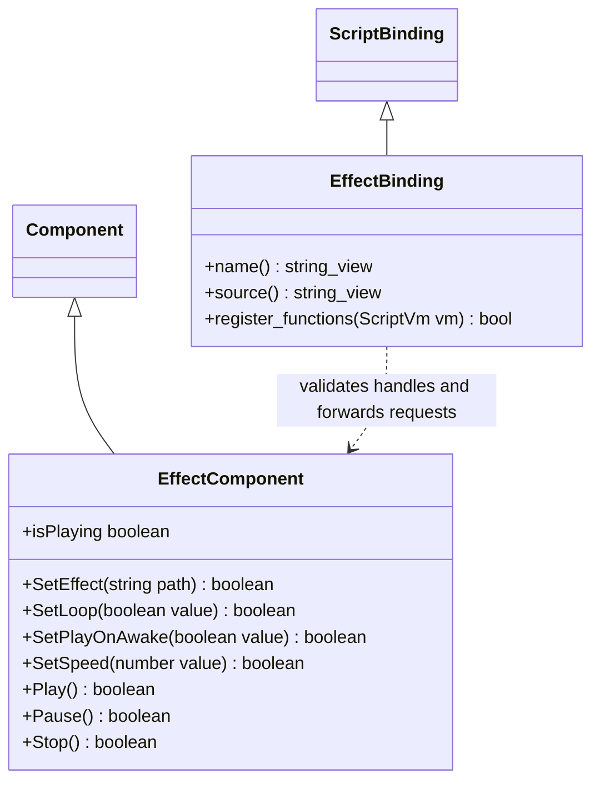

# 特效组件脚本接口

绑定仅随 `runtime/effects` 插件选择注册，复用现有组件及独立 EffectSystem，不暴露 Effekseer 类型。资源由标准目录加载；播放返回请求是否被接受，`isPlaying` 表示系统实际实例状态，不能把请求成功当作已完成渲染。脚本通过普通 Node/Transform 选择特效位置；组件失效后操作返回 false。循环、速度及自动播放设置仍使用生成的 EffectDataT，核心不包含爆炸、建筑或地形策略。
