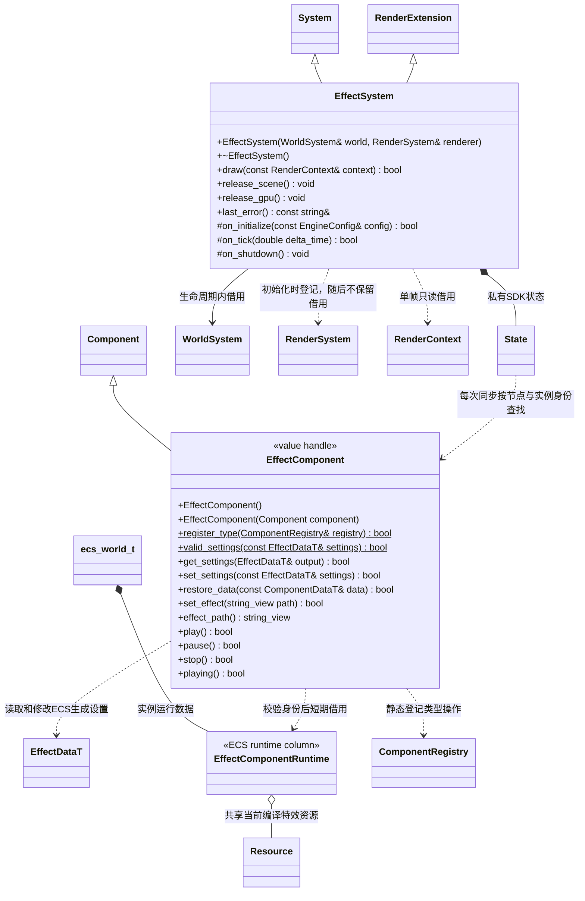
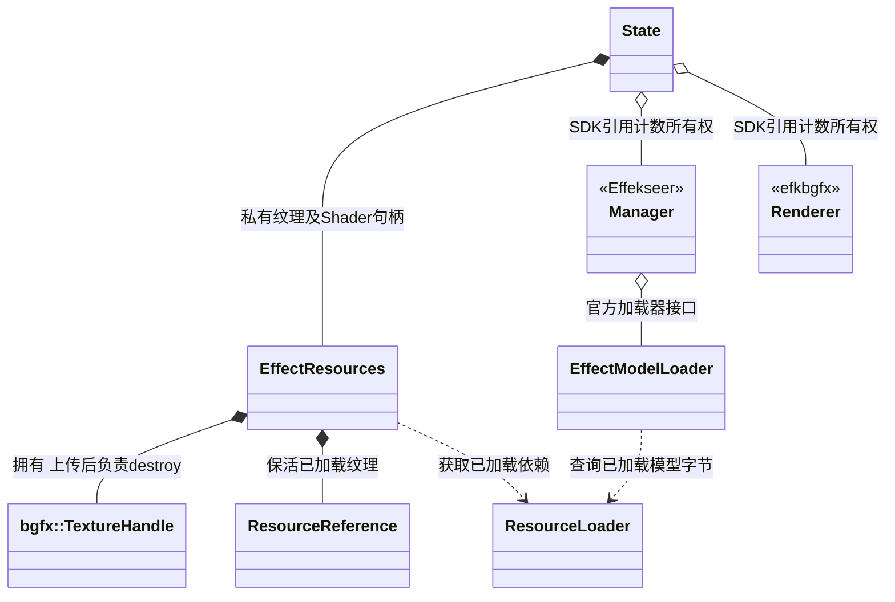

# 特效插件

[类图索引](../../../class-diagrams/index.md) · [渲染扩展](../../../runtime/class-diagrams/render-extension.md)

`runtime/effects` 复用官方 Effekseer 的节点、发射、寿命、运动和排序，使用 efkbgfx 将预定义材质提交给现有 bgfx 设备。核心只持有资源字节和组件 schema；特效状态、SDK 对象及其加载适配全部属于本插件。

- `EffectDataT` 仅保存 `effect_guid`、`speed`、`loop`、`play_on_awake`。速度为有限 `[0,16]`，资源 GUID 可空。读取失败保持原配置及播放状态，显式播放必须有已加载的有效特效资源。schema 和资源头继续由引擎提供；`EFCT` 资源只封装未经修改的官方 `.efkefc` 字节与每效果依赖路径/GUID/种类映射，不重新定义特效算法或参数格式。
- 组件实例拥有独立单调身份，移除后重新添加不能复活旧句柄。`play/pause/stop` 提交当前组件的播放意图；`playing()` 由 SDK 实际句柄状态回写，不能把尚未执行的请求报告为播放成功。显式暂停保留粒子并可恢复，停止清除本实例。组件或祖先禁用时暂停并隐藏已存在的实例，恢复激活后继续原播放意图；单独隐藏只影响绘制，继续推进播放。世界暂停时保留当前粒子，显示状态仍可同步，不推进时间或启动待播放实例。同 GUID 的代际刷新及属性恢复保留播放／暂停／停止意图；只有切换到另一个资源时重新采用自动播放设置。
- 世界负责每帧时间，插件按官方 `Manager::Update(seconds * 60)` 推进。模型渲染器沿 efkbgfx `examples/example.cpp` 使用独立 `CreateModelRenderer(renderer, &arguments)` 工厂完成 Shader 初始化，不使用只分配对象的同名虚方法。已发布世界中无特效资源时不创建 SDK/GPU 状态；Renderer 首次绘制特效时创建，窗口暂停后不访问失效设备；本次 `RenderContext` 的右手镜头矩阵用于观察，节点完整世界矩阵决定发射器位置、朝向和缩放，不在核心补模型或项目特判。
- 同一 GUID/资源代际共享已编译的 Effekseer Effect；播放句柄和暂停状态归各组件。移除节点、替换组件、切换资源会停止对应句柄；普通场景切换遍历所有已发布节点，常驻组件保留原 SDK 句柄、粒子状态和计时，最后一个使用者退出释放资源。`release_scene()` 不借用已销毁节点，`release_gpu()` 在 bgfx 关闭前先销毁 manager、effect、模型与纹理，再销毁 renderer 和 shader。
- 纹理从已加载的 Effect 依赖闭包取得，通过渲染模块公开 `render::upload_texture` 上传；Basis 转码与 meta 色彩空间处理封装在渲染模块内部；模型通过官方 ModelLoader 的内存接口加载 `.efkmodel` 字节。SDK 路径回调仅在官方同步加载期间查询本效果的编译绑定，依赖按 GUID 从根资源闭包取得独立获取并与编译 Effect 共同持有。关闭 SDK 按原文件名缓存，避免不同效果的同名路径混用；共享按 GUID/资源代际处理。不读操作系统文件、不按清单全局猜测路径。官方依赖路径目前限制为有效 UTF-16 的至多 511 个编码单元，超限明确拒绝，避免上游固定缓冲静默截断。
- 保留上游 `MaintainGammaColorInLinearColorSpace` 语义：硬件按 meta 将 sRGB 纹理解码，Shader 回到作者色彩空间组合颜色，再输出线性结果。HDR 直接进入已有 Bloom／映射；SDR 由适配层统一做一次输出 gamma 编码。通用代码不按特效名选择颜色策略。
- 共享 `validate_effect(ByteView, string&)` 使用官方 Setting/Effect 解析器及节点公开参数进行导入／运行双侧校验。当前支持预定义普通／光照材质及 sprite、ribbon、ring、track、model；自定义材质、背景扭曲、软粒子深度采样、GPU 粒子、声音和外部曲线明确返回未支持，不静默缺失。扩展这些能力时仍沿用官方 API 与本资源管线。

## 私有资源适配

这些类型只在插件实现中使用，公开头不出现 SDK 或 bgfx 类型。所有状态返回值为 `[[nodiscard]]`；释放支持重复调用和部分初始化。类图仅引用其他图定义的核心类型，不重新声明其方法。

本页组件均为可复制值句柄，生成设置唯一存于 `ComponentStorage<Data>` 的 ECS 列；`get_settings(output)` 返回独立值并明确报告失败，失败输出安全默认值；不保留吞掉失败的 settings() 包装。Runtime 为 ECS 中的领域运行列，资源引用、请求和缓存归该列或所属 System；句柄不拥有这些数据。Runtime 定义与可变访问仅供所属模块内部实现使用，公开组件不提供 `runtime()`；原生系统的 ECS 列借用仅在当前结构稳定阶段有效，不能跨结构修改留存。类型注册、失效身份与查询规则见 [ECS 场景](../../../runtime/class-diagrams/ecs-scene.md)。
