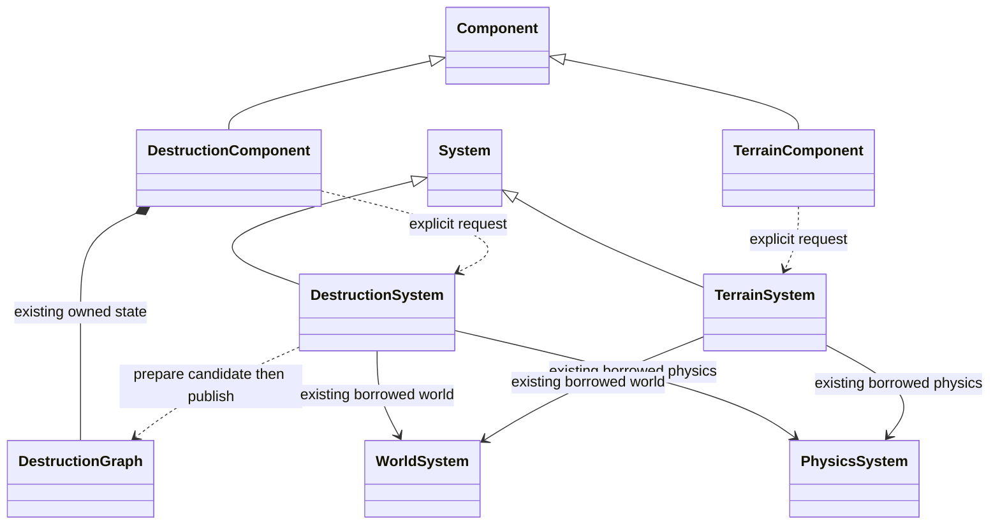
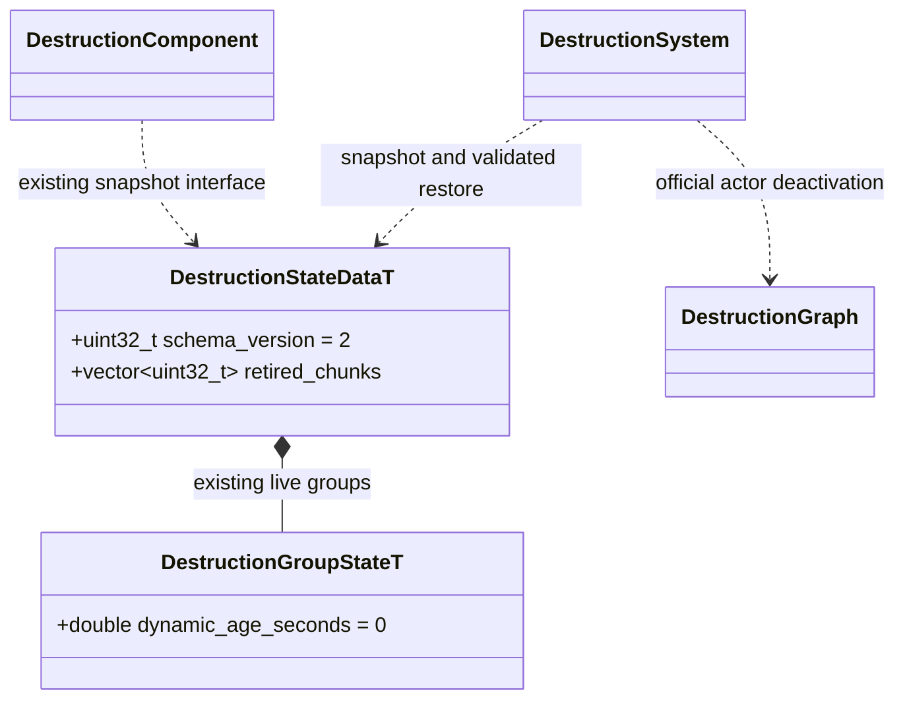

# 动态碎片退休

本页维护已确认的退休契约与状态模型；完整原生接口见
[建筑破坏](destruction.md)、[破坏图](destruction-graph.md)和[体积地形](terrain.md)。

目标是在保留未退休碎片、损伤和碰撞状态的同时，按一个源组件明确释放动态碎片。
调用方选择数量、寿命与调用频率；插件执行请求。沿用现有组件、系统、Blast 与 Jolt，
不增加碎片管理器、公共调度框架或项目策略。

## 最小接口

图中的组件和系统均属于各自现有运行时插件；WorldSystem、PhysicsSystem、
Component 和 System 仅跨图引用。关系与所有权不变。新增原生操作均为
`[[nodiscard]]`；`retired_count` 是输出参数，失败时清零。

脚本继续使用已有逐类绑定，两个组件统一提供：

| 脚本方法 | 结果 |
| --- | --- |
| `RetireFragments(maxCount: number, maxAgeSeconds: number): number \| null` | 成功返回实际退休的动态节点数，包含无变化时的 0；失败返回 null，读取原组件 lastError |

每次调用只处理明确指定的 owner，不扫描所有项目组件，不跨 owner 借用预算。

- `maxCount` 是执行后最多保留的动态组/土块数量，非负整数；0 表示退休全部动态碎片。建筑仍有 world bond 的静态组不参与数量和年龄筛选。
- `maxAgeSeconds` 为非负有限秒数；0 表示不按年龄删除。先选择达到寿命的动态碎片，再按年龄从旧到新缩减到数量上限。年龄相同时按稳定组 ID（土块为节点 ID）排序。
- 年龄从首次脱离支撑或土块成功发布时开始，使用既有系统 `on_tick(delta_time)` 的模拟时间；暂停不累计，编辑器仅调用 `synchronize()` 不累计。动态组再次拆分继承源组年龄，不能靠拆分重置寿命。
- 这是**显式执行时的保留预算**。调用之前仍可能超限；不会隐式改变伤害或塌方的生成语义。需要更低峰值时，调用方在安全点更频繁执行，或另行评审生成预算。
- 只允许主线程物理安全点调用。同 owner 仍有异步请求、在途候选或未派发完成项时返回失败，原请求和碎片保持不变；调用方在该 owner 的队列完成后调用，不强制取消已接受的伤害。
- 未就绪、失效 owner、非法参数、生成组件缺失或身份/参数校验失败，以及准备失败均返回失败；不以删除一部分碎片后返回失败冒充原子操作。Collider 与 MeshRenderer 使用已有实例身份；Transform 与 RigidBody 使用已有存在性及状态校验。
- 成功移除后原 Node/物理查询句柄失效；owner 保持 ready。建筑 groupCount、dynamicGroups 和地形 fragmentCount 只计仍存活的组。资产 chunkCount 保持源资产总数。
- 有实际退休才递增 owner revision；没有变化返回成功和 0。不为退休动态碎片重建源地形网格，也不改变未退休组的 Node、姿态或速度。移除碰撞仍遵守既有 Jolt 支撑更新语义，邻近刚体可能被唤醒，避免支撑移除后继续悬空睡眠。

## 建筑：使用 Blast 的 actor 释放能力

继续使用固定的 [NVIDIA Blast 5.1.0，636e7eb](https://github.com/NVIDIAGameWorks/Blast/blob/636e7eb43b8d41e44c40eb1b4799bfd027f17ba7/include/lowlevel/NvBlast.h)
低层 `NvBlastActorDeactivate`，不另算连通性。实际依赖源和固定提交以仓库
`third_party/blast` 子模块为准。

系统先确定待退休动态组，在现有候选图上调用 `retire_groups`；图方法整体校验
组 ID、重复项及 anchored 状态，再释放候选 family 内的目标 actor。只能退休完整
的当前动态组，不拆开一个仍连接的组，也不通过额外伤害伪造退休。

提交继续复用已有碰撞移除与生成组发布路径：全部候选准备成功后，移除目标 Jolt
刚体和瞬态 Node，再发布候选图及 owner 记录。发布必须识别“组集合减少”本身是
一次变化，不能因 bond health 没变而提前返回。其余建筑和未退休组不重建。

调用方须通过此接口修改所属插件的拥有状态。直接 Destroy 会令装配失效，
禁用 Renderer/Collider 会被同步恢复，禁用 Body 会破坏发布校验；仅禁用
Transform 也不能保证再次分裂后不出现新启用节点。

## 状态恢复不能复活已退休碎片

上图仅列既有 FlatBuffers 模型的退休相关字段，仍以 schema 为唯一持久模型，
不新增手写存档结构。建筑快照写 schema_version=2；旧版快照明确报告
版本不支持，不静默推断退休状态。普通场景源数据与预碎资产无需换版本。

`retired_chunks` 保存已退休组覆盖的源 chunk ID，严格排序且不重复。恢复先按
bond health 重建图，验证退休集合恰好覆盖完整的非锚定组，再调用同一
`retire_groups`，最后恢复仍存活组的姿态、速度和动态年龄。非法集合整次拒绝，
不把缺失快照组当作默认退休。

内部 clone、restore_health 和应力求解用到的临时 family 重建都必须保留退休集合；
尤其现有 ExtStress 会重建 family，不能只在普通 damage 路径处理。全部动态组
退休后允许图为空；bond health 仍须保留完整稳定顺序，不能因为已经没有 actor
而把 healths() 变成空数组。Reset/更换基础资源才明确恢复源资产全部组并清零年龄。

## 土块：回收已有拥有记录

TerrainSystem 在既有每 owner 碎块记录中补充发布时间，按同样预算筛选并走原有
物理移除和节点清理路径。退休只移除已抽出的动态土块，不向源密度填回泥土，
不改变其他 owner。继续挖填不会重新生成这些已抽出的样本。

当前 TerrainStateData 仅保存静态密度，发生过塌方后仍保留现有存档限制；
即使全部土块退休，也不能把它当作“从未发生塌方”而放行静态快照。
完整动态土块存档不在本次最小接口范围。

## 实现验收

1. 两个 owner 交错破坏，仅目标 owner 的最旧动态碎片被回收；静态支撑和未选碎片保持身份、速度及碰撞。
2. 年龄、数量、0 值边界和暂停符合上述语义；分裂不刷新年龄，失效参数与忙碌 owner 不产生部分修改。
3. 回收后继续伤害、刷新地基、应力求解、隐藏/显示组件均不复活旧碎片；Reset 明确恢复。
4. 建筑快照恢复保持退休集合、剩余损伤与年龄，覆盖全部组已退休和损坏状态文件；地形存档限制不被绕过。
5. 旧物理快照和节点句柄失效，碰撞查询不再命中退休碎片；在途请求和场景关闭无悬空回调。
6. 实测记录回收节点数、提交耗时和回收后的物理耗时；只验证这条链路，不扩展优化其他模块。
