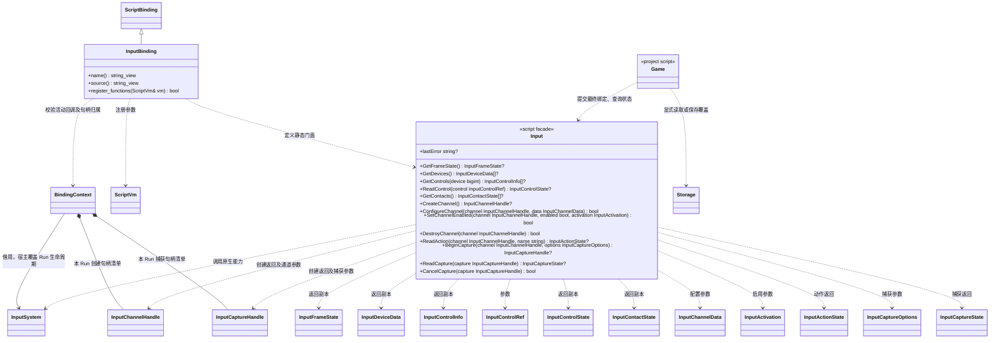

# 输入脚本接口

[原生系统](../../../runtime/class-diagrams/input-system.md) · [数据契约](../../../runtime/class-diagrams/input-data.md) · [设计边界](../../../runtime/input.md) · [绑定注册](script-bindings.md)

本图对应当前 InputBinding 和 `include/engine.d.ts` 的 Input 门面；原生接口方法只在所属原生类图定义。

## TS 完整负责的流程

1. 从项目 TS 模块或调用方选择的来源取得默认配置。
2. 显式读取 Storage，检查 I/O 错误，解析、校验及迁移项目自己的覆盖格式；是否采用默认值由项目决定。
3. 合并默认值与覆盖，读取设备清单，把逻辑槽位配对到连接身份；不将连接 ID 当长期玩家标识保存。
4. 创建通道，提交最终数据，明确指定优先级、是否消费、激活方式和启用状态。
5. 比较 GetFrameState 的 device_revision；变化时重新枚举并决定加入、断线提示、暂停、重连确认或重新配对。cancel_revision 变化时，在原生玩法推进前处理已提交意图的取消。
6. 重绑定时先组织相关通道启停，再 BeginCapture；读取候选、检查冲突、选择替换 / 交换 / 共用，提交完整配置后显式保存玩家覆盖。

InputBinding 不 import 项目模块，不读取或调用 Storage，不替项目执行上述流程，也不额外提供 LoadDefaults / LoadOverrides / SaveMappings 等策略接口。

## 生命周期与调用限制

- 只允许活动 Run 的 Gameplay / UI 回调调用。查询失败返回 null，命令失败返回 false；lastError 在有效回调中返回原因或空字符串，非有效回调为 null。不隐式抛原生异常。
- 模块顶层、构造与候选预检不能创建通道、捕获、提交配置或改变已有输入。有效 OnInitialize 可枚举设备并提交配置；动作首次发布在后续输入帧，不能把提交成功当作已取得动作状态。
- 通道与捕获是带代次的不透明值，脚本绑定记录创建归属。项目可以共享自己的通道引用，不能通过拼接句柄修改另一个 Run 或宿主拥有的通道。GetDevices 返回连接事实，允许多个 Run 预检对象存在也不赋予它们输入操作权。
- OnShutdown 仍可主动读取 / 保存项目覆盖；随后绑定销毁本 Run 创建的通道，取消捕获和虚拟控件占用。没有隐式保存、默认配置或手柄恢复；后续 Run 从 TS 流程重新开始。
- 控件 / 动作是值副本，重复 ReadAction 不消费边沿。TS 不订阅每个鼠标或触摸 motion，也不承担死区、合成、虚拟摇杆运动和逐事件映射；原生玩法可直接读取同一 InputSystem。
- `lastError` 保存本 Run 最后一次输入调用的错误；成功调用清空错误，读取 lastError 本身不清空。原生宿主或其他 Run 的输入调用不会覆盖该状态。
- InputBinding 的三个方法为 const、override 和 nodiscard，name / source 为 noexcept。每类绑定独立实现，QuickJS 与 V8 复用，不把 VM 类型放入核心。

数据字段和枚举对应 `input.fbs`，字段名沿用 snake_case，uint64 使用 bigint；句柄、连接 ID 和 frame_id 均不直接写入项目持久绑定格式。模块导出 InputDeviceKind、InputControlKind、InputActionKind、InputValueMode、InputCombine、InputActivation、InputVirtualKind、InputCaptureStatus、InputUnit 和 InputRegionShape 的冻结数值枚举。

对象入参通过插件内部 JSON 桥转换为生成数据，bigint 暂转十进制文本；这不构成配置文件格式或持久化策略。未知字段、错误类型、非有限数值、超过 4 MiB 的输入、超过 4096 项的列表或超过 4096 字节的文本均返回 false / null 并记录错误，不部分提交；核心仍检查完整映射的语义与预算。
