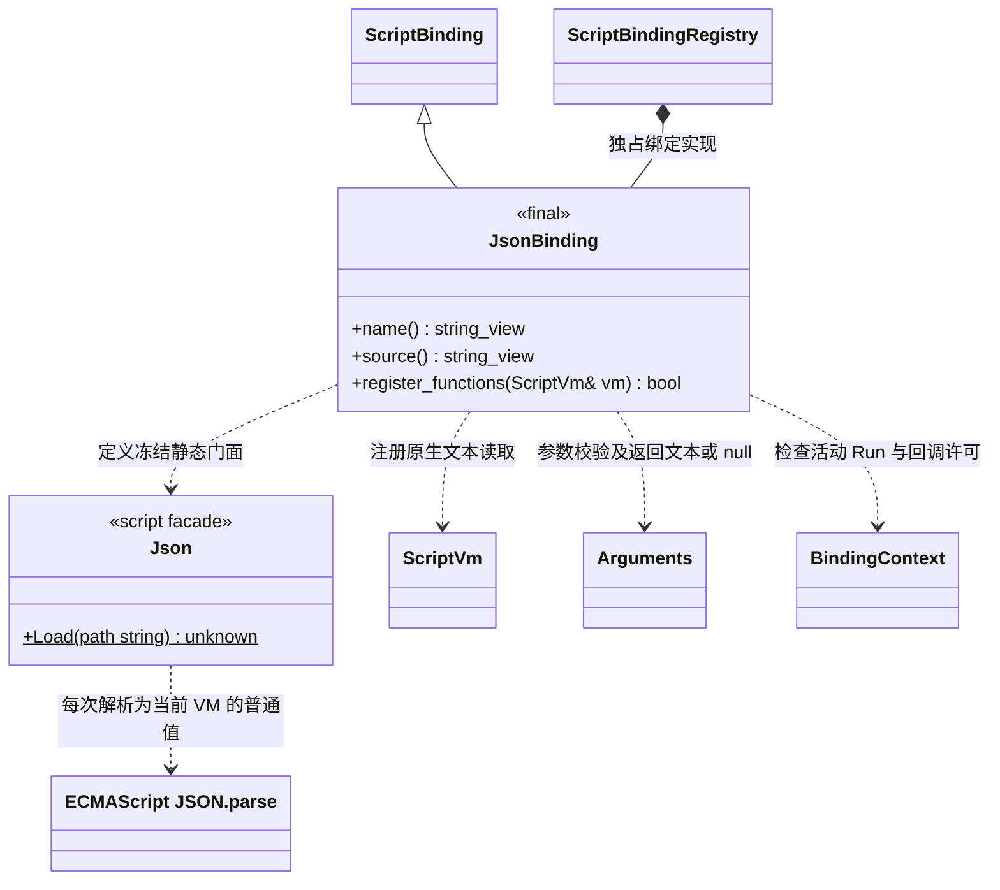
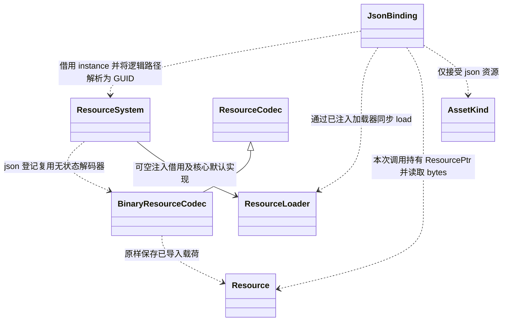

# JSON 资源脚本接口

[类图索引](../../../class-diagrams/index.md) · [绑定注册](script-bindings.md) · [JSON 导入](../../editor/class-diagrams/json-importer.md) · [资源加载接口](../../../runtime/class-diagrams/resource-loader.md)

静态门面 `Json.Load(path: string): unknown` 已按评审契约实现。它读取当前资源目录中的独立 JSON 配置，由项目校验地图、武器等业务字段；不开放本机磁盘读取。

## 新增绑定与脚本门面

`JsonBinding` 位于 `engine::plugins::script::bindings`，在现有 `ScriptBindingRegistry` 中显式登记，由注册表独占。方法均为 `const`、`override`、`[[nodiscard]]`，`name/source` 为 `noexcept`；析构沿用基类。QuickJS 与 V8 复用同一实现，不引入 VM 句柄、持久解析缓存或新的上下文服务。

`Json` 是不可构造、冻结的静态脚本门面，仅公开 `Load`。原生回调返回复制的 UTF-8 `string | null`，门面用当前 VM 的 `JSON.parse` 解析为普通 JavaScript 值；解析失败返回 null。原生实现以不抛异常的校验接口再次检查载荷格式和 UTF-8，不递归构造另一份通用 JSON 值模型。

## 标准资源读取关系

`ResourceSystem`、`ResourceLoader`、`Resource`、`ResourceCodec` 的公开方法沿用其独立类图，不在本图重复定义。

- 只接受一个字符串参数，路径为当前资源目录中的项目逻辑路径，例如 `config/maps.json`，直接相对 `assets/`，不附加项目名、`project/` 或物理包目录。
- 原生读取先通过现有 `BindingContext::current(arguments)` 检查当前 Run 活性和回调许可，再借用 `ResourceSystem::instance()`，用 `path_to_guid` 查找并通过其 `loader().load` 加载当前代际资源；只接受 `resource.info().kind == AssetKind::json`。不新增 BindingContext 字段或服务入口。
- 资源载荷为非空、至多 **4 MiB 字节**的严格 UTF-8 文本；原生回调复制文本返回后释放本次 ResourcePtr，具体共享缓存仍由已注入加载器负责。JsonBinding 不持有跨帧资源指针。
- 有效的 Gameplay 初始化、更新、关闭及已许可的组件/UI 回调可以读取。模块顶层、构造和候选预检阶段不访问资源，返回 null。无需活动场景，允许 Gameplay 在创建场景前读取项目配置。
- 路径缺失、非法参数、非 JSON 资源、失效 Run、加载失败、无资源系统、超出字节上限或解析失败均返回 null；不回退旧目录、不读取绝对文件路径，也不绕过 VFS、资源信封和当前代际。
- 合法 JSON 对象、数组和 primitive 保持其 JavaScript 值；合法 JSON null 与失败均返回 null。本轮不增加 lastError，配置使用者按预期类型和字段验证结果。返回类型保持 `unknown`，不为项目字段建立引擎接口。
- 每次 `Load` 产生独立普通值，项目修改返回对象不修改资源或其他调用结果。停止/重载后，旧值随旧 VM 释放；业务是否重新读取由调用方决定。

JSON 内字符串不自动成为运行资源依赖；精简打包入口与 UI 图片依赖规则见[JSON 导入](../../editor/class-diagrams/json-importer.md)。

## 实现位置

- 新增 `src/engine/plugins/runtime/script/bindings/json_binding.hpp` 与 `json_binding.cpp`，并在同目录 `script_binding_registry.cpp` 显式登记。现有脚本插件清单已收集逐类绑定源码，无需增加集中源码列表。
- 在 `include/engine.d.ts` 增加只含静态 `Json.Load(path: string): unknown` 的声明；不提供暂未实现的方法。
- 扩展脚本测试覆盖有效回调、无场景读取、模块顶层拒绝、缺失/非 JSON 路径、合法 primitive/null、解析失败及独立返回对象；类型与解码登记、导入边界另由资源测试验证。

项目在 Gameplay.OnInitialize 中读取并校验业务配置，模块顶层和构造函数不读取配置。
