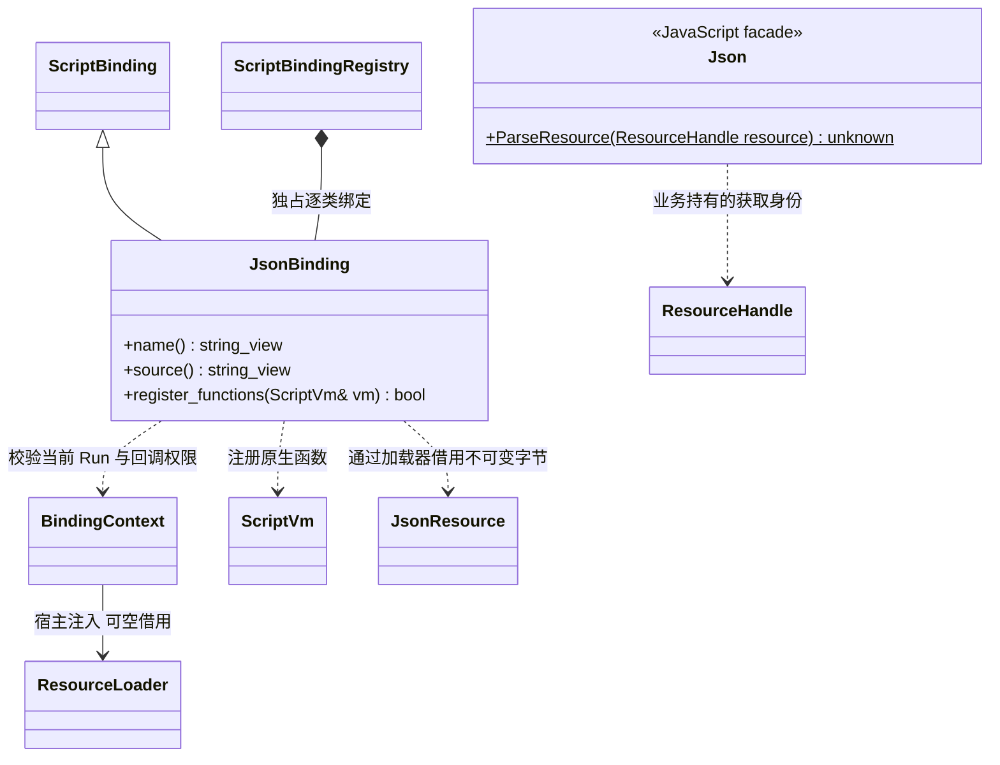

# JSON 脚本接口

[类图索引](../../../class-diagrams/index.md) · [资源脚本接口](resources-script-api.md) · [JSON 导入](../../editor/class-diagrams/json-importer.md)

业务先通过 `Resources.Load` 或 `Resources.BeginLoad` 得到资源获取，再调用 `Json.ParseResource`，最后释放获取。JsonBinding 只解析已加载的 JSON，不读取文件、不查目录、不增加独立缓存。

- 模块顶层、构造和候选预检阶段返回 `null`；有效 Gameplay 初始化、更新、关闭及许可的 UI/组件回调可以解析，无需活动场景。
- 资源句柄失效、属于其他 Run、类型错误、加载器不可用、字节超过 4 MiB 或解析失败，返回 `null`。不接受路径字符串替代句柄。
- 每次解析产生当前 VM 的独立普通值；对象修改不改变资源或其他解析结果。合法 JSON `null` 与失败均为 `null`，业务仍需检查预期类型及字段。
- `Resources.Release` 不销毁已解析出的 JavaScript 值。未释放的资源获取由 Run 关闭时兜底清理。
- JSON 文本中的字符串不自动成为资源依赖；打包入口由调用方明确指定。

实现位于 `src/engine/plugins/runtime/script/bindings/json_binding.cpp`，声明同步在 `include/engine.d.ts`。导入与单项字节校验由 JsonImporter / JsonResourceCodec 承担。
