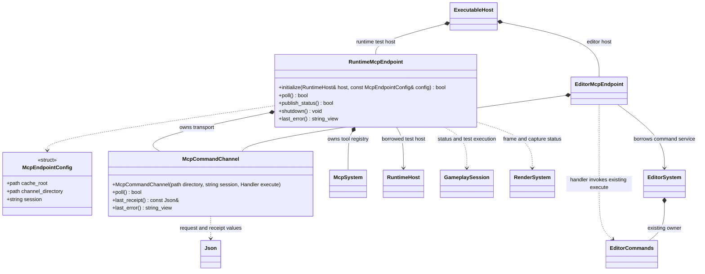

# 可选运行时 MCP 与场景测试

[类图索引](../../../class-diagrams/index.md) · [场景加载状态](../../../runtime/class-diagrams/scene-loading.md) · [首帧与截图](../../../runtime/class-diagrams/render-readiness.md) · [当前独立测试桥接](../../editor/class-diagrams/runtime-mcp-debug.md)

状态与方法按本页契约实现；平台验证与限制集中见[测试文档](../../../testing.md)。

## 模块和依赖

| 所属位置 | 职责 | 依赖 |
| --- | --- | --- |
| plugins/runtime/mcp | McpSystem、McpTool、协议/schema、通用命令通道；测试宿主的状态与截图适配 | 运行时核心、协议所需 JSON 库 |
| plugins/editor/mcp | 编辑、预览工具、导入构建同步、开发端 TS 编译及目标选择 | runtime/mcp、编辑器与明确登记的编辑器插件 |
| 运行宿主 | 显式装配测试端点，选择处理命令的安全点 | 测试构建才链接运行时 MCP 工具目标 |
| 普通运行时模块 | 真实加载、帧、截图及宿主状态 | 不依赖 MCP、编辑器或具体脚本后端 |

协议类沿用现有 [McpSystem/McpTool](mcp-system.md) 的方法与登记契约，位于运行时插件的唯一目录和所属文档，编辑器通过声明的插件依赖复用。runtime/mcp 不带入资源导入、打包、SQLite、建模或编辑器撤销栈。

插件仍由 cmake/plugins/runtime/mcp.cmake 登记，编辑器适配独占 cmake/plugins/editor/mcp.cmake。不新增第三种插件目录，也不复制另一份协议。协议与通道唯一归 runtime/mcp，编辑工具单向依赖该插件。

## 端点与通道

- RuntimeMcpEndpoint 是独立测试可执行宿主拥有的适配对象，借用 RuntimeHost 并先于宿主关闭。McpSystem 继续继承 System，端点组合它的工具登记与分派。
- McpCommandChannel 从现有文件通道提取与编辑器无关的请求校验、身份、回执和原子发布。Handler 为 std::function<bool(string_view, const Json&, Json&, string&)>，借用的执行对象须覆盖通道寿命；编辑器自行用 EditorCommands.execute 适配，Undo/Edit 类型不进入该通道。
- 编辑器端由可执行宿主装配 [EditorMcpEndpoint](../../editor/class-diagrams/editor-mcp-tools.md#独立-mcp-端点)，借用 EditorSystem.commands() 的既有接口；编辑器库不包含或链接具体 MCP 插件。原内部通道随这次迁移移出编辑器核心。
- poll 只在宿主协调安全点执行一批有界命令，按请求身份防重复。publish_status 只复制普通接口返回的状态并发布快照。文件编码和落盘复用现有任务域，保留原子文件和请求回执语义，不让每帧等待磁盘。
- 工具协议仍由独立 mcp_app 处理客户端 stdio；运行程序按帧处理通道，不在游戏主循环调用阻塞 run_stdio。启动方式明确提供同一目标的通道目录，不能误连另一个编辑器或测试进程。
- McpEndpointConfig 的 cache_root 为目标的缓存根，channel_directory 必须位于其独立测试目录。session 在每次宿主启动时重新生成；目标核对真实路径、目录归属和会话，拒绝越界及符号链接。
- 端点在呈现系统初始化后、影片与玩法加载之前启用。启动、加载、暂停、失败及关闭过程都能读取相应状态；没有活动 Run 时不登记为可执行脚本状态。
- 状态与截图不要求脚本插件、项目源码或编辑器资源构建器。只消费已部署运行资源即可测试原生场景；TS 注入工具仅在明确提供开发端编译环境和脚本能力时可用。
- 所有业务工具由所属文件登记，协议层不添加中央业务 switch。运行端点只登记状态、测试执行及截图工具；编辑器专有修改工具仍通过编辑器适配登记。

## 构建用途与正式包排除

使用测试能力开关 ENGINE_ENABLE_TEST_SUPPORT，默认 OFF，独立于 CMAKE_BUILD_TYPE 与 ENGINE_BUILD_TESTS。测试能力与优化等级、是否编译测试程序相互独立。

| 配置用途 | 状态/业务加载接口 | MCP 协议与运行端点 | 临时脚本执行 |
| --- | --- | --- | --- |
| 正式运行构建 | 编译 | 不创建、不编译、不链接 | 声明与实现均排除 |
| 普通 Debug 运行构建 | 编译 | 默认排除 | 默认排除 |
| 显式 Release/Debug 测试构建 | 编译 | 选择 runtime/mcp 后装配 | 有脚本插件且测试能力开启时编译 |
| 编辑器构建 | 编译 | editor/mcp 依赖协议，编辑工具独立 | 只有显式启用测试能力时提供 |

- 测试构建使用独立 CMake Preset、build 目录及带测试身份的可执行产物；不能把它作为正式运行包导出。正式构建与测试构建不混用目标归档或安装清单。
- 标记通过目标级定义传递到参与测试宿主的核心执行契约、脚本接口、当前所选 VM 与调用方，保证同一链接单元中的类定义一致。不能只给 main.cpp 加宏，也不能把带测试虚接口的库链接到按正式头文件编译的宿主。
- 普通场景状态、业务加载接口和 Renderer 截图能力保持同一实现；测试宏仅围住额外的临时执行入口、命令端点与其辅助代码。禁止测试构建替换正式加载算法，或扩大组件私有成员可见性。
- 当前 GameplaySession/ScriptRuntime/ScriptSystem/ScriptVm 中的临时 execute_project_script 链和包装/校验代码随测试能力一起隔离；正式构建不保留空实现、隐藏命令或“运行时禁用”的入口。正常项目脚本执行不受影响。
- 运行端点目标不依赖 engine_editor、EditorCommands、资源构建器或完整 editor/mcp。开发机上的 TS 编译、打包和资源准备与游戏链接依赖分开。
- editor/mcp 可以因编辑器工具用途创建协议目标；这不允许正式游戏链接它。仅运行的正式预设中既不选 runtime/mcp，也不启用 editor/mcp。
- 隔离验证使用实际配置目标、编译源清单、链接图及产物符号/入口；不能只用“服务没启动”或字符串搜索代替构建约束。测试预设运行 Release 功能验收，Debug 只编译。

## 状态与工具契约

MCP 使用与业务相同的 SceneLoadId、SceneScopeId 和截图身份。核心接口名与数据定义以所属类图为准，JSON 使用 lowerCamelCase；全部 64 位身份与纳秒时间使用十进制字符串。

| 工具 | 输入重点 | 返回与完成含义 |
| --- | --- | --- |
| get_status | 固定目标 | 会话、能力、宿主状态、当前 Run、当前场景、保留的 loadIds 及最近帧的同安全点快照 |
| get_scene_load | session、loadId | 原生 SceneLoadSnapshot；包含各阶段进度、scope 和独立错误 |
| execute_project_script | session、runId、临时 TS 源码及 JSON 参数 | 当前 VM 中执行一次，回执记录实际执行身份与宿主 tick |
| capture_frame | session、selection、scope、帧下界、cache 相对路径 | 受理后返回 captureId；受理不代表完成 |
| get_frame_capture | session、captureId | ScreenshotSnapshot，含实际帧归属、状态、路径和错误 |
| get_request_receipt | session、requestId | 查询该次命令最终回执，不重放操作 |

- get_status 中 capabilities 明确区分 scene_loading、frame_capture、script_execution；未装配能力标记不可用，不能返回假的 ready。运行态状态不再借用 projectState=running 代表整个场景已经可玩。
- RuntimeHostStatus 只负责宿主循环事实，GameplaySession 负责加载请求，RenderSystem 负责帧和截图；端点在同一个协调安全点组装 JSON，使用 snapshotId 和 sampledAtNs 标明采样。序列化对象不反向成为引擎状态来源。
- MCP 保留查询和动作入口，不单独增加 list_scene_loads 或 wait_for_state 工具。请求 ID 随 get_status 返回，详细状态复用 get_scene_load；有界等待复用现有测试辅助，轮询加载就绪、激活、目标帧和截图完成等事实。游戏端没有阻塞等待命令，查询不能推进准备；超时不取消请求、不重试执行脚本、不悄悄换成新的加载身份。
- 活动 Run 尚未产生时 runId 为 0，状态与截图仍可用。执行脚本必须校验非零当前 runId；热重载或重开导致旧身份明确失效。
- 请求失败保存在原回执；加载失败保存在对应加载请求；截图失败保存在对应截图请求。它们与最近的命令错误不能互相覆盖。
- 原请求等待超时后继续查询其 receipt/captureId/loadId；不得因网络或工具等待超时重复注入伤害、移动、场景切换等副作用。
- get_frame_capture 必须指定 captureId；get_request_receipt 统一查询运行端与编辑器端的命令回执，不保留旧工具别名。
- 通过脚本开始业务加载后，返回 SceneLoadRequest.GetStatus().id 供测试等待。引擎事实状态不需要脚本注入读取；项目任务结果、分数和动画状态等业务断言继续通过当前 Run 的脚本接口取得。

## 测试执行与卡住诊断

临时 TS 继续在工具进程编译，运行端只接收编译后的 JS 与 JSON。保持同一活动 VM/Gameplay/模块实例，继承既有输入大小、重入和返回 JSON 限制。失败不自动回滚业务副作用，停止/换 Run 后拒绝旧请求。

测试脚本必须短小并主动返回；业务异步工作返回任务身份，后续查询。同步脚本死循环仍可能阻塞所属线程，MCP 的 timeout 不能中断已经运行的 VM；本设计不额外引入未评审的脚本 watchdog。

| 观察到的事实 | 可作出的判断 |
| --- | --- |
| tick 与旧场景帧持续增长，新批次进度增长 | 正在正常并行准备 |
| tick 持续增长，进度长期不变 | 准备未取得进展，记录当前阶段/在途数进一步定位 |
| 帧在增长但 kind=clear/movie | 宿主仍在提交画面，尚不能证明目标场景已绘制 |
| 目标 scope 首帧已提交，PNG 已回读 | 可以进行本用例的视觉断言，不能直接宣布材质/光照正确 |
| 心跳/快照变旧、命令无回执 | 无新观察，可能主线程阻塞、暂停或进程失联；不能直接断言 GPU 死锁 |
| windowDrawable=false 或设备换代 | 按设备状态解释等待，不能把无场景帧记为加载成功 |

最后一份快照由外部 mcp_app 读取；游戏线程停住时仍可报告快照年龄和已持久化的回执。禁止为了制造“在线”心跳而由后台线程直接读取 ECS/VM。无法得到新截图时归档 capture unavailable、最后快照与已有画面。

## 测试迁移与归档

1. 现有 C++ 图形用例使用普通 RenderSystem 请求和身份；公共测试辅助统一等待对应截图完成。
2. 编辑器、独立运行与项目实窗用例使用上述工具，不再固定 sleep 后仅判断图片非黑。
3. 首次加载等待本请求 staged/ready/active 的真实阶段，截图绑定目标 scope；动态批次测试同时验证旧场景持续提交。
4. 失败和超时也归档：最后状态、请求回执、步骤、资源版本、构建配置，以及能够取得的 PNG。普通图形输出与预期黑画面由具体用例判断。
5. 所有文件放对应项目 cache 或构建 test-artifacts；源码和私有资源不自动复制到公开测试材料中，不进入 Git。

验证范围包括 MCP 关闭/开启、无脚本宿主、启动阶段查询、旧 Run/请求、截图排队与失败、同进程加载期间持续呈现，以及正式运行目标不含测试入口。实际执行结果和未验证边界统一见[测试文档](../../../testing.md)。
