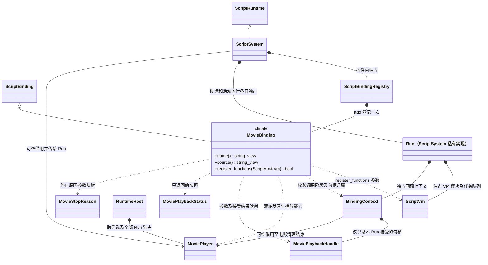
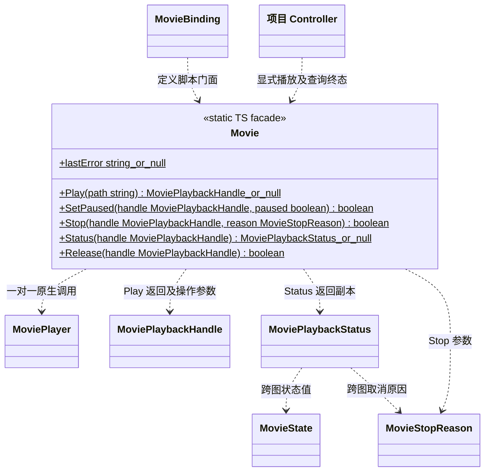
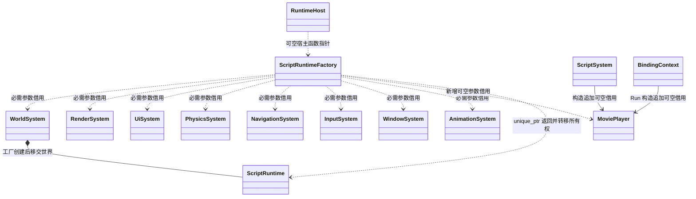
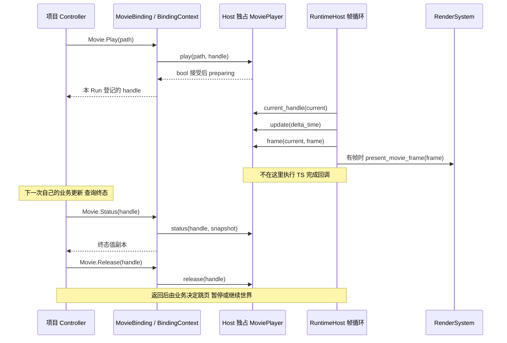

# 影片脚本接口与 Run 生命周期

**资源接入迁移说明：本页记录当前脚本绑定，include/engine.d.ts 尚未修改。目标要求脚本显式加载资源，再把本 Run 的已加载资源身份传给 Movie.Play，不能在绑定或播放器里补读路径；Run 结束分别清理播放和资源获取。统一规则见[业务与模块任务](../../../runtime/class-diagrams/resource-consumers.md)，实施前同步本页脚本外观及声明。**

MovieBinding 与 `include/engine.d.ts` 已提供本页影片门面；绑定复用同一 MoviePlayer，
每个 Run 只拥有自身请求的停止及释放责任。

[类图索引](../../../class-diagrams/index.md) · [既有绑定接口](script-bindings.md) ·
[当前脚本系统](script-system.md) · [播放器契约](../../../runtime/class-diagrams/movie-player.md) ·
[启动装配](../../../runtime/class-diagrams/movie-startup.md) ·
[音频复用](../../../runtime/class-diagrams/movie-audio.md)

## 逐类绑定与所有权



MovieBinding 位于计划中的 `engine::plugins::script::bindings`，继承真实的 ScriptBinding，
沿用 `ScriptBindingRegistry::add<MovieBinding>()`。三个方法均为 `const`、`override`、
`[[nodiscard]]`，其中 name / source 另为 `noexcept`；register_functions 的参数真实类型是
`engine::plugins::script::vm::ScriptVm&`。ScriptBinding、Registry、BindingContext、ScriptSystem
及 VM 的现行方法只在各自图中维护；本页不重复定义它们。

MovieBinding 不拥有 MoviePlayer、World 或音频设备，也不处理 VM 特有句柄。Run 只拥有自己的
播放句柄记录；MoviePlayer、媒体共享引用和声部的所有权以[播放器](../../../runtime/class-diagrams/movie-player.md)
及[音频契约](../../../runtime/class-diagrams/movie-audio.md)为准。核心不 include 或链接 MovieBinding。

Host 不拥有片头或 Run 的播放句柄。它在帧循环内通过原生 current_handle 查询当前唯一请求，
再取得状态和帧用于单次全屏呈现；因此 MovieBinding.Play 不需要另向 Host 登记句柄或创建
第二个播放器。这个查询只供宿主呈现，不是句柄所有权转移，不向 TS 门面开放。

## TypeScript 门面



- Movie 不可构造；初版 Play 表示全屏播放普通影片资源。路径为当前资源目录中的逻辑路径，
  不接受任意原生文件、项目目录或编码器路径。脚本不取得 MovieFrame、GPU 纹理或音频流，
  不提供 MovieComponent、UI 动态视频贴图或材质接口。
- Play 仅在原生 player 接受且 BindingContext 成功记录句柄后返回该句柄；否则返回 null。
  接受表示 preparing，不表示文件已读完、已经开始输出或最终成功。记录归属失败必须取消并释放
  刚接受的请求，不能遗留一个脚本无法控制的全屏播放。立即拒绝时没有可查询句柄，调用方通过
  lastError 取得 `MoviePlayer::last_error()` 的字符串副本；无可用服务 / 非法上下文返回 null。
- SetPaused、Stop、Release 对应相同原生方法；Stop 的 reason 默认 stopped，跳过按钮显式传
  skipped，none 不是合法停止原因。终态再次 Stop 返回 false 且不改写结局。
  没有单独的自动跳页 Skip 接口，跳过只取消播放。Release 仅接受终态，活动句柄须先
  Stop 再 Release；成功释放后才从本 Run 的记录中移除，失败不伪造释放成功。
  Status 失败返回 null，原生输出保持清零安全状态，不伪造 completed；成功返回独立快照，错误
  字符串也必须复制，不能向 JS 暴露 string_view 或播放器内部缓冲。
- MovieState、MoviePlaybackStatus、MovieStopReason 的完整定义仅在播放器图维护，TS 映射保持
  同一字段和状态语义。句柄的两个 uint64 值映射为 bigint，不通过 number 截断；这是瞬时身份，
  不序列化为场景或项目设置。收到他人、旧代或已 release 的句柄，一律拒绝操作。
- 所有接口限定于活动 Run 的合法生命周期 / UI 业务回调。候选预检、模块顶层、构造、普通
  Promise jobs 或失效上下文不得播放、控制或查询。无 MoviePlayer 注入时 Play / Status 为 null，
  修改为 false；不偷偷创建另一个播放器或音频设备。
- 一实例只保留一个尚未 release 的请求，终态也继续占用。忙碌时 Play 返回 null，不自动取消
  片头、Native 或其他 Run 的请求；调用者只能操作自己持有且在本 Run 登记的句柄。
  Native 启动句柄不能从脚本猜测并接管。

## 宿主注入

工厂末尾为可空 MoviePlayer*，完整公开契约统一见[运行宿主](../../../runtime/class-diagrams/runtime-host.md)。

```cpp
using ScriptRuntimeFactory = std::unique_ptr<ScriptRuntime> (*)(
    WorldSystem& world,
    RenderSystem& renderer,
    UiSystem& ui,
    PhysicsSystem& physics,
    NavigationSystem& navigation,
    InputSystem& input,
    WindowSystem& window,
    AnimationSystem& animation,
    MoviePlayer* movies);
```



可执行宿主负责把同一个 MoviePlayer 指针传入所选脚本插件。ScriptSystem 构造在现有 animation
之后追加默认空的 MoviePlayer*；BindingContext 构造在现有 window 之后追加默认空的 MoviePlayer*。
这些都是插件内部借用注入，不改变 ScriptRuntime 抽象玩法方法，不把 RuntimeHost 整体传给插件。
MoviePlayer 必须覆盖 ScriptSystem 及其全部候选 / 活动 Run 的停止、VM 销毁和绑定清理，
不能只活到 OnShutdown 返回。未选脚本插件时，Native 和启动影片照常使用播放器。

## 完成查询、取消与防重入

原生 Player 不调用用户完成回调。Native 启动循环、编辑器调用方和 TS Controller 都在自己的
安全更新阶段取得状态副本，根据 completed / cancelled / failed 决定下一步；先复制终态，再
release，最后执行页面切换或对象销毁。终态不会因为再次 Stop 而被改写。

play / 控制方法返回 false 不自动停止 Engine；单项影片读取、解码或声部失败写入该句柄的 failed
终态，Host 继续更新，让所属业务显式处理。`MoviePlayer::update()` 返回 false 只用于非法
delta_time、生命周期或服务级失败，不能把每个坏文件都提升为整个游戏的帧失败。



暂停影片不会修改 World 暂停；全屏呈现也不会决定游戏输入屏蔽。项目如需过场时冻结玩法，
须自行提交并恢复世界暂停状态，不能让 MovieBinding 猜测调用身份。自然完成才是 completed；
Stop / skipped 都是 cancelled，播放或资源错误是 failed，业务必须分别处理。

窗口后台冻结由 Host 统一保持：不推进 Player::update，暂停共享音频设备，准备完成结果留待
恢复时提交。它不通过对 preparing 调用 SetPaused 来模拟冻结，也不在恢复时擅自解除业务
原先的 paused；恢复 delta 不包含后台墙钟，详见[启动预算与暂停](../../../runtime/class-diagrams/movie-startup.md#主线程与后台预算)。

本轮不增加影片 Promise、完成回调或事件总线。今后确需完成通知时，须先复制终态并交给已有
Run 队列，在下次安全点且 Run 身份仍有效时执行；不能从视频任务、音频回调、Player::update
或析构中直接进入 VM。不得为通知另建线程池或让异步闭包持有 ScriptVm / Run 裸指针。

## Run 停止与释放

BindingContext 的影片专用清理安全点 `cancel_movies() noexcept -> void`：只遍历
本 Run 记录，先停止 preparing / playing / paused 请求，再 release 所有记录；completed / failed
等终态直接 release，清理幂等，不能触碰其他 Run 或 Native 的句柄。它与记录集合都属于插件内部，
不成为核心的 Run 注册接口。

停止顺序明确为：当前用户调用返回 → OnShutdown / 既有脚本绑定解绑 → cancel_movies → 销毁
VM 与其任务队列 → 继续现有 BindingContext / 场景及共享引用清理。候选预检、部分初始化和
Run 析构也必须在 VM reset 前调用这个幂等安全点，不能仅依赖现行析构中晚于 machine.reset
执行的 BindingContext::shutdown。回调栈尚未返回时，只记录停止意图，拥有者在安全点销毁 Run。

release 失败仍按原生句柄有效性及状态处理，不把失败当作他人句柄重新接管。正常 Host 关闭
须先收尾全部 Run，再销毁 MoviePlayer，之后才关闭 AudioSystem、资源及任务域；完整的窗口 /
GPU / 世界解除借用顺序见[启动契约](../../../runtime/class-diagrams/movie-startup.md#完成取消失败与关闭)。
