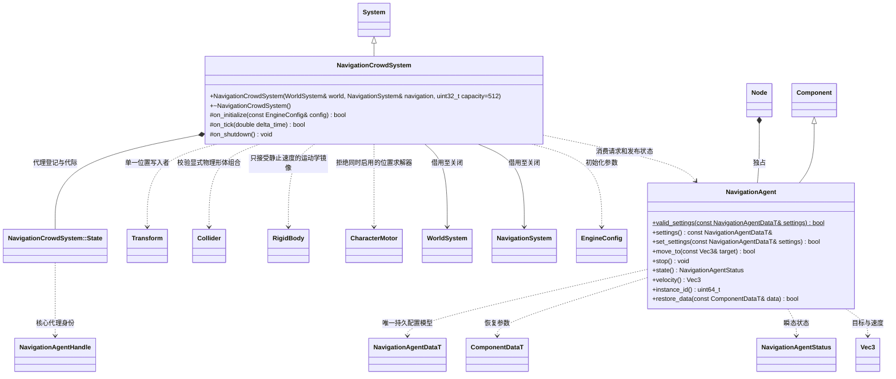

# 多角色导航

[类图索引](../../../class-diagrams/index.md) · [导航核心](../../../runtime/class-diagrams/navigation-system.md)

`navigation_crowd` 是可选运行时插件。核心拥有 DetourCrowd；插件负责场景代理的身份、请求和 Transform 同步。脚本只配置代理与提交目标，不逐帧搬运位置。没有敌人、阵营或战斗规则。

- 宿主在脚本及地形/建筑几何提交之后、物理之前调度插件；核心不自动推进代理，也不扫描场景。
- 代理要求根节点、启用的 Transform、单位缩放；模型可以挂在子节点并自行调整姿态。允许同节点同时启用 Collider 与线/角速度为零的 kinematic RigidBody，作为跟随 Transform 的查询/触发形体；Crowd 仍是唯一位置写入者。Physics 对这种运动学形体只镜像 Transform，不回写位置。Collider 可设为 sensor 避免碰撞响应；查询需要显式选择 sensors。
- 同节点启用 CharacterMotor、dynamic/static RigidBody、非零线/角速度的 kinematic RigidBody，或仅启用 Collider/仅启用 RigidBody 都视为不受支持的组合，发布 invalid 并停止导航写入。无物理组件的既有代理行为保持不变；禁用组件不拥有位置。导航代理沿已提交网格移动，不让刚体额外积分或以碰撞推回代理；需要物理重力和击退的角色仍由 CharacterMotor 驱动。
- 配置包含半径、高度、最大速度、最大加速度、分离权重、到达距离和速度朝向；启用朝向时令节点局部 -Z 指向水平速度。尺寸不得超过网格烘焙净空。宿主选择容量，默认 512；这只是容量，不是性能承诺。
- MoveTo 接受有限目标并进入 pending，排队成功不代表可达。原生发布 idle/pending/moving/arrived/unreachable/invalid 与速度。到达以投影目标及到达距离判断；不可达不能当作到达。
- Stop 清除目标并请求停止。禁用、移除组件、删除节点及切场景在下一次导航更新前移除核心代理；同节点重建组件不会继承旧目标。瞬态目标、状态与句柄不保存到场景。
- 位置由核心积分；外部修改根 Transform 位置视为显式传送，在下一安全点重新投影登记。完整导航重建使核心句柄失效，插件重登记并重发组件仍保留的显式目标；导航清空期间停止写入。局部 tile 更新由核心重建走廊，不能沿旧路径穿过已失效区域。
- 每帧遍历场景登记代理，使用实例身份索引匹配，不做逐角色全场查找。先移除旧实例再分配新代理，支持满容量同帧替换。已失败的登记只在位置、参数、请求、网格版本或可用槽位变化后重试。所有第三方类型留在核心私有实现。
