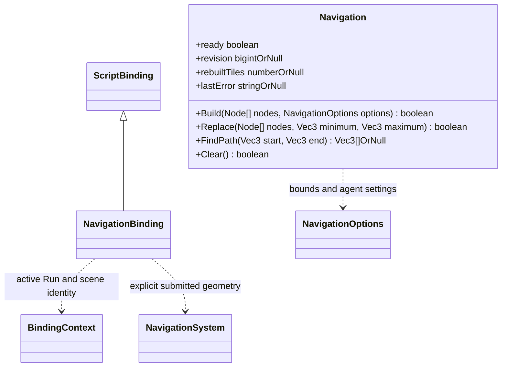
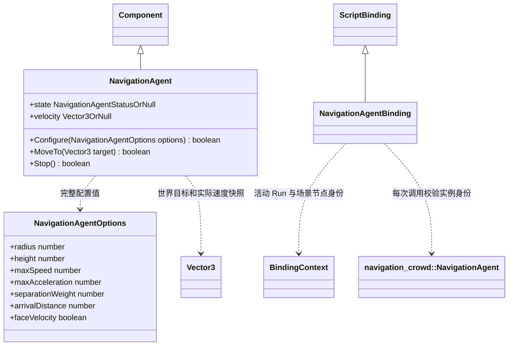

# 导航脚本接口

[类图索引](../../../class-diagrams/index.md) · [绑定实现](script-bindings.md) · [导航核心](../../../runtime/class-diagrams/navigation-system.md)

NavigationBinding 位于 `engine::plugins::script::bindings`，属于脚本插件，单独登记；不把 Node 扫描或玩法策略加到导航核心。
Build/Replace 接受明确的同场景 Node 数组，仅取这些节点上启用的静态 MeshRenderer 和 Transform，
不递归、不扫描整场景、不自动纳入动态碎块。几何只在同步调用期间借用。
NavigationOptions 包含 minimum/maximum 边界、cellSize/cellHeight、tileSize、agentHeight、
agentRadius、agentMaxClimb、agentMaxSlope。默认沿核心配置；不识别具体地形或破坏组件。
Replace 仍提交完整当前几何，dirty 只决定重建哪些 tile；失败区域失效，不能继续使用旧路线。
绑定层拒绝非法 Node 数组、失效/重复节点、非静态刚体、禁用组件或非法参数时清空当前导航；核心收到合法 dirty 后构建失败则仅移除受影响 tiles。Build 失败清空全部导航。
FindPath 仅返回完整可达的世界坐标路径，失败 null，不把部分路径当作成功。
切场景/停止当前 Run 清理导航；无导航借用时查询返回 false/null。

回归入口为 `tests/plugins/runtime/script/navigation_script_test.cpp`：使用实际脚本后端和正式资源目录，覆盖显式几何、父子世界变换、局部替换、参数拒绝与场景清理，不启动窗口。

## 可选多人导航组件

- 仅启用 `runtime/navigation_crowd` 时导出 NavigationAgent；Node 使用既有 `AddComponent/GetComponent` 工厂，不增加导航专用节点接口。脚本插件清单显式声明可选依赖，关闭后不链接组件实现或导出脚本类。
- Configure 接收完整配置；省略的字段采用生成模型默认值：radius=0.3、height=1.8、maxSpeed=3、maxAcceleration=8、separationWeight=2、arrivalDistance=0.15、faceVelocity=true。非法类型或原生校验失败返回 false，并保留原配置与运动请求。
- MoveTo 只提交世界空间目标，成功不等于已到达；Stop 清除本组件的运动请求，失效句柄返回 false。只读 state 返回 `idle/pending/moving/arrived/unreachable/invalid` 或失效时 null；velocity 为世界速度值快照或 null。
- 门面创建时捕获组件的 `instance_id`，包括继承行为 IsValid/SetEnabled 在内的每个组件操作均同时校验场景、节点和实例身份。删除后在同节点重建不会使旧门面复活；绑定不持有原生组件指针，也不在脚本层执行避障或物理步进。
- NavigationAgent 将实例校验函数放入私有 handles 记录；Component 基类的 IsValid 优先使用该函数，SetEnabled 在写入前执行该校验。显式借用基类方法调用也不能绕过实例身份。没有该内部校验函数的既有组件保持原有行为，不向核心或基础绑定引入具体插件依赖。
