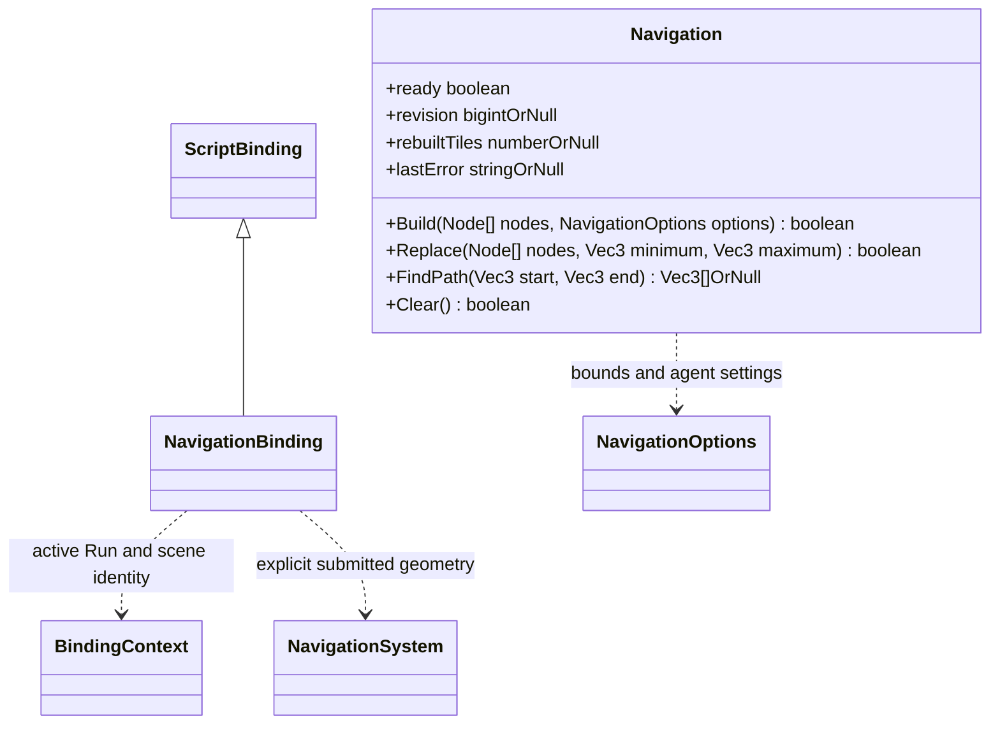

# 导航脚本接口

[类图索引](../../../class-diagrams/index.md) · [绑定实现](script-bindings.md) · [导航核心](../../../runtime/class-diagrams/navigation-system.md)

NavigationBinding 位于 `engine::plugins::script::bindings`，属于脚本插件，单独登记；不把 Node 扫描或玩法策略加到导航核心。
Build/Replace 接受明确的同场景 Node 数组，仅取这些节点上启用的静态 MeshRenderer 和 Transform，
不递归、不扫描整场景、不自动纳入动态碎块。几何只在同步调用期间借用。
NavigationOptions 包含 minimum/maximum 边界、cellSize/cellHeight、tileSize、agentHeight、
agentRadius、agentMaxClimb、agentMaxSlope。默认沿核心配置；不识别具体地形或破坏组件。
Replace 仍提交完整当前几何，dirty 只决定重建哪些 tile；失败区域失效，不能继续使用旧路线。
绑定层拒绝非法 Node 数组、失效/重复节点、非静态刚体、禁用组件或非法参数时清空当前导航；核心收到合法 dirty 后构建失败则仅移除受影响 tiles。Build 失败清空全部导航。
FindPath 仅返回完整可达的世界坐标路径，失败 null，不把部分路径当作成功。
切场景/停止当前 Run 清理导航；无导航借用时查询返回 false/null。

回归入口为 `tests/navigation_script_test.cpp`：使用实际脚本后端和正式资源目录，覆盖显式几何、父子世界变换、局部替换、参数拒绝与场景清理，不启动窗口。
