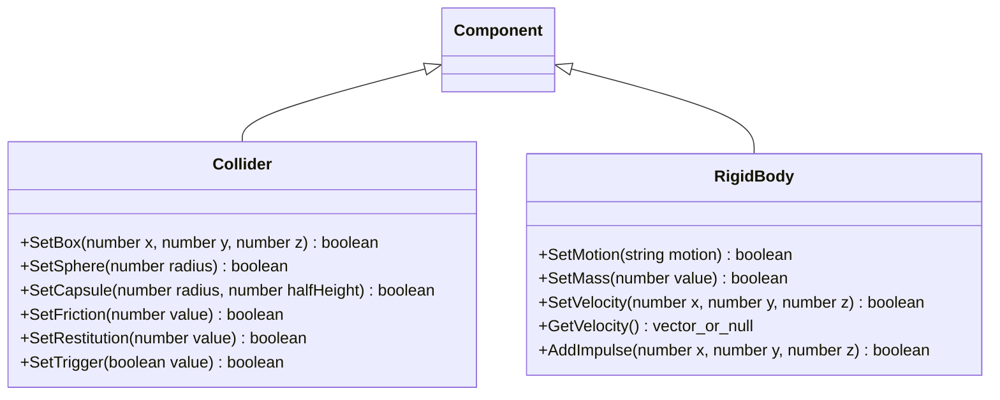
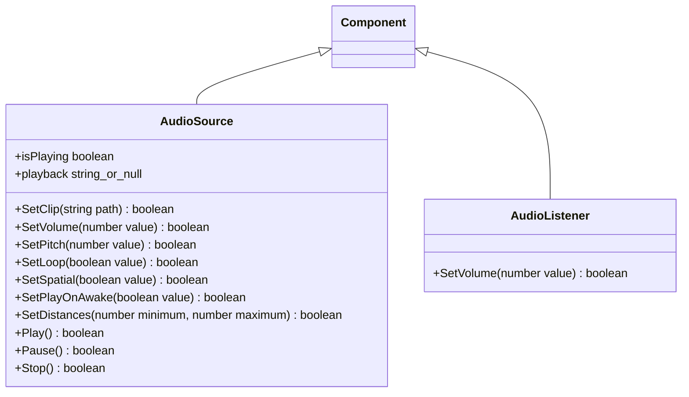
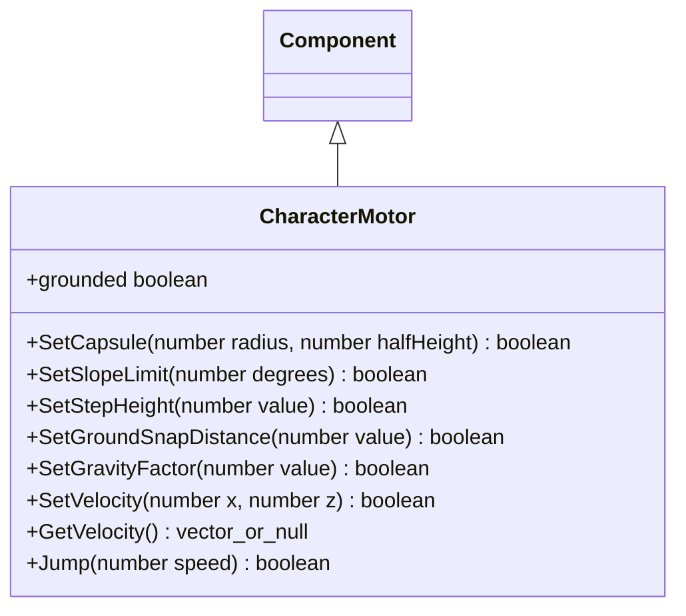

# 物理与音频组件脚本接口

物理与音频组件均通过 `Node.AddComponent(Type)`、`GetComponent(Type)` 访问。绑定类属于 `engine::plugins::script::bindings`，原生组件属于 `engine`；脚本对象只保存场景及节点身份，每次调用重新查找，不借用已销毁的组件地址。

Box 参数为半尺寸，Capsule 的 halfHeight 为圆柱段半高。刚体 motion 为 `static`、`kinematic`、`dynamic`；切换 static 前须将速度清零，状态由原生组件校验。速度和冲量使用世界空间，冲量请求在下一次物理同步消费。GetVelocity 返回普通 `{x,y,z}` 值快照，失效时返回 null。

SetClip 使用资源目录的路径，空字符串清空引用；失败保留原引用。Play 返回请求是否被接受，`pending` 不等于真实输出开始；`isPlaying` 只有原生状态为 playing 才为 true。playback 为 `stopped/pending/playing/paused/failed`，对象失效返回 null；Pause/Stop 只调用组件接口，不从脚本打开设备。布尔参数不做隐式真假转换，非法数值和错误类型返回 false。

`ColliderBinding`、`RigidBodyBinding`、`AudioSourceBinding`、`AudioListenerBinding` 分别位于独立头文件和实现文件，通过 ScriptBindingRegistry 显式登记；Node 和 ScriptSystem 不增加组件类型分支。

CharacterMotor 的脚底原点、设置校验与碰撞由[核心组件](../../../runtime/class-diagrams/character-motor.md)定义。SetVelocity 只提交水平请求；GetVelocity 返回最后物理结果，失效对象为 null。Jump 仅在地面时接受一次请求；grounded 对失效或禁用对象为 false。
