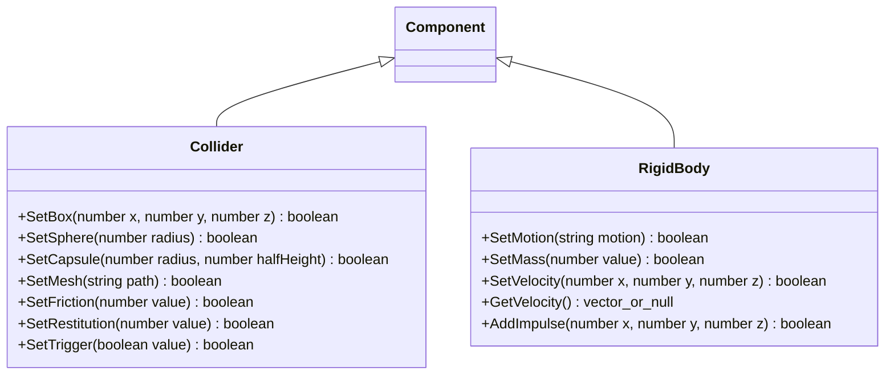
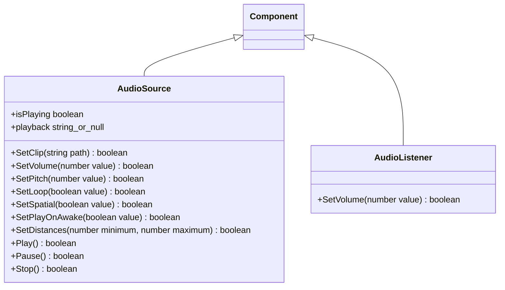
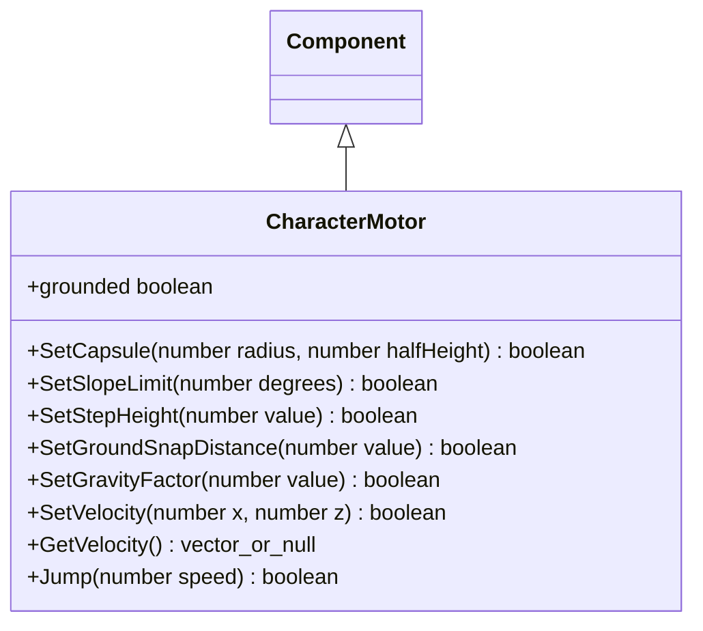
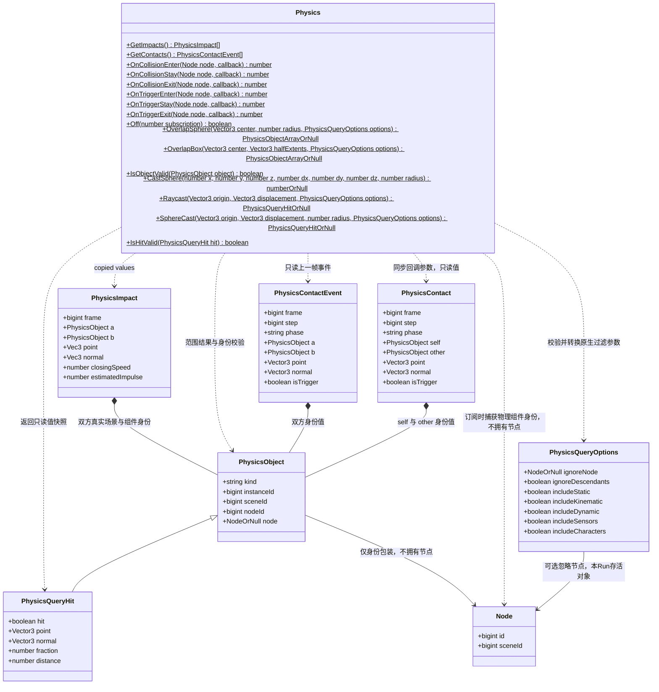

# 物理与音频组件脚本接口

物理与音频组件均通过 `Node.AddComponent(Type)`、`GetComponent(Type)` 访问。绑定类属于 `engine::plugins::script::bindings`，原生组件属于 `engine`；脚本对象保存场景、节点及统一组件实例身份，每次调用重新查找，不借用已销毁的组件地址。

Box 参数为半尺寸，Capsule 的 halfHeight 为圆柱段半高。刚体 motion 为 `static`、`kinematic`、`dynamic`；切换 static 前须将速度清零，状态由原生组件校验。速度和冲量使用世界空间，冲量请求在下一次物理同步消费。GetVelocity 返回普通 `{x,y,z}` 值快照，失效时返回 null。

`SetMesh(path)` 使用资源目录中的独立 Mesh，加载失败保留已有形状；只允许无刚体或静态刚体。`SetBox/SetSphere/SetCapsule` 会清空碰撞网格引用。网格三角面不跟随蒙皮动画改变。

SetClip 使用资源目录的路径，空字符串清空引用；失败保留原引用。Play 返回请求是否被接受，`pending` 不等于真实输出开始；`isPlaying` 只有原生状态为 playing 才为 true。playback 为 `stopped/pending/playing/paused/failed`，对象失效返回 null；Pause/Stop 只调用组件接口，不从脚本打开设备。布尔参数不做隐式真假转换，非法数值和错误类型返回 false。

`ColliderBinding`、`RigidBodyBinding`、`AudioSourceBinding`、`AudioListenerBinding` 分别位于独立头文件和实现文件，通过 ScriptBindingRegistry 显式登记；Node 和 ScriptSystem 不增加组件类型分支。

CharacterMotor 的脚底原点、设置校验与碰撞由[核心组件](../../../runtime/class-diagrams/character-motor.md)定义。SetVelocity 只提交水平请求；GetVelocity 返回最后物理结果，失效对象为 null。Jump 仅在地面时接受一次请求；grounded 对失效或禁用对象为 false。

## 只读物理撞击快照

`Physics.GetImpacts()` 返回当前 Run 存活对象的上一物理帧快照，包含常驻对象；无物理系统或无有效事件时返回空数组。a/b 分别保存真实所属场景及组件实例，允许双方位于不同 Scene。读取不消费，多次读取同帧返回相同数据，调用者按 `frame` 去重。节点在读取前已删除、禁用或更换物理组件的记录不暴露。`normal` 从 a 指向 b；速度为碰前法向接近速度 m/s，冲量为 Jolt 官方 `EstimateCollisionResponse` 的法向估计 N·s，不能当作求解后的真实冲量。传感器和 CharacterVirtual 不在本接口范围。项目脚本在下一次 Tick 决定损伤、阈值、冷却及预算，不从碰撞回调执行场景修改。

`Physics.CastSphere` 复用核心 Jolt 形状扫掠；完整世界位移、有限半径，返回最早命中比例 [0,1]，无命中 1，错误 null。忽略传感器，不隐式推进物理。项目 `Fire` 将弹体放在发射口，首次及后续 Tick 均从上次位置扫掠本帧完整位移，不跳过发射口前的首段距离；发射、目标、引爆和频率均归项目。

## 世界最近命中查询

`Raycast` 与 `SphereCast` 使用世界起点和完整位移，查询已发布节点的碰撞世界，不推进物理或加载资源；当前 Run 仍拥有活动场景或存活常驻节点时可查询。无效参数、无可用物理世界或不属于本 Run 的忽略对象返回 `null`；有效查询返回只读快照，`hit=false` 明确表示未命中，此时身份、向量与数值归零、`node=null`。命中时 `node` 是已有 Node 身份包装，访问仍校验所属 Run；不靠节点名称识别目标。

过滤默认包含静态、运动学和动态 Collider，排除 Sensor。`ignoreNode` 默认 null，指定时默认连同其后代忽略；必须是本 Run 所属场景的存活节点，允许常驻节点。这些是物理对象类别，不是新增的业务碰撞层。角色通过官方 CharacterVirtual inner body 加入查询；includeCharacters 默认 true，独立于 includeKinematic。CharacterMotor 不应再叠加 Collider。

`point` 为世界命中点，`normal` 为世界单位法线，`fraction` 为完整位移中的比例，`distance` 为该比例对应的移动距离；球扫的距离是球心行程，点在被击形状上。零位移被拒绝，不兼任重叠查询。起点位于凸体内部的射线返回零距离，法线按反向射线给出退回方向；此时起点不被当作物体表面点。三角网格采用双面查询，具体重叠语义与核心[物理查询](../../../runtime/class-diagrams/physics-system.md)一致。

`Node.id` 与 `sceneId` 为只读身份，销毁后仍可用于识别旧记录，是否可用通过 `IsValid()` 判断。`Physics.IsHitValid(hit)` 另校验场景、节点、对应物理组件实例和启用状态；删除后重建同名节点或同节点重挂 Collider 不会恢复旧命中。移动只改变后续查询，不使历史命中位置自动更新。模块顶层、构造、预检与过期 Run 不允许查询，返回 null/false。玩法计分、伤害、阵营和射速由调用方决定。

## 范围查询与接触生命周期

OverlapSphere(center, radius, options) 与 OverlapBox(center, halfExtents, options) 返回只读 PhysicsObject 列表；盒为世界轴对齐半尺寸。无效查询返回 null，合法但没有对象返回空数组。结果按组件身份去重，与 Raycast/SphereCast 使用同一过滤和同步语义。PhysicsObject 保存 sceneId/nodeId/kind/instanceId/node；kind 为 collider 或 character，实例代际独立于节点。IsObjectValid 校验身份，IsHitValid 额外要求 hit=true。不保留旧 colliderId 字段，项目与测试统一迁移。

GetContacts 返回上一物理 tick 中涉及本 Run 存活节点的只读事件数组，调用方按 frame 整批去重；step 表示固定物理子步，phase 为 begin/stay/end，同帧多次转换不丢失。a/b 是 PhysicsObject，normal 从 a 指向 b；isTrigger 为任一方 sensor。零子步不产生 stay，休眠持续接触仍有 stay。end 可携带已删除或禁用对象的历史身份，其 node.IsValid/IsObjectValid 可为 false；常驻接收者仍能收到旧关卡对象卸载产生的退出事件。完整 clear 清空所有事件。脚本在正常 Tick 读取，不在 Jolt 回调执行。

常规脚本使用 `Physics.OnCollisionEnter/Stay/Exit(node, callback)` 与 `OnTriggerEnter/Stay/Exit(node, callback)`。返回本 Run 的订阅 ID，失败为 0；`Physics.Off(id)` 显式解除，重复解除返回 false。节点必须具有唯一启用的 Collider 或 CharacterMotor；订阅捕获当前组件实例，在初始化时即可创建，不要求先推进物理。禁用、销毁或替换接收组件后自动解除，重建不会复活旧订阅；存活接收者仍收到包含失效 `other` 身份的 Exit。订阅本身不持有原生组件。

回调收到 `PhysicsContact`，`self` 是订阅对象，`other` 是对方，法线从 self 指向 other；其他字段与快照一致。脚本插件复用现有绑定事件钩子，在 Gameplay.Update 前同步派发，每批只派发一次，保留同帧全部子步转换；GetContacts 读取不消费订阅。仅递送订阅之后产生的事件，回调中新加订阅从下一物理批次生效，Off 立即生效。切场景后停止向已删除接收者派发，常驻接收者保持原订阅；停止与热重载清空订阅。回调不得返回 Promise。按对象身份索引订阅，不逐事件扫描全体订阅者。核心仍只发布值事件，不持有脚本回调。
