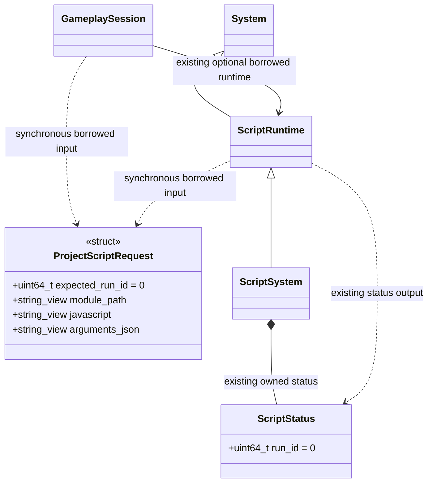
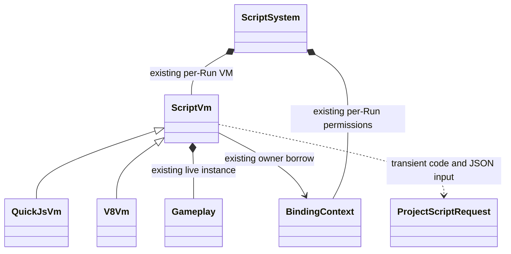
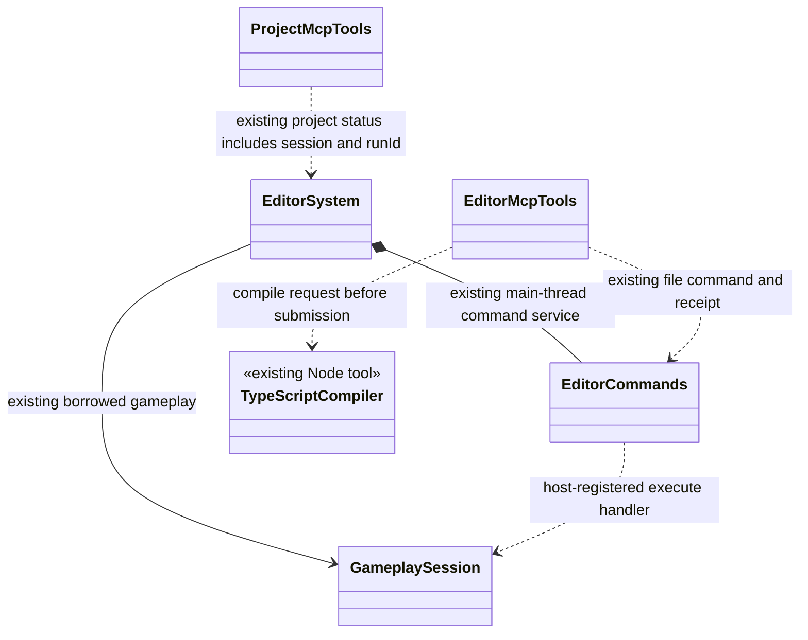

# 在活动玩法中执行临时 TypeScript

本页定义活动 Run 中执行临时 TypeScript 的契约；生命周期见
[ScriptRuntime](../../../runtime/class-diagrams/script-runtime.md)、
[GameplaySession](../../../runtime/class-diagrams/gameplay-session.md)、
[ScriptSystem](script-system.md)、[ScriptVm](script-vm.md)及
[编辑器命令](../../../editor/class-diagrams/editor-commands.md)。

MCP 直接提交一段 TS，在**当前运行的同一 VM、同一项目模块实例和同一
Gameplay 实例**上查询或执行操作。项目不用登记命令名称，不另建脚本上下文。
TS 编译留在编辑器工具端，运行时只接收 JavaScript 和 JSON；
普通运行包无需 MCP、Node 或 TypeScript 编译器。

## 用户调用与脚本形状

MCP 增加 `execute_project_script`，输入如下。现有项目状态返回
`session` 和十进制字符串 `runId`，调用方将两者原样带回。

| 字段 | 类型与语义 |
| --- | --- |
| `session` | 当前编辑器会话身份；防重启后误用旧请求 |
| `runId` | 非零十进制字符串；防停止、重开或热重载后误用旧玩法 |
| `sourcePath` | 相对 assets 的虚拟 TS 路径，例如 `scripts/mcp-check.ts`，只用于模块解析和诊断，不写入 assets |
| `source` | 完整 TS 模块源码；默认导出一个同步函数 |
| `arguments` | 任意 JSON 值；缺省为 null |

脚本默认导出函数为 `default(arguments, gameplay)`。第二个参数就是活动 Run 已有的
Gameplay 对象，不调用构造函数、不重新执行 OnInitialize。可以通过类型导入声明
其项目类型；返回值只含 JSON 数据，不把节点、资源或 VM 对象返回 MCP。

```typescript
import type Game from "./game.js";
import { readState } from "./game-state.js";

export default function (args: { detail: boolean }, gameplay: Game) {
    return {
        state: readState(args.detail),
        running: gameplay !== null,
    };
}
```

`game-state.js` 的导入必须复用当前 Run 的模块缓存，读取的就是当前 Model。
只导入 `game.js` 默认导出的类不会获得活动实例，因此显式传入 `gameplay`。

## 核心契约与所有权



本页定义请求数据和跨层调用关系；方法统一维护在各自的[核心执行契约](../../../runtime/class-diagrams/script-runtime.md)、[玩法会话](../../../runtime/class-diagrams/gameplay-session.md)、[脚本系统](script-system.md)与[VM 类图](script-vm.md)。
`ProjectScriptRequest` 是一个临时输入 struct，放在核心 gameplay 模块：
`module_path` 为规范化后的 assets 相对 `.js` 逻辑路径，
`javascript` 为工具生成的 CommonJS 代码，`arguments_json` 为 UTF-8 JSON。
所有 string_view 都借用调用方内存，只在同步调用期间有效，不保存到任务队列。

新增方法标注 `[[nodiscard]]`。调用前清空 `result_json` 和 `error`；
成功返回 true 和完整 JSON，失败返回 false、空结果和原因。
GameplaySession 只转发并拒绝空 ScriptRuntime，不解析源码或 JSON，
不依赖编辑器、MCP、TypeScript 或具体虚拟机。

`ScriptStatus.run_id` 的规则：

- 0 表示没有可执行的活动玩法；候选预检和初始化中均不向外发布身份。
- 每次成功启动获得进程内单调唯一的非零 uint64；同一 revision 的重开也不同。
  不回绕复用，耗尽时启动失败。编辑器重启由 `session` 区分。
- 停止前先关闭外部执行入口并将可见身份清零，再执行原有 OnShutdown 和绑定清理。
  失败候选预检不改变当前身份；成功替换后旧身份失效。
- 既有状态发布文件和项目状态回执增加 `runId` 字符串，不用 JS number 表示 uint64。
  状态文件是上次报告；执行仍须在主线程核对活动 Run，不能只相信文件。

## 复用 VM 执行及临时代码回收



ScriptVm 只增加一个内部方法，失败原因沿用既有 `last_error()`，
由 ScriptSystem 复制到本次调用的 error 输出；调用结束清理临时句柄和待取 VM 异常。
本次脚本失败不自动停止 Run，不覆盖 Gameplay 生命周期的失败策略。
不向核心公开 VM 类型、函数对象或模块 namespace。

当前 QuickJS 后端使用 quickjs-ng 0.18.0。上游
[`JSModuleDef` 生命周期](https://github.com/quickjs-ng/quickjs/blob/v0.18.0/quickjs.c)
会把已解析模块保存在 context 的 `loaded_modules` 中，直到 context 销毁；
仅释放外部 JSValue 不会卸载该模块。因此临时请求不逐次增加新的 ES module，
也不修改上游增加卸载接口。

实施方式复用官方编译器与两个 VM 的普通函数能力：

1. TypeScript 7 官方原生编译器把本次 TS 输出为 ES2022 目标的 CommonJS 代码。
   沿用项目 paths、严格类型选项与引擎声明，通过官方 Bundler 解析模式确认导入。
   该版本的 CommonJS 输出固定使用 ESM interop；给缓存的真实 ESM namespace
   添加本次请求局部的 Proxy 视图，仅向官方 helper 暴露 `__esModule` 标记，
   保留 namespace 身份、default 导出和活绑定，不修改原 namespace 或再包装 default。
   不自行改写 import/export，不打包或重新编译运行中的项目模块。
2. 在活动 VM 内编译一段具有 `exports`、`module`、`require` 局部参数的临时函数。
   这三个名字只在本次函数作用域存在，不写全局、不注册新引擎绑定。
   QuickJS 使用现有编译/调用 API，V8 使用 ScriptCompiler 编译函数表达式并调用。
3. 此处 `require` 只返回当前 VM 缓存内的 ES module namespace。
   `engine` 返回现有引擎模块；相对路径沿用 `resolve_module_path`，
   以 `module_path` 为基准。不得重新执行被导入模块。
4. 执行临时函数，取得 `module.exports.default`，传入解析后的 JSON 和既有
   Gameplay 实例，同步调用并序列化返回结果。
5. 释放本次函数、exports、参数、结果及句柄。临时代码不加入
   `loaded_modules()`、源目录或资源引用清单；再次执行同一 sourcePath 必须执行
   新提交的代码，不能命中旧脚本。仅有项目主动保留的闭包随原有 Run 生命周期存在。

临时 require 的原生入口复用当前 VM，引用参数使用 VM 管理的值；
不能把栈上请求或临时 C++ 对象的裸指针留给 JS 闭包。
它只在本次同步执行窗口有效，窗口结束后保留的 require 引用调用失败，
不能误用下一次请求的解析基准。

首版只允许导入 **当前 Run 已加载的模块**，运行导入显式使用相对 `.js` 路径。
工具编译阶段核对 TS 解析后的发射路径与该逻辑路径相同；类型导入不要求 `.js` 后缀。
原因是 Run 目前在预检时固定模块图，
并在激活时 retain 已加载的入口资源；临时加载新模块会同时涉及目录一致性、
共享资源持有及新顶层副作用。该接口不绕过这些规则。
未加载模块明确报告逻辑路径；需要用到的项目测试模块可由正常入口静态 import，
经既有资源导入、预检和热重载加入 Run。
不接受任意 OS 路径、Node 内置模块、npm 运行时模块或动态 import。
类型导入仍由 TS 编译器按项目配置解析，擦除后不形成运行时加载。

## 编辑器编译和主线程执行



`TypeScriptCompiler` 是图中对现有 Node 工具的表示，不新增对应 C++ 类。
沿用 `scripts/build_scripts.mjs` 的工具定位、项目 TypeScript 版本、
tsconfig 与引擎声明解析，增加单段源码编译模式。
以虚拟 sourcePath 建立编译器输入，检查类型并只输出本次模块；
项目资源不重编译、不重新导入，不产生 GUID、meta 或 catalog 变更。

MCP 工具属于独立工具进程，可以在那里调用随编辑器部署的 Node，
复用[编辑器扩展工具](../../../editor/class-diagrams/extension-tools.md)的唯一 `run_import_tool` 与工具路径函数，显式检查返回状态。源码通过受控临时文件传入，
不拼入 shell 命令；临时文件只放项目 cache 的本次请求目录，完成或失败后清理，
不写 assets，不进入 Git。编译发生在向编辑器提交命令之前，不阻塞渲染帧。

既有 `EditorMcpTools::call_command` 提交编译后的 JS、逻辑路径、JSON 参数、
预期 session 和 runId。EditorSystem 使用已有 EditorCommands 注册
`execute_project_script`，处理函数只借用既有 GameplaySession：

- 复用原有文件请求、项目身份、session、requestId、锁和持久回执；
  不新增端口、RPC 服务、调度器或命令注册框架。
- 编辑器主线程在既有命令安全点重新核对 session、runId、当前运行状态，
  再调用 GameplaySession。编译期间发生停止或热重载时拒绝旧请求。
- 操作 `undoable=false`，不加入场景编辑历史或 batch。脚本产生的副作用不承诺撤销。
- 同一请求的回执表示该次调用结果；等待超时返回 pending 时查询原回执，
  不重新执行脚本，不把超时当作失败或可安全重试。
- session 必须与注册处理函数借用的当前编辑器会话一致，
  即使新编辑器重新使用相同数值 runId，也不能执行旧会话提交的代码。

普通运行宿主只保留统一 ScriptRuntime 契约；没有 MCP 就不会收到工具请求。
不把 Node、TS 编译器、编辑器目录或 MCP 依赖引入核心。

## 暂停、错误和异步边界

调用只允许在活动 Run、非停止阶段、无嵌套脚本调用的主线程安全点执行。
ScriptSystem 沿用 BindingContext 的 begin_call/end_call，本次 deltaTime 为 0；
临时函数体和默认导出函数都属于此次调用权限窗口。
原有 Gameplay 模块初始化权限不变。

| 情况 | 行为 |
| --- | --- |
| 未运行、仅预览、缺少脚本插件、旧 session/Run、重入 | 拒绝，不执行代码、不改变现有玩法 |
| TS 类型/语法失败、JSON 输入非法、临时 JS 编译失败 | 拒绝，返回诊断；现有 Run 保持 |
| 临时代码执行或默认函数抛错、require 未找到、默认导出不是函数 | 本次请求失败，清理临时句柄和 VM 异常；当前 Run 继续 |
| 返回 Promise/thenable、非法 JSON 值、结果超限 | 本次请求失败，不等待异步结果；当前 Run 继续 |
| 正常执行 | 返回 JSON，维持原运行/暂停状态，随后按已有规则处理 Promise jobs |
| 后续未处理 Promise 拒绝 | 沿已有 ScriptSystem 规则报告并停止 Run |

错误发生后不回滚已执行的操作，也不因调试脚本写错而关闭当前场景。
错误只经本次回执返回；核心执行入口不另立停止策略，真正的运行失败仍沿宿主原有规则处理。
预计会失败的业务条件也可由脚本返回 JSON 状态，如 `{ ok: false, reason: "not-ready" }`。

若返回原生 Promise，只把它作为非法同步返回值处理，并消费该返回 Promise 自身的拒绝，
避免它在下一帧被误报成新的未处理错误。不等待它、不取消其已产生的异步副作用。
脚本另行启动且没有处理的 Promise jobs 仍按原有规则执行；这些异步工作的失败
仍可能导致 Run 停止。一次同步 RPC 失败不等于所有脚本异步工作都已撤销或清空。

源码、编译后 JS、参数和返回 JSON 分别限制为 256 KiB；完整命令与回执继续满足
现有 1 MiB 通道上限。返回 JSON 嵌套最多 64 层；JSON 是 null、布尔、字符串、有限数字、数组和普通对象，
拒绝 undefined、函数、symbol、BigInt、非有限数字、循环引用及 Promise。
JSON 边界只传数据；业务验证由项目脚本负责，不增加通用 Schema/Result 框架。

世界暂停时编辑器仍处理命令，允许查询、修改或调用已有恢复接口。
本工具不自动取消暂停、不推进模拟时间。需要未来帧的行为保持其原有暂停语义。

首版不等待异步函数、不建立异步 RPC。脚本可调用已有异步引擎接口，
立即返回项目保存的任务标识，后续用另一段脚本查询项目状态。
完成回调继续走原有 CompletionBinding 与主线程派发；
重载、停止时按 Run 生命周期释放，不把回调或任务状态迁移到新 Run。
不增加 JS watchdog；同步无限循环与原有 Gameplay 回调一样会阻塞所属线程，
MCP 等待超时不能中断已执行代码。

## 实现验收

1. TS 可导入 engine、读取项目已加载 Model，并通过第二个参数操作已有 Gameplay；
   模块及 Gameplay 构造计数不变，两种 VM 返回相同 JSON。
2. 源码修改后用同一 sourcePath 重复执行得到新结果；
   不增长项目模块清单，不留下临时文件，不把上次的 exports/args 带到下次。
3. 编译错误、旧 Run、旧 session、非运行状态与重入被拒绝；
   临时函数异常、Promise 返回和非法结果只使请求失败，场景与 Run 保持可用，
   随后一条正确请求仍能成功；错误回执不触发自动重复执行。
4. 在编译及等待期间停止、同 revision 重开、热重载或重启编辑器，
   旧请求不能触及新的 Gameplay；失败候选预检仍保留原可用 Run。
5. 暂停期间查询不推进世界；已有异步接口的完成回调、退出清理继续正确，
   Promise 返回不会被误报为完成。
6. 当前 Run 未加载的模块、路径越界、Node 模块、动态 import、
   非 JSON 返回及大小上限都有明确诊断。
7. 使用根 CMake Presets 完成受影响 Debug/Release 构建和 CTest，
   覆盖 QuickJS 与 V8 分别配置；TS 编译工具单测及 MCP 实际调用验证。
