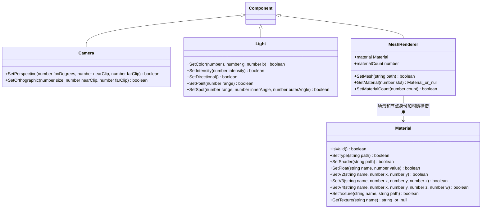

# 渲染组件脚本接口

[绑定实现](script-bindings.md) · [类图索引](../../../class-diagrams/index.md)

这里展示 TypeScript 门面；每个门面仍由对应 `ScriptBinding` 实现，原生组件不依赖 V8。

- `SetOrthographic` 的 size 为竖直半高；角度使用度。Spot 的 innerAngle、outerAngle 均为锥体半角。
- `material` 等同第 0 槽，`materialCount` 只读；超范围槽返回 null，移除槽后原有门面的 IsValid 返回 false。
- 纹理路径通过资源目录解析，失败保留原材质。GetTexture 对未知或非纹理参数返回 null。
- 每次调用校验场景、节点和材质槽，不在脚本对象中保留 C++ 指针。失效对象的修改返回 false。
- 动态 MeshData 使用生成的 FlatBuffers C++ 数据，通过 MeshRenderer 提交；此脚本门面只声明已经绑定的接口。
