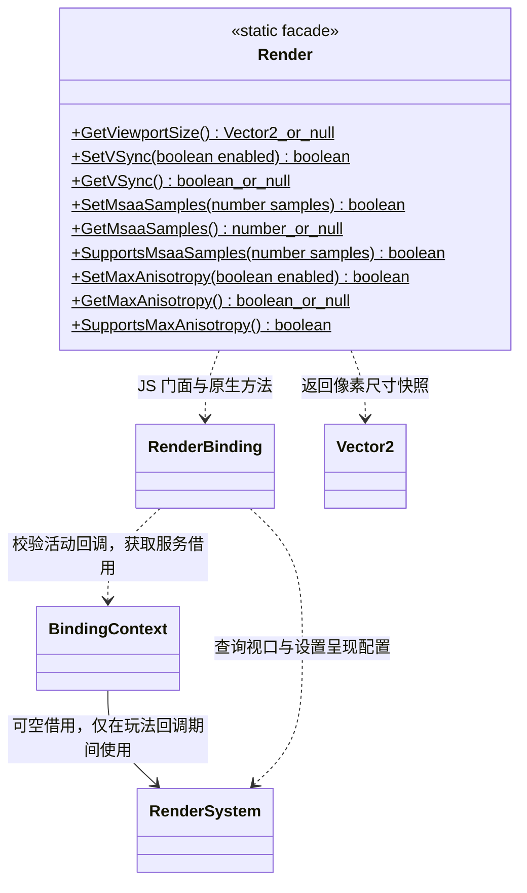

# 渲染脚本接口

[绑定实现](script-bindings.md) · [类图索引](../../../class-diagrams/index.md)

这里展示 TypeScript 门面；每个门面仍由对应 `ScriptBinding` 实现，原生组件不依赖任何脚本虚拟机。

C++ 绑定实现属于 `engine::plugins::script::bindings`，原生组件属于 `engine`。TypeScript 导出名称与 `engine` 模块入口保持不变。

- `Render` 是不可构造的静态设备门面，提供视口尺寸与设备呈现/采样画质。环境、后处理和阴影设置直接通过下方组件接口提交，组件是唯一写入与校验入口，不再提供重复的静态效果 setter。
- `GetViewportSize()` 返回当前绘制目标像素尺寸 `{x,y}`；系统未初始化、GPU 不可用、尺寸为零或当前回调没有渲染器时返回 null。窗口尺寸变化在下一次渲染应用后可见。
- `SetVSync(enabled)` / `GetVSync()` 调用 RenderSystem 的窗口级状态；仅活动回调可用，未注入或未初始化渲染器时设置返回 false、查询返回 null。设置成功表示接受请求，下次正常绘制应用，不进入场景持久数据。
- `SetMsaaSamples(samples)` / `GetMsaaSamples()` / `SupportsMsaaSamples(samples)` 使用 `1/2/4/8`，`1` 表示关闭。绑定严格校验整数档位，不转换字符串或截断小数；无效或当前设备不支持返回 false，保持旧设置。getter 返回最近接受的档位，无渲染器或未初始化返回 null。
- `SetMaxAnisotropy(enabled)` / `GetMaxAnisotropy()` / `SupportsMaxAnisotropy()` 控制普通材质贴图的最大各向异性过滤；参数须为 boolean。setter/getter 生命周期和延迟应用语义与 MSAA 相同。两个 Supports 查询在设备未就绪时均返回 false。UI 可据此禁用不可用选项，不把 setter 失败显示为设置成功。
- 六个接口直接映射 [RenderSystem 的最小设备画质契约](../../../runtime/class-diagrams/render-system.md)，默认 MSAA 关闭、各向异性关闭；项目负责用户偏好的保存与恢复，核心不读项目设置文件。
- 项目通过 Camera、MeshRenderer、EnvironmentComponent 和 Material 的属性组合渲染能力；本轮新增能力不在 Render 静态门面提供状态、统计或调试方法。统一诊断查询、逐视图提交统计和有限寿命调试线仅由编辑器 MCP 提供，见[统一功能入口](../../editor/render-feature-controls.md)。
- 场景初始外观保存在 EnvironmentComponent、相机节点上的 PostProcessComponent 与 Light 中。组件门面使用当前 Run 的节点及组件身份校验；失效句柄返回失败，不通过全局活动场景寻找替代对象。

```mermaid
classDiagram
    direction TB
    class Camera {
        +frustumCullingEnabled boolean
        +SetFrustumCulling(boolean enabled) boolean
        +SetPerspective(number fovDegrees, number nearClip, number farClip) boolean
        +SetOrthographic(number size, number nearClip, number farClip) boolean
        +ScreenPointToRay(number x, number y, number width, number height) Ray_or_null
        +ViewportPointToRay(number u, number v, number aspect) Ray_or_null
    }
    class EnvironmentComponent {
        +SetAtmosphere(boolean enabled, Node_or_null sun, AtmosphereParameters parameters) boolean
        +SetIbl(boolean enabled, number intensity) boolean
        +SetAmbient(number r, number g, number b, number intensity) boolean
        +SetAmbientTricolor(number[] sky, number[] equator, number[] ground, number intensity) boolean
        +SetLinearFog(boolean enabled, number r, number g, number b, number start, number end) boolean
        +SetExponentialFog(boolean enabled, number r, number g, number b, number density, boolean squared) boolean
        +SetClearColor(number rgba) boolean
    }
    class PostProcessComponent {
        +SetExposure(number value) boolean
        +SetFilmicTonemap(boolean enabled) boolean
        +SetHdr(boolean enabled) boolean
        +SetBloom(boolean enabled, number threshold, number intensity, number radius) boolean
        +SetScreenSpaceReflections(boolean enabled, number resolutionScale, number maxSteps, number maxDistance, number thickness, number roughnessCutoff) boolean
        +SetAmbientOcclusion(boolean enabled, number radius, number strength, number power, number fadeStart, number fadeEnd) boolean
    }
    class Light {
        +SetShadows(boolean enabled, number resolution, number bias) boolean
        +SetShadowCascades(number count, number distance, number splitLambda, number blend) boolean
        +SetColor(number r, number g, number b) boolean
        +SetIntensity(number intensity) boolean
        +SetDirectional() boolean
        +SetPoint(number range) boolean
        +SetSpot(number range, number innerAngle, number outerAngle) boolean
    }
    class Material {
        +IsValid() boolean
        +SetType(string path) boolean
        +SetShader(string path) boolean
        +SetFloat(string name, number value) boolean
        +SetCullMode(string mode) boolean
        +GetCullMode() string_or_null
        +SetBlendMode(string mode) boolean
        +GetBlendMode() string_or_null
        +SetV2(string name, number x, number y) boolean
        +SetV3(string name, number x, number y, number z) boolean
        +SetV4(string name, number x, number y, number z, number w) boolean
        +SetTexture(string name, string path) boolean
        +GetTexture(string name) string_or_null
    }
    class MeshRenderer {
        +material Material
        +materialCount number
        +SetMesh(string path) boolean
        +GetMaterial(number slot) Material_or_null
        +SetMaterialCount(number count) boolean
        +staticInstancingEnabled boolean
        +SetStaticInstancing(boolean enabled) boolean
        +staticLodEnabled boolean
        +SetStaticLod(boolean enabled) boolean
        +castShadows boolean
        +SetCastShadows(boolean enabled) boolean
        +bakeStatic boolean
        +lightmapPath string_or_null
        +SetBakeStatic(boolean enabled) boolean
        +SetLightmap(string path) boolean
    }
    class PlanarReflectionComponent {
        +SetSettings(number resolutionScale, number clipBias) boolean
    }
    class LightProbeVolumeComponent {
        +SetResource(string path) boolean
    }
    class Component
    class Ray
    class Vector3
    Camera ..> Ray : 返回世界射线值快照
    Ray *-- Vector3 : origin 与 direction
    Component <|-- Camera
    Component <|-- EnvironmentComponent
    Component <|-- PostProcessComponent
    Component <|-- Light
    Component <|-- MeshRenderer
    Component <|-- PlanarReflectionComponent
    Component <|-- LightProbeVolumeComponent
    MeshRenderer --> Material : Run、节点、组件实例身份加材质槽借用
```

- Camera 的 `frustumCullingEnabled` 与 MeshRenderer 的 `staticInstancingEnabled/staticLodEnabled` 默认 false；setter 只修改各自组件的唯一 ECS 字段，支持场景/预制体保存。设备未初始化或当前资源不具备适用路径仍可保存 true，运行支持和实际生效由 MCP 查询。组件句柄失效时 setter 返回 false。
- `SetOrthographic` 的 size 为竖直半高；角度使用度。Spot 的 innerAngle、outerAngle 均为锥体半角。
- `ScreenPointToRay` 接收视口局部坐标及同单位尺寸，`ViewportPointToRay` 接收归一化坐标及宽高比；均以左上为原点、X 向右、Y 向下，有限视口外坐标允许外推。返回普通 `{origin:{x,y,z}, direction:{x,y,z}}` 值，原点位于近裁剪面，方向为归一化世界方向；透视发散、正交平行。非有限参数、非正尺寸/宽高比、退化变换或失效句柄返回 null。查询不要求该 Camera 启用或成为活动镜头，不依赖窗口或 GPU。像素坐标使用 `Render.GetViewportSize()` 的尺寸；逻辑坐标须搭配同单位的逻辑尺寸，不能混用。
- `PostProcessComponent.SetHdr(enabled)` 只改变 HDR 开关；`SetBloom(enabled, threshold=1, intensity=0.15, radius=1)` 只改变 Bloom 开关与参数。阈值 `[0,100]`、强度 `[0,10]`、半径 `[0.25,4]`，数值有限。先开启 HDR 才能开启 Bloom，先关闭 Bloom 才能关闭 HDR，顺序错误返回 false 并保留全部状态；方法不会自动改写另一开关。旧曝光、AO 方法保留 HDR/Bloom 配置。
- `PostProcessComponent.SetAmbientOcclusion` 使用同一后处理数据：enabled 必须是布尔值；radius 默认 1、范围 `(0,100]`，strength 默认 1、范围 `[0,2]`，power 默认 1.5、范围 `[0.1,8]`，fadeStart/fadeEnd 默认 80/150，要求 `0 <= start < end <= 100000`。全部数值有限，失败不改变曝光或 AO；旧曝光、色调映射接口也保留 AO。组件修改不影响其他相机的后处理配置。
- `Light.SetShadowCascades` 只更新级联参数，保留投影开关、完整 atlas 分辨率和偏移；count 必须为整数 1、2、4，distance 为 `(0,100000]`，splitLambda 默认 0.6、范围 `[0,1]`，blend 默认 0.1、范围 `[0,0.3]`。原有 `SetShadows` 也保留现有级联参数。参数按原生组件契约原子校验，不在绑定内存储另一份状态。
- `PostProcessComponent.SetScreenSpaceReflections` 独立更新 SSR 设置；平面反射通过同节点的 `PlanarReflectionComponent` 配置，光照探针通过 `LightProbeVolumeComponent.SetResource` 绑定资源。`MeshRenderer.SetLightmap` 要求 UV2 与线性纹理，空路径清除绑定；`SetBakeStatic` 标记烘焙参与状态。
- `SetBlendMode` 接受 `opaque`、`alpha_blend` 或 `premultiplied`，由材质统一校验。
- `material` 等同第 0 槽，`materialCount` 只读；超范围槽返回 null，移除槽后原有门面的 IsValid 返回 false。
- 纹理路径通过资源目录解析，失败保留原材质。GetTexture 对未知或非纹理参数返回 null。
- `SetCullMode("back" | "front" | "none")` 设置通用面剔除状态，默认 `back`；`GetCullMode()` 在句柄失效时返回 null。`SetFloat("alphaCutoff", value)` 使用既有具名参数通道启用内置 Shader 的 alpha 裁切，范围为 0..1，0 关闭。
- 每次调用校验 Run、节点、组件实例和材质槽，不在脚本对象中保留 C++ 指针。失效对象的修改返回 false。
- 动态 MeshData 使用生成的 FlatBuffers C++ 数据，通过 MeshRenderer 提交；此脚本门面只声明已经绑定的接口。

EnvironmentComponentBinding 与 PostProcessComponentBinding 各自独立实现 ScriptBinding，只通过 BindingContext 校验当前 Run、节点与组件实例后访问对应原生组件。Node.AddComponent/GetComponent 使用既有组件登记，无需新增节点专用接口。所有渲染组件须满足公共 Component 的 `active` 与 `visibleInHierarchy`。EnvironmentComponent 只允许一个激活且可见组件参与渲染；PostProcessComponent 由活动场景相机节点提供，预览镜头借用同一份参数。Light.SetShadows 支持方向光、点光与聚光，级联参数只适用于方向光，分辨率、bias 与原生组件保持同一校验。

Transform 脚本门面提供 `GetWorldPosition()` 与 `GetWorldForward()`，返回普通 `{x,y,z}` 值快照或 null。两者直接读取核心 world_matrix，forward 为归一化局部 -Z 世界方向；不改变持久数据或增加相机/武器专用核心接口。
