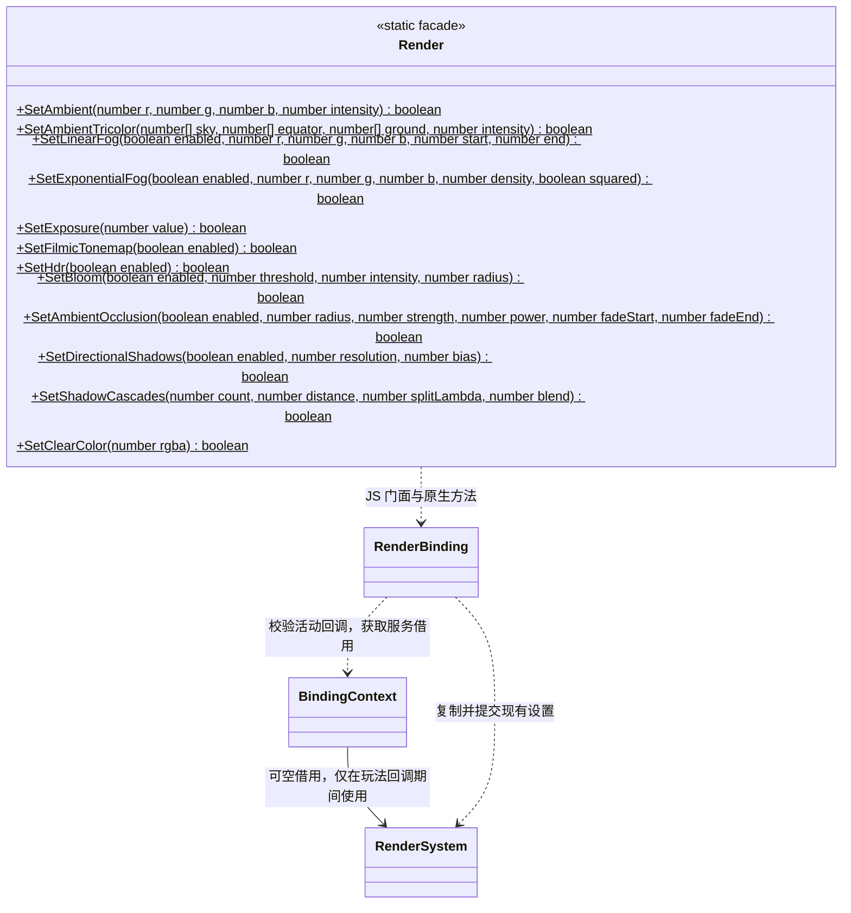

# 渲染脚本接口

[绑定实现](script-bindings.md) · [类图索引](../../../class-diagrams/index.md)

这里展示 TypeScript 门面；每个门面仍由对应 `ScriptBinding` 实现，原生组件不依赖任何脚本虚拟机。

C++ 绑定实现属于 `engine::plugins::script::bindings`，原生组件属于 `engine`。TypeScript 导出名称与 `engine` 模块入口保持不变。

- `Render` 是不可构造的静态门面；各方法复制当前 RenderSettings，仅修改对应字段后调用 `RenderSystem::set_settings()`。一次调用的参数或原生校验失败时返回 false，整份设置不变。
- `SetAmbient` 的 RGB 为线性颜色 `0..1`，强度为 `0..1000`；曝光为 `(0, 100]`。阴影分辨率默认 2048，为 `128..8192` 的二次幂，bias 默认 0.001、范围 `0..0.1`，实际设备限制仍由 RenderSystem 校验。
- `SetAmbientTricolor(sky, equator, ground, intensity)` 接受三个 `[r,g,b]` 线性颜色数组并开启三色模式；调用 `SetAmbient` 恢复常量色模式。`SetLinearFog(enabled, r, g, b, start, end)` 提交线性雾，颜色为线性 `0..1`，距离为世界单位，要求 `0 <= start < end`。`SetExponentialFog(enabled, r, g, b, density, squared=false)` 使用指数雾，squared=true 使用平方指数雾；density 为非负有限数，距离取前向深度减近裁面。两个雾接口写入同一 fog_mode，互相替换；关闭雾同样提交并保留参数，后续可再次开启。
- `SetClearColor` 接收无符号 32 位整数，按 `0xRRGGBBAA` 打包；不接受负数、小数或溢出值。MCP 的 `clearColor` 输入为归一化 `[r,g,b,a]` 数组，两者采用相同的 RGBA 通道顺序，并提交同一个原生字段。
- 预检、模块顶层、构造和旧 Context 不得修改设置；未注入渲染器时返回 false。宿主保证渲染器覆盖全部玩法回调，停止脚本后再销毁渲染器；绑定不拥有该服务。
- 场景初始外观保存在 EnvironmentComponent、活动相机上的 PostProcessComponent 与 Light 中。Render 静态门面更新当前场景的已有组件，缺少所需组件时返回 false，不隐式创建节点；无场景时仅修改待机默认值。项目脚本优先获取组件并动态修改，停止或切换场景不会留下上一场景的覆盖参数。

```mermaid
classDiagram
    direction TB
    class Camera {
        +SetPerspective(number fovDegrees, number nearClip, number farClip) boolean
        +SetOrthographic(number size, number nearClip, number farClip) boolean
    }
    class EnvironmentComponent {
        +SetIbl(boolean enabled, number intensity) boolean
        +SetAmbient(number r, number g, number b, number intensity) boolean
        +SetAmbientTricolor(number[] sky, number[] equator, number[] ground, number intensity) boolean
        +SetLinearFog(boolean enabled, number r, number g, number b, number start, number end) boolean
        +SetExponentialFog(boolean enabled, number r, number g, number b, number density, boolean squared) boolean
        +SetClearColor(number rgba) boolean
    }
    class PostProcessComponent {
        +SetExposure(number value) boolean
        +SetFilmicTonemap(boolean enabled) boolean
        +SetHdr(boolean enabled) boolean
        +SetBloom(boolean enabled, number threshold, number intensity, number radius) boolean
        +SetAmbientOcclusion(boolean enabled, number radius, number strength, number power, number fadeStart, number fadeEnd) boolean
    }
    class Light {
        +SetShadows(boolean enabled, number resolution, number bias) boolean
        +SetShadowCascades(number count, number distance, number splitLambda, number blend) boolean
        +SetColor(number r, number g, number b) boolean
        +SetIntensity(number intensity) boolean
        +SetDirectional() boolean
        +SetPoint(number range) boolean
        +SetSpot(number range, number innerAngle, number outerAngle) boolean
    }
    class Material {
        +IsValid() boolean
        +SetType(string path) boolean
        +SetShader(string path) boolean
        +SetFloat(string name, number value) boolean
        +SetCullMode(string mode) boolean
        +GetCullMode() string_or_null
        +SetV2(string name, number x, number y) boolean
        +SetV3(string name, number x, number y, number z) boolean
        +SetV4(string name, number x, number y, number z, number w) boolean
        +SetTexture(string name, string path) boolean
        +GetTexture(string name) string_or_null
    }
    class MeshRenderer {
        +material Material
        +materialCount number
        +SetMesh(string path) boolean
        +GetMaterial(number slot) Material_or_null
        +SetMaterialCount(number count) boolean
        +castShadows boolean
        +SetCastShadows(boolean enabled) boolean
    }
    class Component
    Component <|-- Camera
    Component <|-- EnvironmentComponent
    Component <|-- PostProcessComponent
    Component <|-- Light
    Component <|-- MeshRenderer
    MeshRenderer --> Material : 场景和节点身份加材质槽借用
```

- `SetOrthographic` 的 size 为竖直半高；角度使用度。Spot 的 innerAngle、outerAngle 均为锥体半角。
- `Render.SetHdr(enabled)` / `PostProcessComponent.SetHdr(enabled)` 只改变 HDR 开关；`SetBloom(enabled, threshold=1, intensity=0.15, radius=1)` 只改变 Bloom 开关与参数。阈值 `[0,100]`、强度 `[0,10]`、半径 `[0.25,4]`，数值有限。先开启 HDR 才能开启 Bloom，先关闭 Bloom 才能关闭 HDR，顺序错误返回 false 并保留全部状态；方法不会自动改写另一开关。旧曝光、AO 方法保留 HDR/Bloom 配置。
- `Render.SetAmbientOcclusion` 与 `PostProcessComponent.SetAmbientOcclusion` 使用同一后处理数据：enabled 必须是布尔值；radius 默认 1、范围 `(0,100]`，strength 默认 1、范围 `[0,2]`，power 默认 1.5、范围 `[0.1,8]`，fadeStart/fadeEnd 默认 80/150，要求 `0 <= start < end <= 100000`。全部数值有限，失败不改变曝光或 AO；旧曝光、色调映射接口也保留 AO。Render 门面修改当前活动场景相机组件，不持有独立状态。
- `Light.SetShadowCascades` 与 `Render.SetShadowCascades` 只更新级联参数，保留投影开关、完整 atlas 分辨率和偏移；count 必须为整数 1、2、4，distance 为 `(0,100000]`，splitLambda 默认 0.6、范围 `[0,1]`，blend 默认 0.1、范围 `[0,0.3]`。原有 `SetShadows` / `SetDirectionalShadows` 也保留现有级联参数。参数按原生组件契约原子校验，不在绑定内存储另一份状态。
- `material` 等同第 0 槽，`materialCount` 只读；超范围槽返回 null，移除槽后原有门面的 IsValid 返回 false。
- 纹理路径通过资源目录解析，失败保留原材质。GetTexture 对未知或非纹理参数返回 null。
- `SetCullMode("back" | "front" | "none")` 设置通用面剔除状态，默认 `back`；`GetCullMode()` 在句柄失效时返回 null。`SetFloat("alphaCutoff", value)` 使用既有具名参数通道启用内置 Shader 的 alpha 裁切，范围为 0..1，0 关闭。
- 每次调用校验场景、节点和材质槽，不在脚本对象中保留 C++ 指针。失效对象的修改返回 false。
- 动态 MeshData 使用生成的 FlatBuffers C++ 数据，通过 MeshRenderer 提交；此脚本门面只声明已经绑定的接口。

EnvironmentComponentBinding 与 PostProcessComponentBinding 各自独立实现 ScriptBinding，只通过 BindingContext 校验当前场景与节点后访问对应原生组件。Node.AddComponent/GetComponent 使用既有组件登记，无需新增节点专用接口。EnvironmentComponent 只允许一个启用组件参与渲染；PostProcessComponent 由活动场景相机节点提供，预览镜头借用同一份参数。Light.SetShadows 只支持方向光，分辨率、bias 与原生组件保持同一校验。
