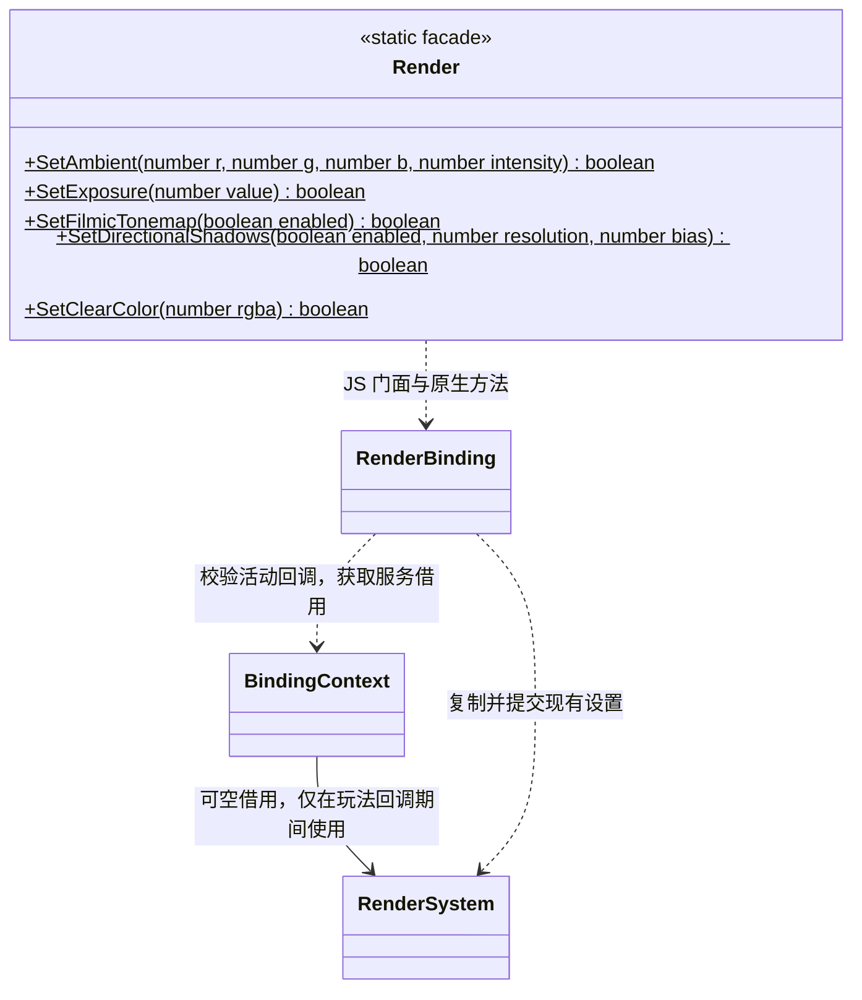

# 渲染脚本接口

[绑定实现](script-bindings.md) · [类图索引](../../../class-diagrams/index.md)

这里展示 TypeScript 门面；每个门面仍由对应 `ScriptBinding` 实现，原生组件不依赖任何脚本虚拟机。

C++ 绑定实现属于 `engine::plugins::script::bindings`，原生组件属于 `engine`。TypeScript 导出名称与 `engine` 模块入口保持不变。

- `Render` 是不可构造的静态门面；各方法复制当前 RenderSettings，仅修改对应字段后调用 `RenderSystem::set_settings()`。一次调用的参数或原生校验失败时返回 false，整份设置不变。
- `SetAmbient` 的 RGB 为线性颜色 `0..1`，强度为 `0..1000`；曝光为 `(0, 100]`。阴影分辨率默认 2048，为 `128..8192` 的二次幂，bias 默认 0.001、范围 `0..0.1`，实际设备限制仍由 RenderSystem 校验。
- `SetClearColor` 接收无符号 32 位整数，按 `0xRRGGBBAA` 打包；不接受负数、小数或溢出值。MCP 的 `clearColor` 输入为归一化 `[r,g,b,a]` 数组，两者采用相同的 RGBA 通道顺序，并提交同一个原生字段。
- 预检、模块顶层、构造和旧 Context 不得修改设置；未注入渲染器时返回 false。宿主保证渲染器覆盖全部玩法回调，停止脚本后再销毁渲染器；绑定不拥有该服务。
- 项目可在 Gameplay.OnInitialize 中应用自己的环境色、阴影和曝光，重启、热重载及 Android 使用同一绑定。设置不自动写入 Scene，也不改变引擎默认值；项目选择的值由项目脚本保存。

- `SetOrthographic` 的 size 为竖直半高；角度使用度。Spot 的 innerAngle、outerAngle 均为锥体半角。
- `material` 等同第 0 槽，`materialCount` 只读；超范围槽返回 null，移除槽后原有门面的 IsValid 返回 false。
- 纹理路径通过资源目录解析，失败保留原材质。GetTexture 对未知或非纹理参数返回 null。
- 每次调用校验场景、节点和材质槽，不在脚本对象中保留 C++ 指针。失效对象的修改返回 false。
- 动态 MeshData 使用生成的 FlatBuffers C++ 数据，通过 MeshRenderer 提交；此脚本门面只声明已经绑定的接口。
