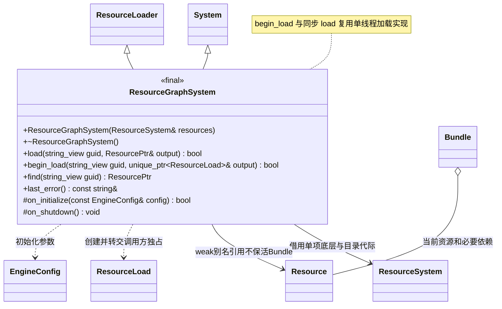
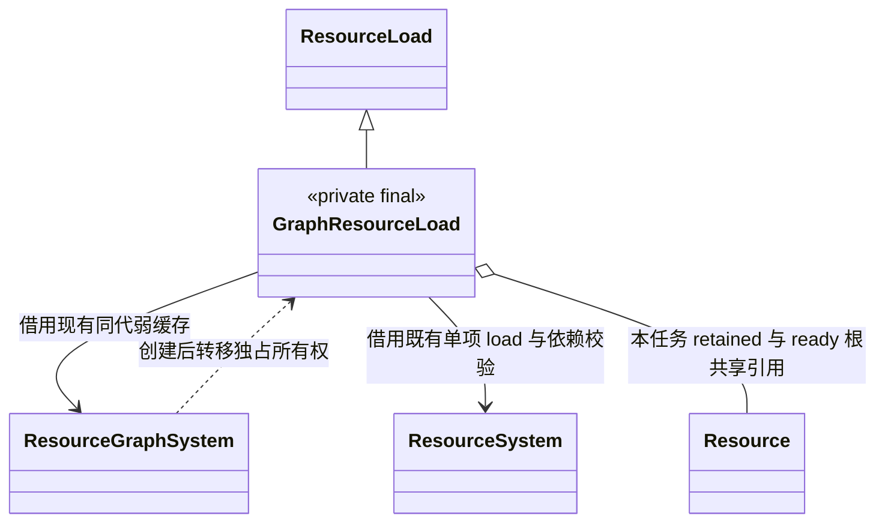

# 资源依赖图插件

[类图索引](../../../class-diagrams/index.md) · [核心加载接口](../../../runtime/class-diagrams/resource-loader.md) · [资源核心](../../../runtime/class-diagrams/resource-system.md)

源码位于 `plugins/runtime/resource_graph/`。插件实现依赖加载策略，核心仅提供目录、单项读取和契约校验；业务请求顶级 GUID 即可取得完整必要依赖。

C++ 类型为 `engine::plugins::resource_graph::ResourceGraphSystem`；`System`、`ResourceLoader`、`ResourceSystem` 和资源数据仍属于 `engine`，依赖方向由插件指向核心。

- 构造、析构、`find`、`last_error` 和 `on_shutdown` 为 noexcept，查询为 const；实现重写接口和系统生命周期钩子。状态和查询标注 nodiscard，禁止不适当的复制或移动。
- 缓存按目录代际隔离。加载先处理直接必要依赖，再调用核心单项 `load`，通过核心 `validate_dependencies` 校验实体引用与依赖一致后提交。
- 相同代际和 GUID 复用已存活的完整对象；缓存只持 weak_ptr。读取未命中实体时才访问文件，读取头或目录不会预加载全部实体。
- `Bundle` 是插件私有所有权记录，拥有当前资源及依赖引用。输出使用标准 shared_ptr 的别名构造保持 Bundle 存活；不在核心 Resource 中保留依赖列表，不另建引用计数系统。
- 最后一个使用者释放后，先销毁当前资源，再反向释放直接依赖；共享依赖保留到最后一个使用者离开。加载失败释放本次候选引用，不改变已有对象。
- 合法目录更新进入新代际；新 `load/find` 只使用当前目录。旧 ResourcePtr 保持完整旧闭包，直到其使用者释放；旧对象不占用新代际缓存条目，也不会按新目录混读旧依赖。
- 宿主决定启用并注入插件。关闭顺序：停止领域使用者，`set_loader(nullptr)` 解除核心借用，关闭插件，再关闭核心。插件不判断编辑器身份或自动扫描、发布目录。

插件由 `cmake/plugins/runtime/resource_graph.cmake` 自声明并通过运行时插件清单选择。其他运行时模块只引用 ResourceLoader 契约；未选插件不能残留到核心目标的源文件或链接项。

## 单线程分步复用

本节及上图的 `begin_load` 已实现；现有同步 `load`、缓存查询、Bundle 所有权与系统生命周期保持原契约。操作的公开方法只在[核心加载接口](../../../runtime/class-diagrams/resource-loader.md#单线程分步操作)定义，此处不重复成员。

`GraphResourceLoad` 是 `engine::plugins::resource_graph` 内部的薄实现，不是新增系统或调度层。创建时复用既有迭代 DFS 确定唯一后序计划，step 保存当前完成位置与 retained 候选，复用既有目录、单项 `ResourceSystem::load`、`validate_dependencies`、同代弱缓存与私有 Bundle。同步 `load` 在缓存未命中时创建同一操作并一次推进完成，不维护第二套依赖遍历、加载或引用计数框架。

- `ResourceGraphSystem::begin_load` 为 `[[nodiscard]]` 的普通重写方法，失败清空调用者输出并通过现有 `last_error` 说明原因；成功创建后把操作所有权转交调用方，本系统只被操作借用，不保存自动推进队列。
- 创建时从目录元数据确定该目标的必要闭包、固定 generation 和唯一 GUID 总数，不读取实体。相同父/子资源在同一闭包中只安排一次；已有存活对象仍可复用。其余无关目录资源不会进入本任务，不扫描源文件、不预加载整个项目。
- step 每完成一个缓存命中或一个通过完整读取、解码和依赖校验的资源，才增加一次 completed；每次最多完成 budget 项。直接依赖先就绪，再组合父项 Bundle。所有新候选都由本任务 retained 强引用，跨帧不会因弱缓存失去必要依赖。
- loading 时每次推进和发布前检查目录 generation、加载器及资源核心状态。目录换代后失败并释放本任务引用，不能把旧候选写入新代索引。ready 后是已完成的旧资源共享快照，保持状态但不得再发布；提交方单独核对创建时的 generation。错误属于本操作，不覆盖其他存活资源或依赖引用。
- ready 前不发布本任务产生的任何弱索引；失败或析构取消只释放私有候选引用，不留下部分驻留条目。完整闭包成功后，才按现有同步 load 的规则统一发布弱索引并持有根 ResourcePtr；ready 根与其所有依赖继续用既有 Bundle 别名共享引用。
- 同一闭包内的重复依赖及已发布的同代缓存继续复用完整共享对象；本轮不增加多个未完成任务的合并器或在途去重服务。发布前若同代完整缓存已由其他调用建立，则复用其完整对象，不用私有候选覆盖它。取消只撤销本任务所持引用；不得删除或强制释放其他使用者持有的缓存对象。ready 后销毁操作也只减少本任务引用，若场景已接管根引用，闭包继续存活。
- 所有创建、step、缓存访问和销毁发生在宿主现有线程；调用方在每帧 Update 中显式推进，System 不增加自动 tick 调度、线程、线程池或跨线程队列。宿主停止、重载或关闭加载器前，须先销毁该 Run 持有的操作。
- 提交阶段继续调用既有 WorldSystem::load_scene，并在返回前持有 ready 根引用，使正常 load 能复用已驻留闭包。成功后 Scene 接管根资源；恢复失败仍保留旧活动 Scene，调用方可丢弃任务。单活动场景及 UiSystem 随场景更换文档的生命周期不变。
- 场景节点恢复和首次 GPU 准备本轮保留同步，不计入 completed/total。不得在它们的内部重入宿主循环来伪造可见进度，也不把候选 Scene 跨帧暴露给活动 ECS、物理或 UI。

本轮只拆分已有专用加载代码的执行边界，不引入依赖或通用执行框架。编辑器 Taskflow 保留在编辑器作用域；后续真正异步加载的执行后端再优先选择成熟开源方案并单独评审。
