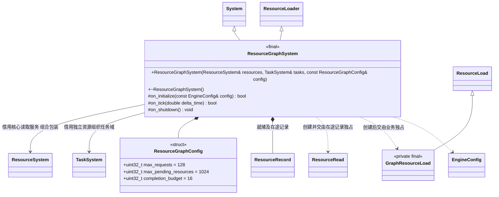
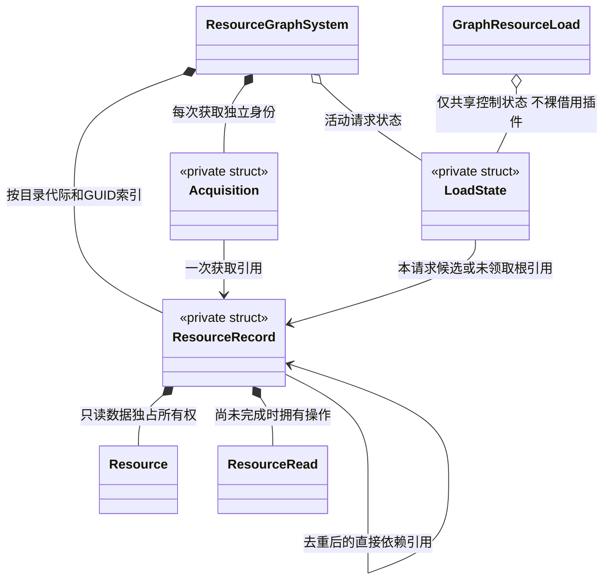
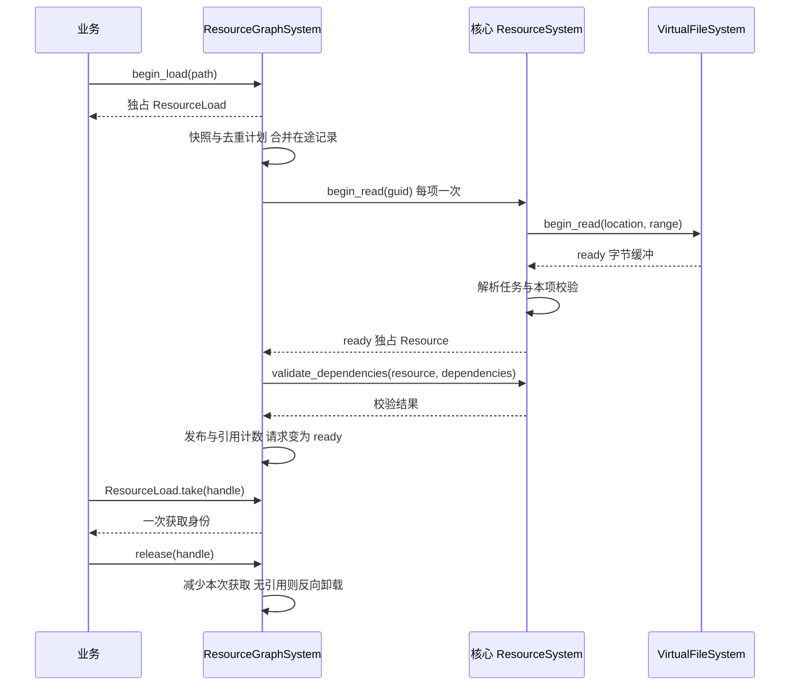

# 资源生命周期插件

[类图索引](../../../class-diagrams/index.md) · [统一生命周期](../../../runtime/class-diagrams/resource-lifecycle.md) · [高层接口](../../../runtime/class-diagrams/resource-loader.md) · [核心读取](../../../runtime/class-diagrams/resource-system.md)

**状态：统一资源契约及业务接入补充已按确认类图实现；验证范围见测试文档。** 保留 plugins/runtime/resource_graph/ 的归属。插件是对底层能力的高级封装：组织加载、依赖、共享、内部计数和卸载；核心不承载这些策略，业务不直接组合单项读取。

默认实现为 engine::plugins::resource_graph::ResourceGraphSystem。ResourceLoader 等契约在核心 engine 命名空间，业务只依赖它们；其他人可提供符合相同契约的加载器，由可执行宿主替换注入。

## 默认包装实现

全部业务公开方法继承并 override [ResourceLoader 契约](../../../runtime/class-diagrams/resource-loader.md#加载接口)，不在此重复维护签名。构造只保存必要借用和配置；初始化检查服务就绪和预算，失败返回。析构/关闭 noexcept，禁止复制和移动。资源核心和任务域必须先初始化，并存活到插件关闭完成。

包装采用组合，不继承 ResourceSystem 或 VirtualFileSystem，不把插件内部对象暴露给业务。插件不 include 编辑器、项目策略或具体领域处理器；类型扩展经核心登记表接入。宿主只在装配处知道默认实现。

## 记录、获取和在途合并

这些是插件内部记录示意，不是新增公开架构层。计数区分获取、依赖、请求和任务引用，所有加减在协调线程完成；计数溢出/身份耗尽返回明确错误，不回绕。共享控制状态允许请求晚于插件析构，资源引用仍由插件集中核算。

- 索引键固定为目录代际 + GUID，同代际路径由目录唯一映射；同一在途资源只存在一份读取/解码。多个请求只是增加各自等待关系，不各自保存一棵重复加载树。
- 每个请求从必要依赖声明建立去重后序计划并检测环。只处理真实必要依赖，不按文件分组加载未使用的模型子资源。
- 每项先得到核心单项候选，再在直接依赖就绪后调用核心 validate_dependencies；成功才原子发布该项及其依赖关系。根 ready 前完整闭包必须就绪。
- 原子单位是一个资源记录及其已就绪闭包；已成功的共享依赖可服务其他请求。根失败只回滚本请求持有的临时引用；无其他引用的依赖立即卸载，不清除其他请求已取得的数据。
- 同一资源多次成功 load 得到独立 Acquisition，数据仍只有一份。release 只撤销自己的身份；不允许 unload(guid) 强制破坏别人的使用。
- 记录总引用归零先撤出可加载索引，取消无需求在途工作；等待其任务保活归零后销毁本项，再释放依赖边。无常驻引用的资源不能仅因索引存在而滞留。
- 模块运行实例自行 retain，任务保活由实例或独立获取负责；业务释放原始句柄不会终止别人的播放或渲染。GPU、VM、声部和 ECS 实例销毁仍由对应模块负责。

## 同步与异步执行

图中等待跨系统 tick 完成，不是单次 begin_load 中同步执行所有步骤。业务 status 是只读查询。宿主先派发共享任务完成，再按依赖顺序 tick 核心读取系统、插件和使用模块；关闭反序。

异步目录计划等 CPU 工作使用本插件的 TaskSystem；输入为不可变目录快照，worker 不修改共享记录。解析任务属于核心读取域，文件任务属于文件域，互不挪用领域模块的任务队列。插件 on_tick 只做有预算的协调与发布，不等待 worker。

同步 load 在协调线程完成自己的计划、读取与校验。若闭包已有在途异步记录，先返回 busy，不等待完成委托、不重复读、不 tick 其他系统。完整命中 ready 时直接获取。异步资源预算暂满时插件有界排队，先检查取消/换代再重试；单项超限明确失败，不无限等待。

取消一个请求不取消其他等待者；无需求的候选才向核心取消。失败原因按请求保存，不因共享记录的另一调用覆盖。目录换代在下一次推进/命令处理前检查，旧未完成请求以 generation_changed 失败；发布前再次核对，晚到结果不得写入新代际。

已完成的旧获取保持完整旧闭包；get/retain/retain_dependency 可以继续访问，新的路径/GUID 加载只使用当前代际。内存入口也采用同样的发布和计数过程，接纳细则见加载契约。

## 装配、替换与关闭

默认插件继续在 cmake/plugins/runtime/resource_graph.cmake 登记；未选择时不创建或链接它的目标。宿主可以装配另一 ResourceLoader 实现，但必须通过相同契约验收；不能让业务根据具体实现类型选择不同流程。

替换实现发生在宿主装配边界：结束旧实现的业务、实例和操作，释放所有获取并解除借用，再关闭旧实现并注入新实现。这里不承诺热插拔或活动句柄跨实现迁移。

关闭先拒绝新请求，取消在途操作并收尾任务；将未交付请求终结、回收未领取获取和全部记录，最后解除核心与任务域借用。遗漏的业务句柄失效并可诊断，不能越过关闭继续使用。核心及任务域随后关闭。操作晚于插件销毁时只访问终结的 LoadState，不访问插件地址。
