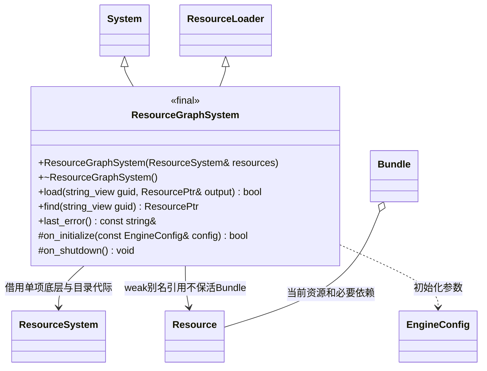

# 资源依赖图插件

[类图索引](../../../class-diagrams/index.md) · [核心加载接口](../../../runtime/class-diagrams/resource-loader.md) · [资源核心](../../../runtime/class-diagrams/resource-system.md)

源码位于 `plugins/runtime/resource_graph/`。插件实现依赖加载策略，核心仅提供目录、单项读取和契约校验；业务请求顶级 GUID 即可取得完整必要依赖。

- 构造、析构、`find`、`last_error` 和 `on_shutdown` 为 noexcept，查询为 const；实现重写接口和系统生命周期钩子。状态和查询标注 nodiscard，禁止不适当的复制或移动。
- 缓存按目录代际隔离。加载先处理直接必要依赖，再调用核心单项 `load`，通过核心 `validate_dependencies` 校验实体引用与依赖一致后提交。
- 相同代际和 GUID 复用已存活的完整对象；缓存只持 weak_ptr。读取未命中实体时才访问文件，读取头或目录不会预加载全部实体。
- `Bundle` 是插件私有所有权记录，拥有当前资源及依赖引用。输出使用标准 shared_ptr 的别名构造保持 Bundle 存活；不在核心 Resource 中保留依赖列表，不另建引用计数系统。
- 最后一个使用者释放后，先销毁当前资源，再反向释放直接依赖；共享依赖保留到最后一个使用者离开。加载失败释放本次候选引用，不改变已有对象。
- 合法目录更新进入新代际；新 `load/find` 只使用当前目录。旧 ResourcePtr 保持完整旧闭包，直到其使用者释放；旧对象不占用新代际缓存条目，也不会按新目录混读旧依赖。
- 宿主决定启用并注入插件。关闭顺序：停止领域使用者，`set_loader(nullptr)` 解除核心借用，关闭插件，再关闭核心。插件不判断编辑器身份或自动扫描、发布目录。

插件由 `cmake/plugins/runtime/resource_graph.cmake` 自声明并通过运行时插件清单选择。其他运行时模块只引用 ResourceLoader 契约；未选插件不能残留到核心目标的源文件或链接项。
