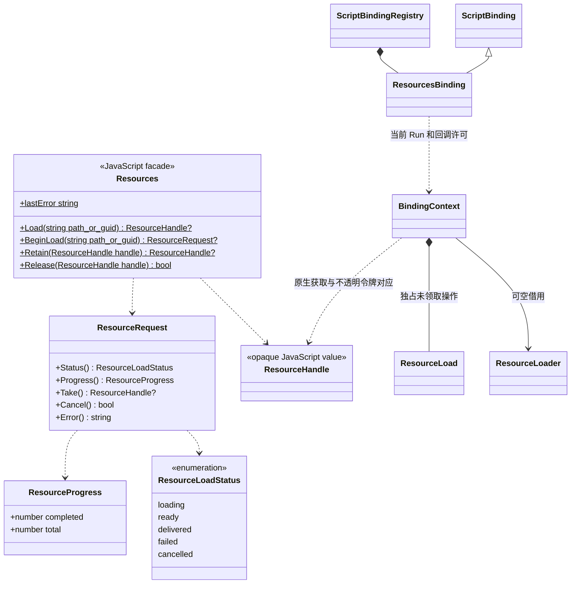

# 资源脚本接口

[类图索引](../../../class-diagrams/index.md) · [资源加载契约](../../../runtime/class-diagrams/resource-loader.md) · [已确认的业务接入](../../../runtime/class-diagrams/resource-consumers.md)

脚本接口直接使用宿主注入的 ResourceLoader。Run 持有每次获取和异步操作，不依赖默认资源插件；实现替换不改变业务流程。

句柄是不可伪造的不透明对象。JavaScript 变量赋值不加引用计数，只有 Load、Retain 和成功 Take 创建独立获取；Release 撤销相应获取。句柄不能跨 Run 使用。

Status、Progress、Error 只查询；资源核心与插件由宿主 tick 推进。Take 仅成功一次，Cancel 不等待任务；Run 关闭取消操作并释放所有尚未交还的获取。新目录不使旧的已就绪获取失效，未完成请求按加载器契约终结。

场景先完成资源加载，再调用 Scene.Load 或 Scene.BeginLoad/StepLoad/CommitLoad；影片把已加载句柄传给 Movie.Play；JSON 使用 Json.ParseResource。使用方会为自身的持续使用独立保活，业务可以在绑定成功后释放原始获取。
