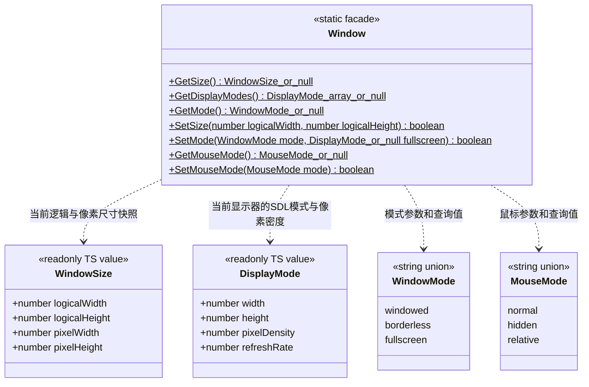
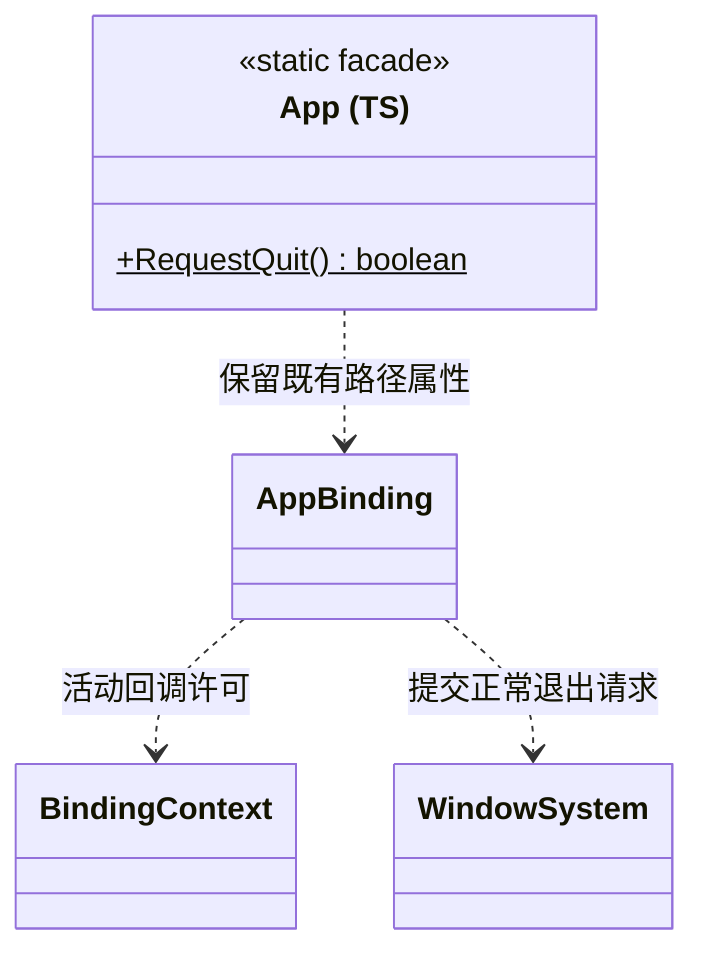
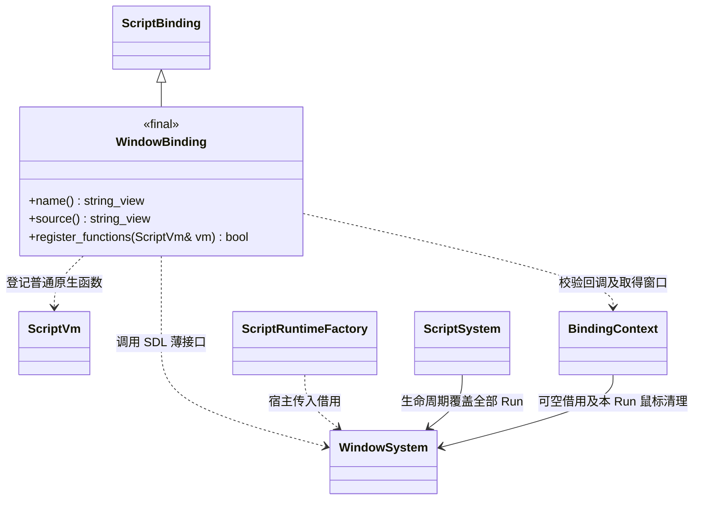

# 运行时窗口、退出与鼠标脚本接口

[类图索引](../../../class-diagrams/index.md) · [窗口系统](../../../runtime/class-diagrams/window-system.md) · [渲染接口](render-script-api.md) · [世界暂停](../../../runtime/class-diagrams/world-system.md)

已按评审契约补齐 项目设置和菜单的原生调用，公开声明同步至
`include/engine.d.ts`。继续使用当前工作分支，不新增窗口管理器、输入框架或第三方依赖。
原生能力全部扩展现有 WindowSystem、RenderSystem、WorldSystem 和资源加载契约；下方 Window
只是项目脚本入口，不是另一个 C++ 窗口系统。成熟库仅在这些系统内部使用，项目不直接调用 SDL/bgfx。

## TypeScript 门面

- `Window` 不可构造；仅在活动 Run 的生命周期和 UI 回调中访问，候选预检、模块顶层、构造、
  Promise jobs 和失效上下文不能读写窗口。无窗口时查询返回 null，修改返回 false。
- `SetSize` 使用 SDL 逻辑窗口单位，只适用于 windowed；必须是正整数且不超过 SDL 的 int
  范围。`GetSize` 同时给出实际像素尺寸，避免把 Retina 帧缓冲像素当作逻辑窗口尺寸。
- `GetDisplayModes` 返回当前窗口所在显示器的有效全屏模式快照，不泄露 SDL 指针。
  width/height 对应 SDL 模式尺寸，物理输出为尺寸乘 pixelDensity，不能忽略 Retina 密度。
  `SetMode("fullscreen", mode)` 只接受当前显示器实际支持的模式；`fullscreen` 以外的模式
  不接受额外显示模式。borderless 使用桌面模式，不伪造独立的渲染分辨率。
- `SetMode` 默认第二参数为 null。true 表示 SDL 接受请求；部分平台稍后通过窗口事件应用，
  项目需重新查询尺寸与模式后更新显示。失败后读取实际状态，不宣称多个 SDL 操作具有事务性。
- `MouseMode.normal` 退出相对模式并显示系统光标；hidden 退出相对模式并隐藏光标；relative
  直接启用 SDL 相对模式，由 SDL 隐藏、约束光标并提供无限相对位移。无需自行搬回鼠标位置。
- 角色输入随模式改用已有 `InputControlKind.mouse_relative`；打开菜单、图鉴或手柄断连页面时
  由项目显式切回 normal。Run 停止或初始化失败时，绑定清理本 Run 的鼠标请求并恢复进入前状态；
  预检不修改窗口，不恢复其他 Run 的状态。

`App.RequestQuit()` 仅提交退出请求，true 不表示进程已退出。宿主在安全帧边界沿已有退出路径
执行 OnShutdown、关闭脚本和资源、反序关闭系统。禁止调用 `exit`、强杀进程或从 JS 回调重入
宿主关闭。C++ `App` 继续只负责平台路径；新方法由既有 AppBinding 转发给窗口退出标志，
不让平台路径类借用 RuntimeHost。无窗口或非活动回调返回 false。

VSync 的脚本方法仅在[渲染脚本接口](render-script-api.md)定义；场景暂停及单线程加载方法
仅在[玩法入口](../../../runtime/class-diagrams/gameplay.md)定义，避免跨图重复维护方法。

## 薄绑定与所有权

`WindowBinding` 位于脚本插件的 `bindings/`，沿用注册表 `add<WindowBinding>()`。三个方法均为
const、override、nodiscard；name/source 为 noexcept。公开数据只是即时查询值，不新增持久化
模型、GUID 资源或 JSON Schema。

`ScriptRuntimeFactory` 最后追加 `WindowSystem&`，宿主明确传入已有窗口。ScriptSystem 和
BindingContext 构造最后追加默认空的 `WindowSystem*`；查询 `window()` 为 const noexcept、
nodiscard，非活动回调返回空。窗口有效期覆盖全部 Run，先结束玩法和鼠标请求，再关闭输入与窗口。
核心只传抽象脚本工厂，不 include 或链接 WindowBinding。

单线程加载复用现有 ResourceLoader/ResourceGraphSystem；ResourceLoad 只是调用方独占的进度操作，
不继承 System、不自动执行，也不是另一套资源系统。其方法及所有权在对应资源类图维护。

## 项目接入范围

- 分辨率按实际像素显示，并补入当前显示器支持的尺寸。windowed 使用查询到的 pixel/logical 比例转换为窗口逻辑尺寸，
  应用后重新查询实际结果；fullscreen 从真实模式列表选择。borderless 固定桌面尺寸，UI 显示
  DESKTOP 并禁止修改该项，不把选项保存成功当作分辨率已应用。
- 设置保存与应用结果分别反馈；失败显示当前有效值。进入玩法时应用已保存的显示与 VSync 设置，
  游戏和编辑器使用同一公开接口，由调用方决定调用时机。
- 进入战斗时启用 relative，暂停菜单/图鉴/设置/断连页恢复 normal，返回战斗再启用 relative。
- 暂停由 Scene 实例控制；菜单继续响应 Gameplay.Update 和 UI 事件，项目只在 HUD 页面推进玩法。
- 加载采用单线程依赖资源分步推进，百分比只表示已完成资源计数；场景恢复与首帧 GPU 准备
  独立显示阶段。每次推进之间返回主循环，不增加线程池、Future 框架或重入式渲染。

## 已选成熟实现

- 窗口尺寸和全屏直接使用 SDL3：
  [SDL_SetWindowFullscreenMode](https://wiki.libsdl.org/SDL3/SDL_SetWindowFullscreenMode)、
  SDL_GetFullscreenDisplayModes、SDL_SetWindowFullscreen、SDL_SetWindowSize。
- 鼠标直接使用 [SDL3 Mouse](https://wiki.libsdl.org/SDL3/CategoryMouse) 的相对模式和光标 API。
- VSync 直接使用 [bgfx reset](https://bkaradzic.github.io/bgfx/bgfx.html#reset) 的
  BGFX_RESET_VSYNC；不使用 bgfx 尚不支持的 FULLSCREEN 标志替代 SDL 全屏。
- 暂停沿用 Flecs/Jolt/Effekseer 的既有更新入口与 SDL Audio 的暂停能力，不增加通用调度框架。
  单线程资源操作只复用现有依赖遍历、解码与标准共享引用，不重写所选依赖的功能。
